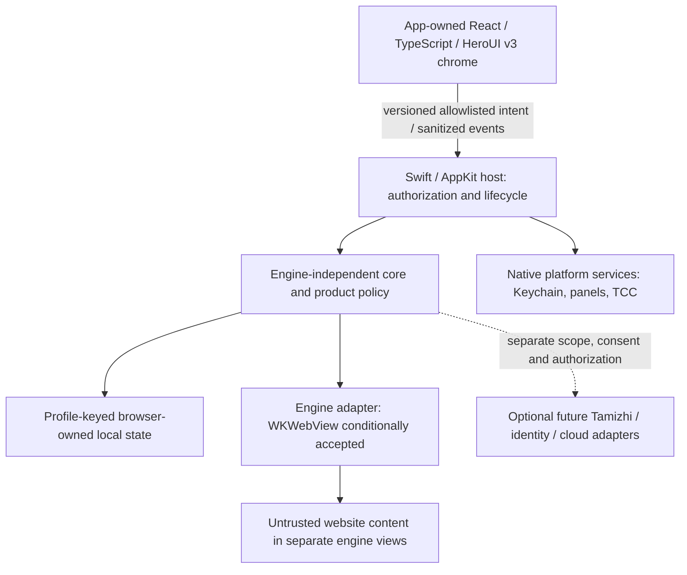

# Browser MVP architecture baseline — approved boundaries

**Version:** boundary baseline 0.1, 2026-11-07. **Status:** architecture baseline APPROVED by Product Owner on 2026-11-07, with the listed implementation choices still open. WKWebView has CONDITIONAL ACCEPTANCE for MVP planning and implementation; ADR 0001 remains Proposed.

The [owner decision](owner-approval-decision.md) approves the boundaries/invariants, not a production-ready implementation or undisclosed technology choices. This Phase 4.2 task records approval and prepares [Phase 5](../phase-5/README.md); it starts no production work, build or test. No unconditional production-engine acceptance or public distribution is authorized.

## Binding product decisions and scope

The authoritative product constraints are internal-only macOS **26.0+**, Swift/AppKit native host, React + TypeScript + HeroUI v3 browser chrome, an engine-independent browser core, and no `@vezham/aura` dependency, import, placeholder or API assumption. Chromium/CEF is evaluation-only. No production Tamizhi, Vezham identity or cloud dependency is required for local browsing. These are established user decisions; this packet proposes how to freeze their boundaries, not whether to replace them.

The prototype is feasibility evidence, not the production module layout. Its AppKit controls, in-process native command envelope, fixture script evaluation and host-only private process diagnostics are not a production React bridge, core implementation or adapter contract. The existing [engine contract](../browser-engine-contract.md) is an illustrative proposed API; declarations are not implemented capabilities.

## Approved ownership and trust boundaries

| Boundary | Owner and responsibilities | Allowed information / prohibited coupling | Evidence versus proposal |
|---|---|---|---|
| Swift/AppKit native host | Native app/window/view lifetime; validate caller/commands; platform authorization; coordinate core and adapters on correct native queues. | Receives typed bounded requests and opaque IDs; owns OS objects and native paths. React cannot authorize itself. | Native host feasibility shown; production authority/dispatcher proposed. |
| React/TypeScript/HeroUI v3 chrome | Render tabs/address/find/prompts/status using sanitized core state; express user intent. | Dedicated bundled app-owned surface and fixed origin. No navigation to remote pages while privileged; no raw WK/CEF objects, filesystem paths, account tokens, generic reflection or arbitrary script. | Future implementation; no React bridge tested in Phase 3. |
| Browser core | Product policy and engine-neutral models: profile/view ownership, navigation/session policy, history, permissions, transfer policy and lifecycle orchestration. | Opaque ProfileId/ViewId/NavigationId/RequestId/DownloadId; engine details remain adapter-private. Native host independently enforces authorization. | Boundary approved; no complete core exists. Runtime/language binding is a freeze exception below. |
| Engine adapter | Map core requests/events to documented engine operations; create a content view with its store before navigation; normalize supported/partial/unsupported capabilities. | WKWebView/WKNavigation/data-store handles stay private. Future CEF internals also remain private; unsupported operations return explicit errors. | WK prototype evidence; production adapter direction conditionally accepted; implementation absent. |
| Website content | Render untrusted pages only in separate content views/processes managed by the chosen engine. | No browser UI native handler, chrome DOM/state, credentials or privileged routes. Upload only explicitly selected data; page APIs never dispatch host commands. | Bounded absent-channel/scheme tests; production complete isolation unverified. |
| Browser storage/profile management | Core owns profile-keyed app state; adapter owns engine website-store mapping. Native storage service provides durable transactions/migrations. | Stable core profile identity maps privately to persistent engine store IDs. History/bookmarks/settings/permission/download records are separate from website cookies/cache/storage. No raw paths across chrome boundary. | Synthetic engine data stores tested; product DB/schema/migration not implemented. |
| Native platform services | Host brokers file panels/security scope, Keychain, media/TCC, downloads and release/update services. | Origin/profile-bound one-shot requests; opaque temporary selection/destination tokens; least entitlements. OS denial cannot be overridden by page or chrome. | Selected native panels/denial tested; full service lifecycle and release operations not qualified. |
| Future Tamizhi integration | Separate optional feature/service adapter, off the rendering and startup path. | Future explicit, scoped, minimized content grant bound to view/profile/lifetime and disclosed destination. Never secrets, browser chrome, unrelated tabs or private data by default. No free-form agent-to-native command channel. | Out of current MVP engine scope; no production implementation or page extraction authorization. |
| Optional Vezham identity/cloud | Separate opt-in service adapters with explicit data inventory and Keychain-backed secrets. | Local engine/core/history/bookmarks remain usable offline. No default cookie/password/auth/private/extract sync; revoke/delete policy required before enabling. | Future optional capabilities; no cloud dependency added. |

The arrows show ownership/control flow, not a promised process topology. Product core and host may share a trusted process; remote page isolation is engine-managed. Never claim one OS process or sandbox per product profile. A future engine change must preserve product policy/storage ownership without assuming engine website data can be migrated losslessly.

## Command, event and lifecycle rules to freeze

1. Commands are versioned, schema/size bounded and allowlisted. Validate the registered app UI surface, origin/frame, active view/profile ownership and request authorization in native code; the content of a page-supplied origin field is not proof of identity. Unknown/malformed/replayed/stale requests fail closed.
2. The website surface has no app command handler. The privileged chrome resource origin cannot navigate to remote content; intentional navigation creates/uses a separate website view after policy validation. Restrictive CSP and bundled dependency provenance are implementation gates.
3. Commands/events use opaque IDs and bounded values. Every asynchronous event carries current view/profile, request/navigation identity, generation and per-view ordering information. Disposal invalidates owners and cancels or resolves pending panels/prompts/transfers safely; late events cannot mutate replacement UI.
4. Main-frame committed navigations are the input to durable product history. Provisional failures are not committed visits. Engine back/forward entries remain per-view session state; no durable-history inference from a web view list.
5. Core recovery policy retains committed URL and profile metadata outside the content process, exposes stopped/error state, rejects stale navigation events and performs reload only after an explicit permitted product/user strategy. The current 49 checks demonstrate a prototype slice, not the entire lifecycle contract.
6. No generic JavaScript evaluation/reflection, arbitrary file path, native object or account credential crosses the chrome/core adapter boundary. Future page-content access, if ever approved, uses fixed named operations and revocable scoped grants. Fixture evaluation helpers do not become product APIs.
7. Report capability support against the actual SDK/engine/runtime. Permission types, exact find counts, process topology, interception, extensions, context menus and migration can remain partial/unsupported. Do not hide engine-specific differences in a nominally portable method.
8. Production adapter/platform code uses documented supported APIs. The private Darwin diagnostic ABI used to attribute test helpers must not become a product process-control dependency.

## Storage and private-session rules to freeze

- A persistent profile owns a distinct engine website store and separately keyed product state. A view is bound to its profile for its entire lifetime; a profile switch creates/selects an appropriately owned view rather than rebinding live storage.
- A private session uses a nonpersistent website store shared only by its intended private windows. Closing the last owner releases the session and app-owned temporary state. The core refuses deletion while views/transfers still own a persistent profile, until they close/cancel.
- Private visits, suggestions, permission records, recovery/session data and optional service payloads must not enter normal persistent product stores or sync. Exact ephemeral lifetime/persistence policy must be specified and tested; a bounded engine-store scan is not complete cleanup proof.
- Native file selection brokers only user-selected data to the intended requesting origin/profile. Downloads stage incomplete bytes in app-owned storage and publish a final destination only on success. Completion, overwrite, symlink, cross-volume, quarantine/security scope, cancellation and abrupt-host-death behavior remain acceptance obligations.
- Credentials and future identity tokens belong in native Keychain services. Engine website cookies and Vezham identity tokens are different assets. Logs/telemetry do not receive secrets/page/private data by default; OS/engine crash telemetry needs separate review.

## Distribution and operation rules

Accepted [ADR 0002](../../decisions/0002-browser-distribution-and-platform.md) remains authoritative: internal-only channels, Developer ID/notarization, immutable artifacts, authenticated/signed update metadata and integrity, staged rollout/halt, safe rollback/minimum version, revocation and protected keys. The existing [distribution architecture](../browser-distribution.md) defines outcomes; no installer/updater framework is selected here.

macOS 26.0/latest supported 26.x runtime and signing/notarization are user-deferred final-stage requirements, never pre-passed. Exact release entitlements require minimal feature-based justification and runtime validation; do not inherit temporary media-test entitlements or weaken protections. Local browsing continues when optional services/update connectivity are unavailable. OS WebKit changes require assigned regression and incident ownership.

## Approved freeze surface and explicit implementation exceptions

Approved boundaries: the ownership/trust boundaries above; engine-neutral identifiers and capability/error model; local browser-state ownership; immutable profile/view assignment; default-deny privilege policy; no Aura/cloud rendering dependency; separation of engine choice, implementation and release authorization.

| Remaining detail | Required decision before relevant implementation | Approval / validation boundary |
|---|---|---|
| Conditional engine conditions | Carry the owner decision and unresolved validation into relevant Phase 5 milestones | WKWebView direction is conditionally accepted for planning/implementation; authenticated compatibility/current performance remain unknown, ADR 0001 Proposed. |
| Core execution/runtime binding | Choose the trusted core placement/language and the Swift/TypeScript bindings explicitly | Existing engine contract uses illustrative TypeScript interfaces. That does not authorize policy authority inside React or select a new Go/cloud runtime. Host validation stays authoritative. |
| Chrome host resource origin and transport | Pin bundled origin/scheme, message schemas, CSP, replay/lifetime enforcement and UI view hosting | No production chrome/bridge exists; security cannot be inferred from an absent channel. |
| Browser-owned storage | Choose local store technology/schema, encryption needs, migrations/deletion and private ephemeral rules | No database selection or durable history is established by website-store tests. |
| Permission capability matrix | Define supported kinds and one-time/persisted/private/revoke semantics per SDK | Denial-only evidence does not authorize actual grants. |
| Transfer/lifecycle API details | Define opaque tokens, scopes, overwrite/quarantine and cancellation/session lifetimes | Current prototype covers only bounded cases. |
| Product feature matrix | Approve critical sites/subflows, native UX, extension/interception requirements and optional-service timing | Public-only tests leave compatibility unknown; no complete extension/migration system is promised. |
| Release system and operations | Choose installer/updater/protocol, signing/key custody, rollout health signals, OS update/security ownership | ADR 0002 outcomes are accepted, implementation specifics are not. |

These exceptions prevent an apparent “freeze” from inventing runtime APIs, implementation choices or evidence. Owner approval covers the boundaries above and retains these explicit open details for the relevant later design tasks; it does not choose the technologies or automatically begin those tasks. Changes to frozen boundaries after approval require an ADR/change review with capability, privacy, migration and release consequences.

## Evidence and authority

See the [exit review](phase-3-exit-review.md) and [ledger](browser-acceptance-gate-ledger.md) for what ran and what did not. The recorded Product Owner decisions govern: this baseline is approved, WKWebView conditionally accepted for planning/implementation and ADR 0001 remains Proposed. Remaining conditions and separate execution authorization still apply. Maintained [platform architecture](../browser-platform-architecture.md), [engine contract](../browser-engine-contract.md), [security architecture](../../security/browser-security-architecture.md), [threat model](../../security/browser-threat-model.md) and acceptance documents remain outside this historical review folder. Align their remaining pre-approval wording to this approved boundary baseline in a separately scoped documentation change; do not silently duplicate or supersede their status here.
