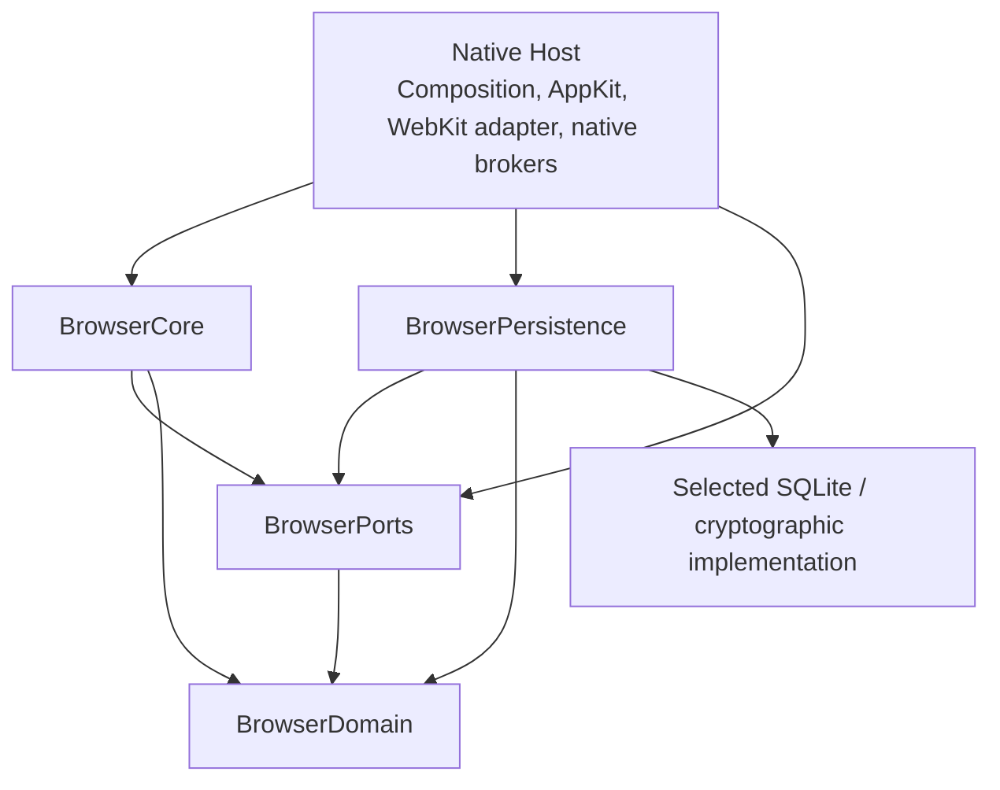

# M1 Developer Specification v1.0 — Proposed (Refined)

## 1. Document status, scope and authorization boundary

| Item | Status |
|---|---|
| Prepared | 2026-11-08, Asia/Kolkata |
| Document status | Proposed requirements and review baseline |
| Owner dispositions | Discussion-only |
| Architecture direction | Established |
| Experimental validation | Pending |
| Implementation | Not Started |
| Implementation authorization | Not Granted |
| Repository changes | Not Authorized |

This document retains the preceding specification and adds **REQ-22**, explicitly connecting WebKit website-data protection, deletion and backup qualification to **AC08**.

The earlier refinements remain:

- **R1:** explicit encryption/protection coverage.
- **R2:** explicit deferred-policy feature gates.
- **R3:** requirement-to-validation traceability.
- **R4:** qualified audit-evidence attribution.

Document v1.0 does not establish a released protocol, ABI, database version or validated implementation.

The source hierarchy remains:

1. Current owner dispositions OD-R01–OD-R20.
2. WS01.1 namespace separation.
3. Preserved historical decisions and evidence.
4. Existing architecture/security documentation.
5. ADRs and implementation plans.
6. Public product references.
7. Clearly labelled technical recommendations.

The complete owner entries in §27 remain normative. Summaries do not remove their conditions.

Terminology:

- **Owner policy:** approved discussion-only direction.
- **Requirement:** normative text within this proposed specification.
- **Recommendation:** proposed technical design, not owner approval.
- **Open specification:** engineering detail still requiring completion.
- **Validation requirement:** evidence needed before relying on behavior.
- **Deferred policy:** OP-01–OP-04, defined in §25.

### Evidence qualification — R4

Repository reference: `/Users/vigneshwaranbhoj/Downloads/repo-labs/vx-browser`

| Information | Provenance and qualification |
|---|---|
| F01–F17 | Findings reported in the preceding Codex reconciliation audit. They were not independently re-audited against repository contents during this correction. |
| Historical crosswalk and repository line references | Inherited from the preceding audit and specification. They are not newly verified file observations. |
| Prior branch/commit | Earlier reports identified `timeline` at `05f73d840d1230684089076b068bea3853193022`. This correction did not independently recheck branch or HEAD. |
| Prior clean-before/after and 665-file preservation claims | Attributed to earlier Codex reports and their reported snapshots. No new count, hash comparison or preservation audit was performed. |
| Evidence visible in supplied material | The preceding responses contain findings, traceability tables and reported state/fingerprint values. This correction did not independently inspect their underlying manifests. |
| Preceding refinement’s independent observation | That task reported one read-only `git status` with no reported changes at that instant. It did not establish a new 665-file preservation result. |
| Current correction | Used the supplied conversation and document only. No repository access, Git commands or hash checks were performed. |

The preceding refinement’s status command was a reported process exception. It is historical attribution, not an action performed during this correction.

The phrase **“no Git operations”** is broader than the preceding reports support. The accurate distinction remains **read-only Git inspection versus Git mutations**.

## 2. Product principles and M1 goals

**Owner policy:** OD-R01–OD-R20.

Requirements:

- Provide a native macOS experience.
- Keep browser domain/core independent of engine implementation.
- Support local operation without a mandatory server, account or cloud service.
- Isolate persistent profiles and protect their browser-owned data.
- Keep private browsing outside durable browser-owned storage.
- Make locking, deletion, backup and recovery explicit and failure-aware.
- Preserve truthful acknowledgements and user control.
- Treat registration/readiness as separate from authorization.

Safari remains a reference for native integration, profile/private-window presentation and website-data controls. Its documented sharing model is not Vezham’s specification: Safari shares bookmarks and several settings across profiles. [Apple’s profile guide](https://support.apple.com/en-ie/105100).

Arc remains a reference for sidebar, pinned-tab and contextual organization. Spaces associated with one Arc profile can share browsing data; a Space is not automatically a profile-security boundary. No proprietary Arc architecture is assumed. [Arc’s documented data relationships](https://resources.arc.net/hc/en-us/articles/44413129117591-Move-from-Arc-to-Dia).

These public-reference facts were consulted during the preceding audit, not freshly tested in this correction. Arc’s vendor also announces a December 22, 2026 sunset; its availability must not become a Vezham validation dependency. [Vendor announcement](https://arc.net/).

**Open:** SPEC-01–SPEC-16.

**Validation:** §23–24. Reference-product behavior is not Vezham evidence.

## 3. Platform baseline and macOS requirements

Requirements:

- Minimum supported OS: **macOS 26.0**.
- Distribution: internal-only.
- Native host: Swift/AppKit.
- Core: Swift 6.
- Future chrome: React, TypeScript and HeroUI v3.
- WKWebView: conditional candidate.
- Chromium/CEF: evaluation-only.
- Aura, including `@vezham/aura`: excluded.
- Production Tamizhi: outside scope.
- Identity/cloud: optional.

A newer development host or SDK does not establish macOS 26 runtime compatibility.

Mandatory final-stage gates remain:

- macOS 26.0 and latest supported 26.x runtime validation.
- Developer ID Application signing/notarization.
- Gatekeeper, App Sandbox, Hardened Runtime and entitlements.
- Installer/updater integrity, rollback/revocation and release procedures.
- Candidate-specific compatibility, reliability and performance.

These remain open, not waived or passed. The referenced sequencing comes from the previously inspected [ADR 0001 Stage C](/Users/vigneshwaranbhoj/Downloads/repo-labs/vx-browser/docs/decisions/0001-browser-engine-strategy.md:107).

## 4. System architecture and ownership boundaries

**Owner policy:** OD-R02/03/10/11/15/16.

Proposed dependency graph; arrows mean compile-time dependency:

| Component | Owns | Prohibited responsibility |
|---|---|---|
| Native Host | Application/window lifetime, composition, caller context, platform execution | Bypassing Core policy |
| BrowserDomain | Values, identities and domain invariants | Platform/database implementation |
| BrowserPorts | Typed contracts | Concrete adapters or generic dispatch |
| BrowserCore | Authoritative state, authorization and lifecycle policy | Concrete native/engine/database objects |
| BrowserPersistence | Repositories, transactions, migrations | UI authority or website storage |
| Engine adapter | Engine objects and callback translation | Durable browser-history policy |
| Chrome | Presentation and bounded intents | Keys, SQL, native grants or engine handles |
| Website content | Untrusted website execution | Privileged browser-native channel |

**Recommendation:** initially keep the adapter and native brokers inside the host target rather than creating speculative packages.

**Open:** SPEC-01/02.

**Validation:** future dependency/conformance checks. This diagram is not compiled evidence.

## 5. Swift 6 Browser Core runtime

**Owner policy:** OD-R01.

Requirements:

- Foundation-based, engine-independent domain values.
- Explicit actor isolation for authoritative mutable state.
- Short state transitions and bounded pending work.
- Database I/O outside the main actor and Core actor.
- Ownership/generation revalidation after suspension.
- No FIFO-completion assumption across asynchronous calls.
- No unchecked-concurrency annotations used to conceal ownership defects.

**Recommendation:** retain the existing single-Core-actor proposal initially, with bounded repository workers.

**Open:** concrete concurrency annotations, bounds and scheduling contracts.

**Validation:** reentrancy, stale completion, conflicting revisions, cancellation and shutdown.

## 6. Native Host and Browser Core boundary

**Owner policy:** OD-R02/09/11/15/18.

Native authority context must identify:

- Registered caller/surface and generation.
- Current AppRun.
- Persistent-profile or private-session scope.
- Applicable target and object generation.
- Access/revocation generation.
- Request/effect identity.
- Allowed operation class.
- Opaque current native authorization references.

Frontend identifiers do not grant authority.

Execution contract:

1. Host validates caller context.
2. Core validates policy/current state.
3. Core records the intended effect.
4. Native execution rechecks authority and OS constraints.
5. Typed completion returns.
6. Core revalidates before state publication.

Native denial remains authoritative after Core approval.

Startup validates bindings/dependencies before readiness. Shutdown fences new work, retains reconciliation dependencies, tears down dependents first and reports incomplete cleanup honestly.

**Open:** SPEC-01/14/15; concrete types and authentication freshness.

**Validation:** forged/stale context, owner retirement and shutdown races.

## 7. Four-target package architecture

**Owner policy:** OD-R03.

| Target | Permitted dependencies | Boundary |
|---|---|---|
| BrowserDomain | Swift; reviewed Foundation subset | Values/rules |
| BrowserPorts | BrowserDomain | Contracts only |
| BrowserCore | BrowserDomain, BrowserPorts | Policy/orchestration |
| BrowserPersistence | Domain, Ports, selected storage implementation | Private SQL/connections |

Requirements:

- Acyclic graph.
- No Core import of Persistence.
- No platform/database objects in engine-independent interfaces.
- Narrow injected contracts.
- No assumption that package manifests or bindings already exist.

**Recommendation:** reuse the previously proposed package location only under a later authorized scaffolding task.

**Open:** SPEC-01; visibility and concrete target configuration.

**Validation:** future package/dependency/conformance checks.

## 8. Browser engine strategy and WebKit integration boundary

**Owner policy:** OD-R02/06/10 and existing conditional engine decision.

Requirements:

- ADR 0001 remains Proposed.
- WKWebView remains conditional.
- Engine objects remain adapter-private.
- Views have immutable profile/store ownership.
- Cross-profile movement creates newly owned resources.
- Capabilities distinguish supported, partial and unsupported behavior.

Engine contracts must cover lifecycle, store assignment, navigation, correlated events, terminal outcomes, content-process termination, website-data deletion and supported downloads/find/zoom integration.

Durable history belongs to Core repositories.

Script integration must not create privileged website-to-native dispatch. Chrome uses a separate fixed-origin typed allowlist. Cookie/page-extraction APIs do not automatically become chrome commands.

**Open:** SPEC-02/08; concrete Swift bindings and callback/capability mapping.

**Validation:** EXP-01/02/05/06 and later integration fixtures.

## 9. Database topology and persistence contracts

**Owner policy:** OD-R04/05/07.

Requirements:

- One browser catalog.
- Separate persistent-profile databases.
- Private state in memory without persistent leases.
- Native path resolution and ownership verification.
- Typed operations and bound statements.
- Explicit transaction boundaries and verified constraints/configuration.
- Private rejection before file/receipt access.
- No normal cross-profile database attachment/querying.
- No engine, Keychain, panel or network call inside SQL transactions.

Mutation contract:

1. Verify store/profile/access lease.
2. Validate mutation identity, revision and bounded operations.
3. Apply transaction.
4. Commit revision/receipt consistently.
5. Return committed acknowledgement.
6. Reconcile cancelled/disposed callers separately.

Receipts provide bounded retry reconciliation, not unlimited exactly-once execution.

**Recommendation:** serialized writers, bounded reads and conservative durability. WAL/FULL remains proposed pending provider qualification.

**Open:** SPEC-03/04; schema, indexes, migrations, receipt windows and catalog protection.

**Validation:** EXP-03/07 and repository fault cases.

**Deferred:** OP-01–OP-04 where affected.

## 10. Profile creation, isolation, unlock, lock and deletion lifecycle

**Owner policy:** OD-R05/07/08/09/10/18.

Model resource lifecycle, access state and long-running operation state separately.

| Operation | Proposed progression | Completion invariant |
|---|---|---|
| Create | Hidden intent → provision → verify → publish ready | No partially usable profile |
| Unlock | Locked → authenticate/acquire key → verified open → active | Failure remains inaccessible |
| Lock | Active → fence → reconcile → revoke/close → locked | Required barrier actually completed |
| Delete | Verify owners → deletion intent → cleanup → deleted/cleanup-required | Partial deletion cannot reopen ready |

Creation/deletion span catalog, DB, keys, Keychain, engine and files. Their consistency requires an explicit saga, not a fictitious global SQL transaction.

Locking must:

- Fence new requests before awaiting cleanup.
- Advance access generation.
- Reject queued/late sensitive results.
- Reconcile transactions truthfully.
- Close key/database access and clear sensitive projections.
- Suspend/retire associated views through validated behavior.
- Keep partial failure access-blocked.
- Prevent app restart from bypassing an outstanding lock.

Manual/inactivity lock is scoped. OS-wide events independently affect every applicable profile.

**Open:** SPEC-06/07; checkpoint fields, public OS signals and WebKit barriers.

**Validation:** EXP-01/04/05/08.

## 11. Encryption, Keychain, recovery material and key lifecycle

**Owner policy:** OD-R07/08/09/10/14/19/20.

### 11.1 Normative coverage matrix — R1

The matrix distinguishes **approved protection requirements** from **demonstrated protection**.

**No row establishes validated Vezham protection merely because a policy or OS mechanism exists.**

#### Ownership, location and required protection

| ID/category | Data owner | Storage location | Encryption/protection requirement or proposal | Establishment/validation status |
|---|---|---|---|---|
| **C01 Browser-owned persistent profile data** | Core policy; Persistence/native execution | Native-owned per-profile storage; exact layout open | Encryption and authenticated integrity required under OD-R07; includes sensitive associated browser-owned artifacts | Policy established; implementation/configuration unselected and unvalidated |
| **C02 SQLite main database** | BrowserPersistence | Per-profile native-owned DB location | Selected encrypted SQLite-compatible mechanism required; ordinary SQLite access is not proof | SPEC-03/04 open; EXP-03 pending |
| **C03 WAL, journals and temporary files** | Persistence and native file service | DB-associated and provider/runtime temporary locations; inventory required | Profile-data protection must cover these artifacts; no plaintext spill/fallback within the declared boundary | Coverage unestablished; EXP-03 must exercise actual modes/spills |
| **C04 Browser catalog** | Core registry policy; Persistence/native storage | Native application-level catalog location | Separate field-by-field protection assessment required. Blanket catalog encryption is not yet established; no implicit plaintext approval. Catalog placement cannot evade C01 protection | SPEC-04 open; sensitive-field use blocked until protection is defined |
| **C05 WebKit-managed website data** | WebKit/adapter; Core controls assignment | Engine/OS-managed locations, to be inventoried | Dedicated stores required. OS/app-level protection must be assessed independently; SQLite encryption provides no coverage claim | Logical design specified; isolation/protection/lock/backup behavior unvalidated |
| **C06 Download metadata** | Core policy; repository/broker execution | Encrypted profile storage; operational secrets remain native | Encryption required; no raw credentials or authorization blobs in general UI state | EXP-03/06 pending; retention additionally gated by OP-02 |
| **C07 Actual downloaded files** | User; native file broker executes authorized writes | Downloads directory or authorized configured destination | Profile encryption does not cover external payloads. Current dispositions do not mandate app-encryption of saved external files. Selected backup payloads must be encrypted in the archive | Native authorization/finalization unvalidated; external OS protection not assessed here |
| **C08 Keychain-held keys** | Native key service | Selected macOS Keychain implementation; bounded native memory while in use | Keychain protection/access control required; no unprotected durable key export or UI/log exposure | OS mechanism referenced; Vezham configuration and lifecycle unvalidated |
| **C09 Recovery material** | User custody; native generation/export | Printable kit and separate encrypted recovery file | Recovery file encryption required. Printable material is sensitive; its representation/custody protection must be specified, not assumed covered by profile encryption | Format, export verification and independent recovery unvalidated |
| **C10 Backup archives/manifests** | Core coordination; backup/native services | Authorized archive destination and protected owned staging | Payload and sensitive manifest data must be encrypted; security-critical metadata authenticated. Minimal outer metadata/disclosure must be specified | SPEC-12 open; EXP-07 pending |

For C04, a separate assessment is an unresolved security specification—not permission to store sensitive data unprotected.

For C05, absence of a demonstrated application-level encryption mechanism is a limitation, not an approved assertion that all website data is encrypted.

#### Backup, restore, deletion and outstanding questions

| ID | Backup/restore treatment | Deletion expectations | Outstanding security questions |
|---|---|---|---|
| C01 | Encrypted declared profile coverage; exclude private data; revalidate identity/lineage | Clear selected data and derivatives; reconcile copies/ledgers; no forensic-erasure claim | Complete asset inventory, format boundaries and residual copies |
| C02 | Verified consistent snapshot; protected staging; authenticated restoration | Fence/close before owned cleanup; preserve inaccessible ciphertext on failure | Provider, schema/key binding, migration and rekey compatibility |
| C03 | Capture committed state through validated snapshot protocol, not live-main-file copying | Coordinated owned cleanup; never delete live WAL/journals to manufacture success | Actual temp locations, spill modes, provider coverage and crash residue |
| C04 | Include declared coherent catalog snapshot in encrypted archive | Reconcile entries/intents and protected fields; avoid orphan adoption | Bootstrap-before-unlock needs, sensitive metadata, integrity and key hierarchy |
| C05 | Include only data classes with reliable validated restoration; disclose exclusions | Use scoped supported deletion; report incomplete cleanup | Locations, protection, service-worker/cache lifecycle, lock and portable restore |
| C06 | Include approved metadata coverage; reconcile file references without importing authority | Metadata deletion must not delete payloads; TTL remains OP-02 | Resume-secret placement, retained fields and lock/finalization races |
| C07 | Excluded by default; selected files included with manifest/integrity; authorize destination mapping | Metadata/profile deletion must not delete external files; user deletion is separate | Permissions, quarantine, conflicts, moved/missing files and partial restore |
| C08 | Do not assume copying the source Keychain is recovery. Use specified wrapped key/recovery structures | Remove owned access material through lifecycle protocol; do not claim all independent copies are erased | Keychain implementation, ACLs, authentication freshness, signing identity and rotation |
| C09 | Keep recovery material separate from Mac/backups; do not embed the sole recovery secret beside ciphertext | Explicit user custody/deletion; printed/exported copies cannot be universally recalled | File format, password/KDF protection, verification, loss and rotation compatibility |
| C10 | Authenticate, bound and verify before promotion; preserve source archive/existing destination on failure | Preserve restore inputs until success; app-owned retained copies governed by OP-03 | Manifest disclosure, archive attacks, ledger coverage, staging and promotion recovery |

### 11.2 Key lifecycle requirements

- Unique secure profile key material.
- Independent normal-access and recovery paths.
- Opaque bounded key leases outside native key services.
- No key/recovery secrets in Core/UI/logs.
- No replacement key generated over inaccessible ciphertext.
- Explicit distinction between rewrapping, data-key rotation and data re-encryption.
- Authentication/recovery failure preserves existing recovery paths.
- Export verification does not guarantee future custody.

**Recommendation:** native-controlled profile encryption keys with separately specified Keychain and recovery wrapping paths.

**Open:** SPEC-04/05; provider, algorithms, parameters, key formats, Keychain configuration and memory handling.

**Validation:** EXP-03/04/05/07. No universal memory/OS-artifact erasure guarantee.

## 12. WebKit website-data storage and protection

**Owner policy:** OD-R06/07/10/18.

Requirements:

- Dedicated persistent stores and explicit nonpersistent private stores.
- Immutable native-verified assignment.
- Inventory all applicable website-data classes.
- Validate sharing, isolation, deletion, relaunch and concurrent views.
- Assess protection/locking independently from SQLite.
- Include website data in backups only after reliable restoration.
- Hold affected features if public behavior cannot satisfy required guarantees.

**Recommendation:** qualify browser-owned backup coverage independently first.

**Open:** SPEC-08.

**Validation:** EXP-01/02/05; additional claimed website-backup cases.

## 13. Private browsing lifecycle and cleanup

**Owner policy:** OD-R06.

Requirements:

- Distinct private scope; memory-only browser-owned state.
- No private history/grant/restore/download-history/receipt persistence.
- Parent labels confer no authority or storage inheritance.
- Private sharing only through explicit native group ownership.
- Last-owner teardown fences requests and releases owned resources.
- No private restoration after restart.
- Explicitly saved files may remain.

Any minimal crash-cleanup marker must have a specified ownership protocol and contain no private browsing payload.

**Open:** SPEC-06/08; grouping, teardown and staging contracts.

**Validation:** EXP-02/06 and stale-callback cases.

OS artifacts and intentional files remain outside a blanket forensic-erasure promise.

## 14. Website permissions and authorization

**Owner policy:** OD-R11.

Requirements:

- Core policy plus independent native/OS enforcement.
- Verified origin/capability/profile scope.
- Explicit temporary/persistent semantics.
- User inspection/revocation.
- Private decisions do not change persistent grants.
- Unsupported/ambiguous requests deny.

Specify requesting/top-level/frame origins, canonicalization, opaque origins, redirects, prompt-navigation races, user-action evidence, expiry, revocation and callback limitations.

Restored records do not constitute OS grants or automatically activate authority.

**Open:** SPEC-09/14/15.

**Validation:** per-kind positive/negative, expiry/revocation, foreign-scope and OS-denial cases. Supported launch-kind selection remains a later scope gate.

## 15. History, retention and deletion

**Owner policy:** OD-R12.

Requirements:

- Encrypted independent profile history.
- **Forever** default.
- Approved configurable alternatives.
- Entry/range/all deletion offline.
- Private exclusion.
- Verified current main-frame commit eligibility and deduplication.
- Derived-state cleanup and stale-write fencing.
- Restore reconciliation under OD-R17.

Clear Browsing Data must expose independent approved categories and truthful per-category completion/partial outcomes.

**Open:** SPEC-03/10/13; clocks, boundaries, same-document mapping and derived-state coverage.

**Validation:** retention/commit fixtures and EXP-08.

**Feature gates:** OP-01 fields and OP-04 recovery-generated history. Forever retention does not approve unspecified collection.

## 16. Downloads and filesystem lifecycle

**Owner policy:** OD-R13/18/20.

Requirements:

- Native-authorized default/configured destinations.
- Separate encrypted metadata and external payloads.
- No path-as-authority or silent overwrite.
- Safe naming/collision and applicable quarantine.
- Resume only where supported; protect resume material.
- Owned abandoned-staging cleanup.
- Private history nonpersistence.

Proposed progression:

`Created → Destination authorized → Transferring → Finalizing → Completed`

Interrupted/cancelled/failed outcomes remain distinct. Resume requires fresh bound attempt authority. A receipt alone cannot authorize replaying a file write.

Completion requires actual native finalization evidence.

Restore must preserve original source files, treat old paths as provenance and obtain receiving-Mac destination authorization.

**Open:** SPEC-07/11/12.

**Validation:** EXP-05/06/07.

**Feature gate:** OP-02 for durable metadata retention/purge.

## 17. Backup, restore, migration and deletion reconciliation

**Owner policy:** OD-R14/17/19/20.

Requirements:

- Independent/profile-selected encrypted portable backups.
- Coherent catalog/profile/key-version snapshot.
- Private exclusion.
- Files excluded by default; optional all/individual selection.
- Pre-start size estimate.
- Protected staging and authenticated versioned manifest.
- Verified publication and preserved source inputs.

Restore progression:

1. Bounded parsing.
2. Authentication/decryption into protected staging.
3. Integrity, identity, compatibility and coverage validation.
4. Deletion reconciliation.
5. Explicit unknown-coverage/conflict handling.
6. Supported migration and destination key protection.
7. Durable promotion/reconciliation.
8. Truthful acknowledgement.

Reject traversal, unexpected links, excessive expansion, undeclared resources and unsupported versions. Authentication does not make archive contents benign.

Migration must use supported checksummed transitions, compatibility checks and an approved recovery path. No destructive reset/downgrade or external calls inside SQL transactions.

Deletion reconciliation must:

- Protect independent records and lineage.
- State available coverage without claiming global freshness.
- Apply known deletions.
- Require bound confirmation for unknown coverage.
- Preserve offline recovery.
- Define propagation and post-profile-deletion recoverability.
- Prevent identity remapping from bypassing deletion knowledge.

Confirmation is not proof that deleted information cannot reappear.

**Open:** SPEC-03/05/12/13.

**Validation:** EXP-04/07/08; separate website-data evidence.

**Feature gates:** OP-03 for app-owned snapshot lifecycle; OP-04 for durable session behavior. Portable backup does not replace durable host recovery.

## 18. Static capability composition and typed capability contracts

**Owner policy:** OD-R15/16.

Requirements:

- Static reviewed startup bindings.
- Feature-specific contracts; no arbitrary invocation.
- Explicit versions, scopes and dependency validation.
- Registration/readiness separate from authorization.
- Core policy; native execution.
- Initialization rollback and fenced teardown.
- Dependent-before-dependency disposal.
- Explicit required/optional capability outcomes.

Proposed lifecycle:

`Declared → Validated → Initializing → Ready → Quiescing → Disposed`

Cleanup failure retains truthful unavailable/cleanup-required state.

**Recommendation:** direct constructors/narrow ports; no plugin container, DSH runtime or universal provider framework.

**Open:** SPEC-01/06/14/15.

**Validation:** fake-provider lifecycle and required-feature failure cases.

## 19. Events, cancellation, sequencing and profile-context propagation

**Owner policy:** OD-R16/18.

Requirements:

- Typed facts, not authorization middleware.
- Scope/generation checks at subscription and delivery.
- Per-source sequence and authorized projection revisions.
- No global cross-profile ordering guarantee.
- Bounded queues and explicit gap/overflow resnapshot.
- Coalesce only advisory events.
- Retain terminal outcomes in authoritative state.
- Retire queued sensitive results after lock/revocation.
- Resubscription restores state, not actions.

Cancellation before commit is best effort; after commit it must reconcile the actual result. Presentation disposal suppresses sensitive delivery, not completed effects.

**Open:** SPEC-14/15; exact envelopes, bounds and serialization.

**Validation:** stale delivery, overflow, lock races and cancellation/commit cases.

## 20. Failure handling and cross-component consistency

Requirements:

- Saved/completed/locked/deleted/restored acknowledgements require defined barriers.
- Transactions cover only their actual resources.
- Cross-resource work uses durable intent/idempotent reconciliation.
- Preserve inaccessible/corrupt/unsupported originals.
- No reset, key regeneration or journal removal to manufacture success.
- Bounded retries with an explicit reason.

Required error families include invalid/stale authority, locked access, cancelled/failed authentication, unavailable key, recovery/integrity failure, unsupported capability/version, revision conflict, storage failure and incomplete cleanup.

Do not claim distinctions the selected provider cannot establish.

Same-process actors/timeouts do not contain fatal traps, memory corruption or noncooperative code.

**Open:** SPEC-06/15.

**Validation:** fault/conformance cases, with injected versus actual failures distinguished.

## 21. Security and privacy threat model requirements

Requirements address untrusted websites/frames, compromised chrome, cross-profile/private leakage, native-authority abuse, offline data exposure, malicious archives, stale callbacks, key loss and release compromise.

Controls include:

- No privileged website bridge.
- Fixed trusted chrome origin/CSP when implemented.
- Bounded typed allowlists and native ownership checks.
- Independent profile stores/keys and private nonpersistence.
- Declared protection coverage from §11.
- Explicit recovery/deletion limits.
- Minimal entitlements and preserved OS protections.
- Redacted diagnostics.

Residual risks include compromised trusted-host behavior, engine defects, OS artifacts, prior disclosures and externally retained copies.

Cross-profile/private leakage and unauthorized native actions remain hard failures.

**Open:** security review of selected provider/platform design.

**Validation:** applicable EXP and later Stage B/C security checks.

## 22. Data lifecycle requirements

| Asset | Required lifecycle rule |
|---|---|
| Catalog | Minimal protected inventory and coherent profile intents |
| Preferences/bookmarks | Profile-owned protected storage and explicit deletion |
| History | OP-01 fields; approved retention; deletion/ledger coverage |
| Permissions | Explicit lifetime/revocation; no imported OS authority |
| Download metadata | Encrypted; OP-02 retention; separate from payloads |
| External files | User-authorized output; optional backup; no implicit deletion |
| Restore descriptors | OP-04 before real capture/reopening policy |
| Migration snapshots | Protected; OP-03 lifecycle |
| Archives | Encrypted/authenticated declared coverage; preserved restore inputs |
| Keys/recovery | Native/independent paths; explicit rotation/loss/deletion limits |
| Deletion records | Protected lineage and defined coverage/propagation |
| Private state | Memory only; last-owner cleanup; no backup/restore/sync |

Derived records, receipts and digests belong in the privacy inventory. A URL hash is not anonymization.

## 23. Experiments and validation plan

**All procedures below are proposed. No experiment was executed, and no new M1 experimental evidence was produced.**

Priority wave: **EXP-01, EXP-03, EXP-04, EXP-07**. Other experiments remain necessary before relying on their corresponding behavior.

Common environment/evidence requirements:

- Separately authorized disposable harness and synthetic data.
- Pinned source, actual OS/SDK, architecture, provider/configuration.
- Positive/negative controls and explicit failure/stop cases.
- Individual expected/actual results and preserved failures.
- No raw key/recovery-secret evidence.
- Preserve historical evidence.
- Stop on unexpected access, disclosure, destructive replacement or protection bypass.
- Newer-host results do not qualify macOS 26 release behavior.

| Experiment | Question, scope and proposed procedure | Evidence and pass/fail | Limits and decisions informed |
|---|---|---|---|
| **EXP-01 Persistent profiles** | Hypothesis: assigned stores isolate A/B while intentionally shared A views share correctly. Use pinned native harness, multiple views and loopback storage. Write/read each data class; reopen/delete/replace views; inject foreign/stale bindings. | Binding inventory and per-class results. Pass: expected same-profile sharing/persistence, zero foreign markers, scoped deletion. | Store IDs are not OS isolation. Informs SPEC-02/08 and conditional engine suitability. |
| **EXP-02 Private cleanup** | Hypothesis: private state stays outside durable data and ends with its session. Use persistent controls and independent/shared private groups. Exercise last-owner closure, late callbacks, abrupt restart and staging cleanup. | Resource/storage observations. Pass: no durable private browsing metadata or surviving markers under the defined contract. | No forensic-erasure proof; intentional files remain. Informs SPEC-06/08. |
| **EXP-03 Encryption** | Hypothesis: selected provider protects declared DB artifacts and fails safely. Exercise real WAL/journal/temp workloads, correct-key control, unencrypted detection control, wrong/missing keys, tamper, rekey interruption and storage faults. | Configuration/provenance, artifact coverage and reopen outcomes. Pass: no plaintext fallback/reset and correct declared transaction outcomes. | Marker absence alone is insufficient; excludes automatic WebKit/file protection. Informs SPEC-03/04. |
| **EXP-04 Keychain/recovery** | Hypothesis: normal and independent recovery reach the right key without source Keychain/cloud. Use isolated entries, approved authentication and independent destination/network-off environment. Test export, cancellation, wrong material and interrupted replacement. | Opaque identity/version and integrity results. Pass: exact offline recovery; failures preserve paths; no unauthorized key access. | Export cannot prove future custody. Informs SPEC-05 and OD-R08/09/19. |
| **EXP-05 Locking** | Hypothesis: completed lock fences access without harming unrelated scopes. Use A/B, active views/queries/transfers and controlled approved OS triggers. Race commits/results; timeout cleanup; restart locked; authenticate unlock. | Generations, handles, outcomes and independent-profile results. Pass: no post-barrier unauthorized access or false Locked acknowledgement. | Public OS/WebKit behavior may constrain feasibility; no universal RAM wipe. Informs SPEC-06/07/08. |
| **EXP-06 Downloads** | Hypothesis: authorized transfers yield correct bytes/metadata without overwrite/leakage. Use known-hash resumable/nonresumable fixtures and authorized paths; interrupt/cancel/lock, move files and fail finalization. | Hashes, authorization/state inventory, staging results. Pass: exact bytes, no unauthorized write/overwrite, truthful resume limits, no private history persistence. | Server/context-dependent resume; saved files persist. Informs SPEC-11. |
| **EXP-07 Backup/restore** | Hypothesis: selected data restores coherently across Macs. Prerequisites: selected formats and EXP-03/04 outcomes. Capture two profiles/catalog/selected files; test tampering, truncation, identity/path conflicts and interrupted promotion. | Manifest/revisions/inventory/hashes/checkpoints. Pass: coherent authenticated data, authorized destinations and preserved originals/source archive on failure. | Website data conditional; complete deletion handling also requires EXP-08. Informs SPEC-12. |
| **EXP-08 Deletion reconciliation** | Hypothesis: known deletion applies; incomplete knowledge is disclosed. Use old/new archives, protected records, original/fresh destinations. Test stale/missing/forged records, replayed confirmation, lineage remapping and interruption. | Coverage, filtered identities and confirmation binding. Pass: no silent resurrection in declared cases, unknown confirmation, no cancellation mutation/lineage bypass. | Offline confirmation cannot prove global freshness. Informs SPEC-13. |

Separate future conformance procedures remain necessary for offline local UI, package dependencies, permission kinds, history semantics and native contracts.

## 24. M1 acceptance criteria and requirement traceability — R3

### 24.1 Acceptance identifiers

| ID | Required outcome |
|---|---|
| AC01 | Disconnected local operation without server/account dependency |
| AC02 | Correct package/engine-independent boundaries |
| AC03 | Persistent-profile isolation |
| AC04 | Private nonpersistence/cleanup |
| AC05 | Declared profile encryption/integrity coverage |
| AC06 | Authorized normal access and independent recovery |
| AC07 | Approved lock triggers enforce the barrier |
| AC08 | Capability-correct WebKit protection/deletion/backup claims |
| AC09 | Origin/profile/lifetime/OS-correct permissions |
| AC10 | Approved history fields, retention and deletion |
| AC11 | Safe download/file/metadata lifecycle |
| AC12 | Encrypted coherent cross-Mac backup/restore |
| AC13 | Known deletion and unknown-coverage reconciliation |
| AC14 | No unauthorized cross-profile/private delivery |
| AC15 | Truthful failure/cancellation/recovery outcomes |

### 24.2 Requirement-to-validation matrix

**Status qualification for every row:** the requirement is specified in this proposed document; the validation procedure is proposed; applicable experiments are unexecuted; corresponding M1 implementation evidence has not been established here. Policy-gated rows remain blocked as indicated.

REQ identifiers are local requirement references, not owner-decision IDs. Existing REQ-01–REQ-21 entries are preserved; REQ-22 is appended.

| Requirement | Normative contract/specification | Proposed validation | Expected evidence | Pass/fail rule | Known limitations/gates |
|---|---|---|---|---|---|
| **REQ-01 Offline operation** | §2/3/9; SPEC-01/03; AC01 | Disconnected launch/reopen/local-operation charter | Actual network-off setup, local operation results, service-request inventory | Supported local operations succeed without server/account dependency | Full integrated UI not demonstrated by fake ports |
| **REQ-02 Runtime/target boundaries** | §4–8; SPEC-01/02; AC02 | Package/dependency/conformance fixtures | Actual imports, target graph and binding results | No prohibited dependency or concrete engine leakage | Proposed graph is not compilation evidence |
| **REQ-03 Native authority/bridge** | §6/8/14/21; SPEC-02/09; AC09/14 | Valid-command controls and malformed/stale/foreign/page-origin cases | Rejection/effect traces and authorized controls | Zero unauthorized native effects; legitimate owned requests remain usable | Requires actual chrome/native implementation |
| **REQ-04 Profile isolation** | §9/10/12; SPEC-03/08; AC03/14 | EXP-01 plus repository A/B cases | Store/lease inventory and per-scope results | No foreign data; correct intended sharing | Not separate OS accounts/processes |
| **REQ-05 Profile encryption** | §11 C01–03/C06; SPEC-04; AC05 | EXP-03 | Provider/configuration and artifact coverage | Declared coverage, integrity and fail-safe behavior | Does not protect C05/C07 automatically |
| **REQ-06 Catalog protection** | §9/11 C04; SPEC-04; AC12/14/15 | Catalog inventory/protection review and scoped EXP-03/07 cases | Field classification, bootstrap/key design, protected snapshot results | No unreviewed sensitive-field exposure; coherent scoped restore | Blanket mechanism unresolved; not validated |
| **REQ-07 Keys/recovery material** | §11 C08/09; SPEC-05; AC06 | EXP-04/07 | Authorized access, export verification and independent recovery | Correct data recovered without source Keychain/cloud; failures preserve paths | Does not guarantee future custody or all-copy erasure |
| **REQ-08 Lock enforcement** | §10–12/16/19; SPEC-07; AC07/14/15 | EXP-05 | Barrier/generation/lease/handle and transaction results | No post-barrier unauthorized access or false lock success | OS signals/WebKit feasibility unqualified |
| **REQ-09 Private lifecycle** | §13/16; SPEC-06/08; AC04/14 | EXP-02/06 | Owned-resource and durable-store observations | No persistent private browsing metadata; scoped cleanup | OS artifacts/intentional files excluded from absolute claims |
| **REQ-10 Permissions** | §14; SPEC-09; AC09/14 | Per-kind grant/deny/revoke/expiry/OS-denial fixtures | Trusted origins, generations and actual outcomes | Unsupported/ambiguous deny; current valid grants scoped correctly | Supported callback inventory/access authorization required |
| **REQ-11 History** | §15/25; SPEC-10; AC10/13 | Commit/retention fixtures and EXP-08 | Eligibility, cutoff, deletion and stale-write results | Only approved eligible data; correct configured deletion | OP-01 and OP-04 |
| **REQ-12 Download metadata** | §16/22/25; SPEC-11; AC11 | EXP-06 plus future retention cases | Encrypted scoped metadata and payload separation | No private/cross-profile metadata or false completion | OP-02; no invented TTL |
| **REQ-13 Downloaded files** | §16; SPEC-11; AC11 | EXP-06 | Hashes, target authorization, collision/quarantine results | Correct selected file; no path escape/overwrite | External payload not profile-encrypted automatically |
| **REQ-14 Archive/restore integrity** | §11 C10/17; SPEC-12; AC12/15 | EXP-04/07 | Manifest/revisions/hashes, malformed cases, promotion checkpoints | Coherent authenticated restore; failures preserve sources/destination | Website coverage conditional; OP-03 for retained app copies |
| **REQ-15 Deletion reconciliation** | §17; SPEC-13; AC13 | EXP-08/07 | Coverage/lineage, filters and confirmation binding | No silent resurrection in declared cases; unknown state disclosed | Confirmation is not global-freshness proof |
| **REQ-16 Backup file selection** | §16/17; SPEC-11/12; AC11/12 | EXP-06/07 selection/conflict cases | Requested versus included files, estimate and destination results | Default exclusion; only selected payloads; no silent overwrite | Estimates may vary; moved/missing files require defined outcomes |
| **REQ-17 Static capabilities** | §18; SPEC-01/06; AC02/15 | Fake-provider lifecycle fixtures | Binding validation, initialization rollback, disposal order | No readiness-as-permission or ghost resources | Fakes do not prove crash containment |
| **REQ-18 Events/cancellation** | §19/20; SPEC-14/15; AC14/15 | Race/overflow/resnapshot fixtures and EXP-05 | Sequence/generation, terminal outcome and receipt traces | No stale disclosure; no false rollback; explicit gaps | Per-source ordering, not global ordering |
| **REQ-19 Migration/resource consistency** | §9/10/17/20; SPEC-03/06/15; AC15 | Fault fixtures and EXP-03/04/07/08 | Transaction/reopen and saga checkpoint outcomes | No destructive reset, premature publication or false cleanup | Injected errors are not hardware-durability proof; OP-03 |
| **REQ-20 Durable recovery** | §8/10/17/25; SPEC-06/10; AC15 | Separate future host-crash and content-process recovery charters | Fresh identities, scope checks and excluded pending/private state | No unauthorized action/POST/grant replay; truthful scoped recovery | OP-04; Phase 3 results do not qualify M1 |
| **REQ-21 Release protection** | §3/21/30; existing Stage C gates | Final candidate qualification | Actual signed/notarized artifacts, clean install, OS matrix and updater results | All applicable mandatory release gates satisfied | Deferred final stage; no release authorization |
| **REQ-22 WebKit Website-Data Protection, Deletion and Backup Qualification** | **§8, §12, §17 → SPEC-08 → AC08.** Required coverage and unresolved technical contracts are detailed in §24.3. | **EXP-01, EXP-02, EXP-05, EXP-07**, using declared per-data-class cases; all proposed and unexecuted | Pinned store/data-class inventory, protection observations, deletion/cleanup results, lock/lifecycle traces and declared backup/restore/migration results | Concrete per-data-class pass/fail criteria remain to be finalized under SPEC-08; unsupported or unverified required behavior cannot be credited as Passed | SQLite encryption does not protect WebKit automatically; public-API/platform limits and backup coverage remain unverified; see §24.3 |

No acceptance count, aggregate pass rate or experimental result is created by this matrix.

### 24.3 REQ-22 — WebKit Website-Data Protection, Deletion and Backup Qualification

**Architecture:** §8 Engine Strategy and WebKit; §12 WebKit Data Protection; §17 Backup/Restore/Migration.  
**Technical specification:** SPEC-08.  
**Experiments:** EXP-01, EXP-02, EXP-05, EXP-07.  
**Acceptance criterion:** AC08.

The entry implements existing policy, principally OD-R06/07/10/14/18. It creates no new owner decision.

| Traceability field | Required distinction |
|---|---|
| **Normative requirement** | WebKit-managed data must follow persistent-profile isolation and private nonpersistent-session requirements. Protection, deletion, cleanup, lock/lifecycle and backup/restore/migration claims must be bounded to declared supported data classes and backed by evidence. Unsupported or unverified coverage must be disclosed and cannot be represented as a guarantee. |
| **Technical specification still required** | SPEC-08 must define the data-class inventory; profile/store ownership; applicable public APIs; actual storage/protection characteristics; private sharing/teardown semantics; deletion completion and partial-failure semantics; lock/lifecycle interactions; backup/restore/migration coverage and exclusions; and the supported OS/SDK context. |
| **Proposed validation method** | EXP-01 examines persistent-profile isolation and scoped lifecycle/deletion behavior. EXP-02 examines private website-data behavior and cleanup. EXP-05 examines relevant lock/lifecycle barriers and stale access. EXP-07 examines only explicitly declared website-data backup/restore/migration coverage; browser-owned backup results alone do not qualify WebKit data. |
| **Evidence required** | Pinned source/OS/SDK/engine context; native store bindings; per-data-class positive/negative observations; documented protection mechanisms and limitations; deletion/reopen and cleanup outcomes; lock-generation/lifecycle traces; archive coverage/exclusion manifests; restored/migrated fixture results; preserved failures and redacted artifacts. No qualifying result is supplied by this correction. |
| **Pass/fail criteria to be defined** | SPEC-08 must finalize concrete fixtures, expected observations and completion boundaries for each required data class. Proposed oracles include correct same-profile sharing, absence of foreign-profile data, defined private teardown behavior, correctly scoped deletion, truthful incomplete cleanup, required lock-barrier behavior and correct restoration of explicitly covered data. A required unsupported behavior or missing evidence leaves the affected acceptance open; declaring a limitation does not itself pass AC08. |
| **Known limitations and unverified behavior** | Distinct store identifiers are not isolation proof. Nonpersistent APIs are not forensic-erasure guarantees. SQLite encryption does not cover WebKit storage. Public APIs, locations, OS protection and lifecycle behavior may constrain control. Portable cookies/authentication/storage restoration is not assumed. Initial browser-owned backup qualification is not website-data qualification. All referenced experiments remain unexecuted. |

Required coverage within this entry:

1. **Persistent-profile isolation:** assess the applicable website-data classes across distinct profiles, intended same-profile sharing, concurrency and relaunch.
2. **Private browsing:** assess nonpersistent storage, intended session ownership, last-owner cleanup and restart behavior.
3. **Protection:** establish what protection actually exists and its threat-model limits; do not infer application-level encryption.
4. **Deletion/cleanup:** define scoped completion, verification, unrelated-data preservation and incomplete outcomes.
5. **Lock/lifecycle:** qualify relevant view/store behavior, access fencing, teardown and late callbacks.
6. **Backup/restore/migration:** identify supported, unsupported and unverified classes; include data only where reliable restoration is demonstrated.
7. **Claims:** require reviewed, revision-specific evidence before asserting a protection, deletion or backup guarantee.

**Current status:** normative requirement specified; SPEC-08 incomplete; procedures proposed; experiments not executed; AC08 not passed.

## 25. Deferred owner-policy feature gates — R2

These gates restrict future dependent behavior. Resolving a gate does not itself authorize implementation.

| Policy | What remains undecided | Why it matters | Blocked behavior | Safe provisional behavior | May developer choose a default? |
|---|---|---|---|---|---|
| **OP-01 History fields/URL handling** | Exact fields; query, fragment and title treatment | Sensitive data, revisit fidelity, encryption inventory and restore exposure | Real history capture/schema/projections dependent on that inventory | Synthetic fixtures and a minimized proposed inventory; runtime navigation/display does not approve durable collection | **No, unless explicitly owner-authorized** |
| **OP-02 Download-metadata retention** | Retention duration and associated expiry policy | Privacy, storage growth, history UX and backup contents | Durable metadata retention/purge behavior | Controlled synthetic metadata; no implicit 30-day, Forever or session-only product default | **No, unless explicitly owner-authorized** |
| **OP-03 App-owned snapshot lifecycle** | Retention/deletion of backup/migration snapshots | Recoverability, deletion expectations, disk use and rollback | Automatic real-data snapshot retention/expiry/deletion and migrations relying on that retained recovery path | Preserve restore inputs as approved; specify controlled fixture ownership; do not silently adopt indefinite retention | **No, unless explicitly owner-authorized** |
| **OP-04 Restore behavior** | Capture/restore UX, automatic reopening of restored sessions/tabs and treatment of recovery-generated history | Network actions, privacy, history semantics and crash recovery | Real durable capture/reopening and recovery-history behavior dependent on policy | Fake descriptors; no inferred automatic navigation or capture default; safe stopped/error presentation during proofs | **No, unless explicitly owner-authorized** |

Clarifications:

- Forever history retention remains approved.
- Private persistence remains prohibited regardless of OP-01/02.
- Download-file backup exclusion/optional selection remains approved.
- Source-backup preservation during restore remains approved.
- Required durable host recovery remains required; OP-04 does not make it optional.
- Provisional behavior is not a permanent shipped policy.

## 26. Historical decision crosswalk

This crosswalk is preserved from the preceding audit, using its historical references. It was not reconstructed from numeric suffixes or freshly reverified here.

Historical source: [owner packet matrix](/Users/vigneshwaranbhoj/Downloads/repo-labs/vx-browser/docs/architecture/phase-5/reports/M1/m1-owner-decision-packet.md:30). Line references below refer to that previously inspected version.

| Historical ID / line | Historical meaning | Current correspondence |
|---|---|---|
| OD01 / 32 | Swift 6 trusted core | OD-R01 matches |
| OD02 / 33 | Host/core same native process | OD-R02 matches/refines limitations |
| OD03 / 34 | Domain/Ports/Core/Persistence package | OD-R03 matches; concrete graph technical |
| OD04 / 35 | SQLite repository adapter | OD-R04 refines offline/no-server requirement |
| OD05 / 36 | Catalog plus per-profile databases | OD-R05 matches |
| OD06 / 37 | Memory-only private core; no persistent lease | OD-R06 adds explicit engine/download conditions |
| OD07 / 38 | Fixture-first; real-data protection choice open | Refined across OD-R07/08/09/18/19; optional encryption alternative superseded |
| OD08 / 39 | History 30 days; bookmarks/preferences until deletion; recovery-history cause open | OD-R12 supersedes history default; OP-04 retains unresolved recovery behavior |
| OD09 / 40 | Download metadata 30 days; separate file lifetime | OD-R13/20 refine file policy; TTL remains OP-02 |
| OD10 / 41 | URL/title/query/fragment inventory | Related OD-R07/12; OP-01 unresolved |
| OD11 / 42 | One pre-migration snapshot, at most 24h | OD-R14/17/20 expand backup scope; OP-03 unresolved |
| OD12 / 43 | Opt-in capture/default-off reopening; explicit recovery | No direct current replacement; related OD-R14/16; OP-04 unresolved |
| OD13 / 44 | Privacy epochs/deletion intents/snapshot invalidation | OD-R12/17 refine records and unknown coverage |
| OD14 / 45 | Checksummed migrations, minimum writer, transactions, bounded receipts | Supports OD-R04/05/14; not equivalent to current OD-R14 |
| OD15 / 46 | Static bindings and owned lifecycle | OD-R15 matches/refines authority |
| OD16 / 47 | Typed ports/events and bounded subscriptions | OD-R16 refines exact contracts |
| OD17 / 48 | Launch-required built-ins/workflows/permission scope | Related OD-R10/11/13/15/16; launch scope still open |
| OD18 / 49 | Extensions/spaces/advanced search deferred | OD-R15 retains dynamic-loading exclusion; no Spaces approval |
| OD19 / 50 | Future Tamizhi/optional services | OD-R04 matches optional scope |
| OD20 / 51 | I1/I2/synthetic-I3 execution proposal, not granted | Current authorization remains not granted; OD-R20 is a different subject |

Historical proposals are not retroactively marked approved. WS01.1 preserves both namespaces.

## 27. OD-R01–OD-R20 traceability index

Navigation summaries below do not replace the verbatim owner entries.

| Decision | Sections | Acceptance/validation |
|---|---|---|
| OD-R01 | §5/7 | AC02 |
| OD-R02 | §4/6/20 | AC15 |
| OD-R03 | §4/7 | AC02 |
| OD-R04 | §2/9 | AC01/02 |
| OD-R05 | §9/10/17 | AC03/12/15 |
| OD-R06 | §12/13/16 | AC04/14; EXP-02/06 |
| OD-R07 | §9/11/12 | AC05; EXP-03 |
| OD-R08 | §10/11/17 | AC06; EXP-04/07 |
| OD-R09 | §6/10/11 | AC07; EXP-04/05 |
| OD-R10 | §8/10/12 | AC03/08; EXP-01/02/05 |
| OD-R11 | §14/19 | AC09/14 |
| OD-R12 | §15/17/22 | AC10/13 |
| OD-R13 | §16/22 | AC11; EXP-06 |
| OD-R14 | §17/22 | AC12/15; EXP-07/08 |
| OD-R15 | §4/6/18 | AC02/15 |
| OD-R16 | §18–20 | AC14/15 |
| OD-R17 | §17/22 | AC13; EXP-08 |
| OD-R18 | §10/12/16/19 | AC07; EXP-05 |
| OD-R19 | §11/17 | AC06/12; EXP-04/07 |
| OD-R20 | §16/17/22 | AC11/12; EXP-06/07 |

### Verbatim normative owner entries

### OD-R01 — Swift 6 Browser Core Runtime

**Disposition: Approved**

Use Swift 6 as the Browser Core runtime.

Approved direction:

- Foundation-based, engine-independent domain values.
- Actor-coordinated core state.
- Native host retains macOS platform authority.
- Swift-native architecture for the initial M1 core.

This approves the runtime direction, not every implementation detail or the final package implementation.

### OD-R02 — Same-Process Native Host and Browser Core Boundary

**Disposition: Approved**

Use a same-process Native Host and Browser Core boundary for the initial MVP.

Approved direction:

- Native Host and Browser Core execute within the application process.
- Web-content processes remain engine-managed.
- Browser Core owns browser policy and authoritative state.
- Native Host owns platform-specific execution and application lifecycle.

A same-process module boundary is not a security sandbox or crash-isolation boundary.

### OD-R03 — Four-Target Package Structure

**Disposition: Approved**

Use the proposed four-target logical package structure:

1. `BrowserDomain`
2. `BrowserPorts`
3. `BrowserCore`
4. `BrowserPersistence`

Approved direction:

- Domain models and rules remain engine-independent.
- Ports define contracts.
- Core orchestrates browser behaviour.
- Persistence implements browser-owned storage.

The final dependency graph, target boundaries and engine-adapter placement still require technical specification.

### OD-R04 — SQLite Persistence Adapter and Offline-First Operation

**Disposition: Approved**

Use SQLite as the primary Browser-owned persistence adapter.

Approved direction:

- Browser-owned persistence works without a local server.
- Core local functionality works offline.
- No mandatory Vezham cloud account or service dependency.
- Repository contracts remain independent of SQLite implementation.
- Cloud sync and Tamizhi remain optional future capabilities.

PocketBase is not selected as the primary local persistence adapter.

### OD-R05 — Database Topology

**Disposition: Approved**

Use:

- One browser catalog database.
- Separate SQLite databases for persistent profiles.
- Memory-only browser-owned state for private browsing.

Conceptual topology:

- Browser catalog database for global profile registry and browser-level metadata.
- Profile database for profile-specific browser-owned data.
- Private session state excluded from persistent browser-owned storage.

The exact directory layout, schema and cross-resource transaction strategy remain technical specification work.

### OD-R06 — Private Browsing Storage

**Disposition: Approved**

Use memory-only browser-owned private-session state and nonpersistent WebKit website-data storage.

Approved direction:

- Private browsing does not write persistent browser-owned history or session metadata.
- Private WebKit views use nonpersistent website-data storage.
- Private session state is not restored after application restart.
- Private permission decisions do not modify persistent profile grants.
- Explicitly saved downloads may remain as user files, but private download history must not persist.

Validate cleanup, lifecycle and OS-level privacy limitations.

### OD-R07 — Persistent Profile Encryption

**Disposition: Approved**

Use full persistent-profile encryption.

Approved direction:

- Unique encryption key per persistent profile.
- Protect persistent profile data.
- Include SQLite database-associated files such as WAL, journals and temporary files in the protection assessment.
- Define authenticated integrity, key rotation and format versioning.
- Assess browser catalog protection separately.

WebKit-managed website data is a separate protection domain and is not automatically covered by SQLite encryption.

### OD-R08 — Keychain and Independent Recovery

**Disposition: Approved**

Use macOS Keychain protection together with independent recovery material.

Approved direction:

- Generate cryptographically secure unique profile key material.
- Protect normal-access key material using macOS Keychain.
- Provide independent user-controlled recovery material.
- Support offline recovery without a mandatory Vezham account or cloud service.
- Define key hierarchy, recovery, rotation and loss handling.

Recovery material must provide an independent recovery path for the profile encryption key.

### OD-R09 — Profile Unlock and Authentication Policy

**Disposition: Approved**

Use OS-native unlock with optional profile locking.

Approved direction:

- Normal access uses macOS Keychain.
- Do not require a separate browser password at every launch by default.
- Users can manually lock individual profiles.
- Unlock requires macOS authentication when a profile is locked.
- Define inactivity locking and secure key lifecycle behaviour.

A UI-only lock is insufficient if the encryption key remains available to unrestricted operations in memory.

### OD-R10 — WebKit Website-Data Store Architecture

**Disposition: Approved**

Use dedicated WebKit website-data stores per persistent profile.

Approved direction:

- Each persistent profile has its own persistent WebKit data store.
- Private browsing uses a nonpersistent WebKit data store.
- Cookies, LocalStorage, IndexedDB, service-worker data and caches are isolated by profile.
- Browser Core controls profile-to-store assignment.
- Website-data deletion and cleanup are explicit operations.

Validate actual WebKit storage protection, backup behaviour and deletion semantics independently.

### OD-R11 — Website Permissions and Authorization

**Disposition: Approved**

Browser Core owns the central website-permission and authorization policy.

Approved direction:

- Grants are scoped to verified origin and capability.
- Grants are isolated between profiles.
- Temporary and persistent grants are supported.
- Users can inspect and revoke grants.
- Private-session decisions do not modify persistent profile records.
- OS authorization remains an independent enforcement layer.
- Unsupported or ambiguous requests fail closed.

WebKit capabilities and callbacks must be validated individually.

### OD-R12 — History Retention and Deletion

**Disposition: Approved**

Use profile-specific browsing history with **Forever as the default retention period**.

Approved direction:

- Configurable retention: 30 days, 90 days, one year and custom.
- Delete individual entries.
- Delete by date range.
- Delete all history.
- Private browsing is excluded.
- Retention and deletion work offline.
- Deleted history must not silently reappear after backup restoration.

Clear Browsing Data must provide independent controls for history, cookies, website data, cache, download history and permissions.

Deleting download history does not delete downloaded files.

### OD-R13 — Downloads Storage and Lifecycle Management

**Disposition: Approved**

Use the macOS Downloads directory as the default destination, with configurable locations.

Approved direction:

- Download metadata is encrypted and profile-specific.
- Actual downloaded files are separate from browser-owned metadata.
- No silent overwrites.
- Safe duplicate-name handling.
- Resume interrupted downloads where supported.
- Clean abandoned temporary files.
- Private-session downloads may be explicitly saved.
- Private download history is not persisted.
- Deleting profile metadata does not automatically delete externally saved files.

Validate WebKit resume support and download lifecycle behaviour.

### OD-R14 — Encrypted Portable Backup, Restore and Migration

**Disposition: Approved**

Use encrypted, portable and offline-first backups.

Approved direction:

- Independent profile backups.
- Full-browser backups covering catalog and selected persistent profiles.
- Independent recovery capability.
- Offline export and restore.
- Cross-Mac migration and restoration without Vezham account dependency.
- Private-session data excluded.
- Downloaded files excluded by default, with optional user selection.
- Versioned backup manifests.
- Validated migrations.
- Preserve existing backups until restoration succeeds.
- Restore must not silently resurrect deliberately deleted data.

WebKit-managed website data should be included only where reliable backup and restoration are validated.

### OD-R15 — Static Capability Composition

**Disposition: Approved**

Use static capability composition for M1.

Approved direction:

- Trusted capabilities are wired during application startup.
- No dynamic plugin or arbitrary runtime loading in M1.
- Browser Core owns capability lifecycle and authorization policy.
- Native Host performs platform-specific execution.
- Optional capabilities may be unavailable.
- Capability registration or readiness does not grant permissions.
- Required capability failures must be handled explicitly.

Future dynamic extensibility requires separate review.

### OD-R16 — Typed Capability Contracts and Events

**Disposition: Approved**

Use explicit typed Swift capability protocols and profile-scoped typed events.

Approved direction:

- Structured typed inputs and results.
- Explicit subscription lifecycle.
- Owned cancellation and cleanup.
- Browser Core retains authorization authority.
- No unrestricted cross-profile event feed.
- No authorization-rewriting middleware.

Event ordering, sequence gaps, lock/unlock fencing, overflow and terminal operation outcomes still require normative contracts.

### OD-R17 — Deleted-Data Reconciliation Across Backups

**Disposition: Approved — Option D**

Use independent deletion records where available.

Approved direction:

- Maintain deletion records where feasible.
- If deletion status is unknown, require explicit user confirmation before restoring potentially affected data.
- Preserve offline backup and recovery capability.
- Do not claim that user confirmation guarantees deleted information cannot reappear.

Important limitation:
An old offline backup cannot automatically know about deletions performed after it was created. The specification must define how updated deletion records are propagated to other devices and backup media.

### OD-R18 — Profile Lock Policy

**Disposition: Approved — Option A**

Approved lock triggers:

- macOS locks.
- Mac goes to sleep.
- User switches macOS sessions.
- Configurable inactivity timeout.
- Manual locking at any time.

While locked:

- Block profile data access.
- Suspend associated WebKit views.
- Invalidate active access to its encryption key.
- Keep other unlocked profiles unaffected.

Define lock-state transitions, key reacquisition, in-flight operations, downloads, queued results, subscriptions and partial-failure recovery.

### OD-R19 — Recovery-Material Custody and Loss

**Disposition: Approved — Option D**

Approved direction:

- Provide a printable recovery kit.
- Provide an exportable encrypted recovery file.
- Generate recovery material locally.
- Store recovery material separately from the Mac and profile backups.
- Verify successful saving/export.
- Never transmit or retain an unprotected copy on Vezham servers.
- Warn that loss of both Keychain key material and recovery material may make the profile permanently unrecoverable.

The recovery-file format, protection, verification and recovery workflow require technical specification.

### OD-R20 — Download and Backup Policy

**Disposition: Approved — Option D**

Approved direction:

- Downloaded files are excluded from backups by default.
- Users can optionally include downloaded files.
- Users can select all or individual files.
- Show estimated backup size before starting.
- Preserve original file locations.
- Avoid silent overwrites on restore.
- Keep encrypted download metadata separate from actual downloaded files.
- Deleting a profile must not silently delete externally saved files.

Define selection manifests, integrity verification, duplicate handling, missing/moved files and failure recovery.

## 28. F01–F17 audit finding traceability

These remain **reported prior findings**, not fresh repository findings. “Resolved in specification” does not mean implemented, repository-corrected or experimentally passed.

| Finding | Current disposition and preserved qualification | OD-R | Sections / acceptance |
|---|---|---|---|
| **F01 Medium** | Namespace/crosswalk specified; repository record unchanged; evidence attribution qualified | All; WS01.1 | §1/26–27; traceability prerequisite |
| **F02 High** | Swift/engine/chrome boundaries specified; actual bindings open; no website-native bridge | 01/03/10/16 | §4/7/8/14/19; AC02/09/14 |
| **F03 High** | Staged scope clarified; synthetic proof cannot replace critical experiments | 04/07/08/14 | §23/24/29/30; AC01/05/06/12/15 |
| **F04 High** | Ownership/dependency proposal specified; concrete graph uncompiled | 02/03/15 | §4/6/7/18; AC02/15 |
| **F05 Critical** | Coverage matrix added; provider/configuration/artifact validation still open | 07/08 | §9/11/12; AC05/06 |
| **F06 High** | Key/recovery obligations specified; formats/Keychain/independent proof pending | 08/09/19 | §10/11/17; AC06/07/12 |
| **F07 Critical** | Barrier specified; OS/WebKit/key-lifetime enforcement unvalidated | 09/18 | §10–12/16/19; AC07/08/14/15 |
| **F08 High** | Permission invariants specified; concrete origins/callbacks/per-kind evidence pending | 11 | §14/19/20; AC09/14 |
| **F09 Medium** | Private durable-metadata ambiguity resolved normatively; cleanup limits remain | 06 | §13/16/21/22; AC04/11 |
| **F10 High** | Lifecycle saga specified; schema/checkpoints/interruption evidence open | 05/09/10/14 | §9/10/17/20; AC03/07/12/15 |
| **F11 High** | Explicit OP-01–OP-04 feature gates; no invented defaults | 12/13/14 | §15–17/25; AC10/11/12/15 |
| **F12 Critical** | Unknown-deletion policy preserved; archive/ledger/promotion details and proof pending | 14/17/19/20 | §11/17/23/24; AC12/13/15 |
| **F13 High** | File/metadata/conflict rules specified; native/resume behavior unvalidated | 13/18/20 | §16/17; AC07/11/12 |
| **F14 High** | Contract obligations specified; concrete Swift/wire/schema details remain open | 03/10/11/16 | §6–9/14/18–20/29; AC02/09/14/15 |
| **F15 High** | Event/cancellation semantics specified; bounds/race evidence pending | 15/16/18 | §18–20; AC07/14/15 |
| **F16 High** | Charters plus requirement/evidence chains supplied; all unexecuted | Relevant 01–20 | §23/24/29; AC01–15 |
| **F17 Medium** | Reference scopes preserved; no proprietary inference or Spaces approval | 05/10/12/15 | §2/8/18/26; scope control |

## 29. Open technical specifications and implementation dependencies

| ID | Remaining output |
|---|---|
| SPEC-01 | Concrete package graph, visibility, bindings and composition |
| SPEC-02 | Swift engine contract and callback/capability mapping |
| SPEC-03 | Schema/types/indexes/migrations/receipt configuration |
| SPEC-04 | Crypto provider/parameters/formats and category-specific protection |
| SPEC-05 | Keychain, wrapping, recovery-file and rotation protocols |
| SPEC-06 | Complete lifecycle ownership/checkpoints/reconciliation |
| SPEC-07 | Reliable lock signals and actual access/key/view barrier |
| SPEC-08 | WebKit storage/protection/deletion/backup evidence |
| SPEC-09 | Origins, supported permission kinds and per-kind contracts |
| SPEC-10 | Approved field integration, clocks/cutoffs/history semantics |
| SPEC-11 | Destinations/resume/finalization/conflict protocols |
| SPEC-12 | Archive/manifest/coherent snapshot/promotion formats |
| SPEC-13 | Deletion-record protection/lineage/coverage/propagation |
| SPEC-14 | Event envelopes, bounds and resnapshot |
| SPEC-15 | Typed failures, retries and cancellation outcomes |
| SPEC-16 | Executable finite case inventories after authorization |

Remaining blockers:

- Binding-level technical specifications.
- Critical EXP-01/03/04/07 evidence.
- Lock/private/download/deletion validation.
- OP-01–OP-04 for their dependent features.
- Actual WebKit feasibility against required guarantees.
- Integrated offline, permission, history and contract evidence.
- Separate execution and implementation authorization.

Recommended sequence remains specification completion → separately authorized bounded experiments → evidence review → finite implementation-plan review → explicit implementation authorization → Stage B integration → final Stage C qualification.

## 30. Authorization boundary and correction summary

### Exact correction

Added **REQ-22 — WebKit Website-Data Protection, Deletion and Backup Qualification** to §24.2, with detailed traceability in §24.3:

**§8 / §12 / §17 → SPEC-08 → EXP-01 / EXP-02 / EXP-05 / EXP-07 → AC08**

The addition separates normative obligations, unresolved technical specifications, proposed methods, required evidence, criteria still requiring finalization and known limitations.

### Preservation

- REQ-01–REQ-21 are preserved.
- AC01–AC15, SPEC-01–SPEC-16 and EXP-01–EXP-08 are preserved.
- OD-R01–OD-R20, WS01.1 and the historical crosswalk are unchanged.
- F01–F17 mappings are preserved.
- OP-01–OP-04 are unchanged.
- ADR statuses and conditional WKWebView direction are unchanged.
- Safari and Arc remain references, not implementation specifications.

### Remaining traceability gaps

No additional acceptance criterion lacking an explicit REQ mapping was identified in this document-level review. **AC08 now has dedicated ownership through REQ-22.**

Case-level fixtures, finalized SPEC-08 criteria and links to actual evidence artifacts remain pending. Structural traceability does not establish validation completeness.

### Updated readiness

| Label | Assessment |
|---|---|
| Architecture direction established | Yes |
| Specification complete or incomplete | Incomplete for concrete implementation bindings/configurations; the AC08 requirement-level traceability gap is corrected |
| Experimental validation pending or complete | Pending |
| Implementation readiness conditional or established | Conditional; not established |
| Implementation authorization granted or not granted | Not Granted |

### Operating constraints

This correction used the supplied text only. No repository access or Git command was performed. No files, source code, dependencies, configuration, ADR status or owner decision were changed. No builds, tests, benchmarks, experiments, commits, pushes, branch changes or release activities occurred.

**M1 Developer Specification v1.0 — Proposed. Owner dispositions are discussion-only. Implementation remains Not Started. Repository changes are Not Authorized. Implementation authorization is Not Granted. No builds, tests, experiments, commits, pushes or release activities are authorized.**