# M1 Owner Readiness Review v1.1

**Status: Proposed — corrected owner-review document only.**  
**Revision date: 2026-11-08.**

This revision applies only C01–C03. It does not update the underlying specification, validation plan, charters, case-level matrix, repository files or owner dispositions.

| Version | Revision |
|---|---|
| v1.0 | Consolidated architecture, specification, traceability and validation-readiness assessment |
| **v1.1** | Corrected inventory terminology and aggregate counts; explicitly retained the PERM-016 acceptance-mapping discrepancy and RECOVERY-010 policy-dependency discrepancy |

## A. Executive owner assessment

**The architecture direction is sufficiently established. The complete M1 validation campaign is not yet ready for authorization.** The remaining work is to finish the contracts needed by the selected cases, resolve affected owner policies, and prepare a finite campaign with defined environments, fixtures, expected outcomes and evidence requirements.

The inventory comprises **154 proposed validation cases**, **11 experiment-reference rows** and **165 total traceability rows**. These are planning records, not executed results.

The experiments do **not** need to pass before their execution can be authorized. They need sufficiently defined hypotheses, safe procedures and reviewable prerequisites. Their results would support a later implementation-readiness decision.

| Assessment area | Readiness | Basis |
|---|---|---|
| Architecture direction | **Ready with conditions** | OD-R01–OD-R20 establish the direction; feasibility and binding details remain open |
| Developer Specification completeness | **Not Ready** | Normative requirements exist, but SPEC-01–SPEC-16 retain material technical work |
| Validation-plan design | **Ready with conditions** | Eight experiments have purposes and evidence obligations; concrete configurations and oracles remain incomplete |
| Supporting-charter design | **Ready with conditions** | Five charters identify integration cases; several depend on future integration artifacts |
| Traceability | **Ready with conditions** | Required namespaces have proposed routes, including REQ-22 and the separate REQ-21 release reference; two cross-document discrepancies remain explicit |
| Validation execution readiness | **Not Ready** | Applicable specifications, environments, fixtures and execution/access authorization remain outstanding |
| Actual environment availability | **Not Assessed** | Current devices, second Mac, identities and supported-platform availability were not established |
| Implementation authorization | **Not Ready — Not Granted** | Discussion-only architectural approval does not authorize implementation |
| Release authorization | **Not Ready — Not Granted** | Stage C qualification and a separate internal-release decision remain required |

**Main remaining owner questions:** OP-01–OP-04 and the launch-critical workflow/supported-permission scope retained under historical OD17. These do not require reopening the twenty approved architectural directions.

### Sources and evidence limits

Repository covered by the original review: `/Users/vigneshwaranbhoj/Downloads/repo-labs/vx-browser`.

The v1.0 repository search did **not locate canonical copies** of the four newer deliverables, or the OD-R01/WS01.1 identifiers. Their supplied response-only versions were assessed separately from repository documents. No equivalence with older reports was assumed.

That inspection record is carried forward. **This targeted revision performed no new repository inspection or validation.**

| Alias | Supplied document |
|---|---|
| **DS** | M1 Developer Specification v1.0 — Proposed, including REQ-22 |
| **VP** | M1 Validation Plan v1.0 — Proposed |
| **SVC** | M1 Supporting Validation Charters and Case-Level Traceability v1.0 — Proposed |
| **CT** | M1 Final Traceability Refinement — Case-Level Matrix v1.1 — Proposed |
| **OR** | Explicitly supplied current owner register OD-R01–OD-R20 |

Repository references retained from v1.0:

| Alias | Repository source |
|---|---|
| **R1** | [M1 README](/Users/vigneshwaranbhoj/Downloads/repo-labs/vx-browser/docs/architecture/phase-5/reports/M1/README.md:3) |
| **R2** | [Owner decision packet](/Users/vigneshwaranbhoj/Downloads/repo-labs/vx-browser/docs/architecture/phase-5/reports/M1/m1-owner-decision-packet.md:30) |
| **R3** | [Decisions and risks](/Users/vigneshwaranbhoj/Downloads/repo-labs/vx-browser/docs/architecture/phase-5/reports/M1/m1-decisions-and-risks.md:29) |
| **R4** | [Browser Core architecture](/Users/vigneshwaranbhoj/Downloads/repo-labs/vx-browser/docs/architecture/phase-5/reports/M1/browser-core-architecture.md:9) |
| **R5** | [Core boundary contracts](/Users/vigneshwaranbhoj/Downloads/repo-labs/vx-browser/docs/architecture/phase-5/reports/M1/core-boundary-contracts.md:7) |
| **R6** | [Engine contract](/Users/vigneshwaranbhoj/Downloads/repo-labs/vx-browser/docs/architecture/browser-engine-contract.md:4) |
| **R7** | [Local persistence architecture](/Users/vigneshwaranbhoj/Downloads/repo-labs/vx-browser/docs/architecture/phase-5/reports/M1/local-persistence-architecture.md:40) |
| **R8** | [Browser Core data model](/Users/vigneshwaranbhoj/Downloads/repo-labs/vx-browser/docs/architecture/phase-5/reports/M1/browser-core-data-model.md:29) |
| **R9** | [Migration and recovery strategy](/Users/vigneshwaranbhoj/Downloads/repo-labs/vx-browser/docs/architecture/phase-5/reports/M1/migration-and-recovery-strategy.md:11) |
| **R10** | [Launch feature matrix](/Users/vigneshwaranbhoj/Downloads/repo-labs/vx-browser/docs/architecture/phase-5/reports/M1/m1-launch-feature-matrix.md:30) |
| **R11** | [Implementation authorization proposal](/Users/vigneshwaranbhoj/Downloads/repo-labs/vx-browser/docs/architecture/phase-5/reports/M1/m1-implementation-authorization-proposal.md:3) |
| **R12** | [Security acceptance criteria](/Users/vigneshwaranbhoj/Downloads/repo-labs/vx-browser/docs/security/browser-security-acceptance-criteria.md:19) |
| **R13** | [ADR 0001](/Users/vigneshwaranbhoj/Downloads/repo-labs/vx-browser/docs/decisions/0001-browser-engine-strategy.md:3) |
| **R14** | [ADR 0002](/Users/vigneshwaranbhoj/Downloads/repo-labs/vx-browser/docs/decisions/0002-browser-distribution-and-platform.md:3) |

References such as **R5:66** mean that file’s line 66 in the original inspection. DS/VP/SVC/CT references identify supplied sections or exact row IDs.

This review generated **no validation evidence**. Historical Phase 3 results remain historical: ADR 0001 separately records the 49/49 actual-window recovery and 48/48 regression results; neither qualifies the proposed M1 architecture. *(R13:88; R10:48.)*

## B. Deliverable status matrix

| Deliverable | Version | Current status | Strengths | Gaps | Required action |
|---|---|---|---|---|---|
| Developer Specification | v1.0 | **Proposed; incomplete for implementation** | Authority boundaries, owner dispositions, protection domains, lifecycle obligations, policy gates and REQ-22 | Binding-level contracts, formats, schemas, API mappings and concrete oracles remain open | Close applicable SPEC items; establish a versioned baseline |
| Validation Plan | v1.0 | **Proposed; not executable as a complete campaign** | Eight bounded experiments; prerequisites, evidence handling, failure rules and sequencing | Selected provider, harness configuration, fixture parameters, native access and environment availability remain unspecified | Prepare a finite first campaign with explicit exclusions |
| Supporting Validation Charters | v1.0 | **Proposed; partially specified** | Separates package, bridge, permissions, integrated offline and recovery validation | Integration artifacts and semantics remain outstanding; older AC07 and OP-01 associations conflict with CT | Complete contracts; retain discrepancies for a separately authorized update |
| Case-Level Traceability | v1.1 | **Proposed; structurally consolidated** | **154 validation cases plus 11 experiment-reference rows**; explicit permission variants; separate Stage C reference; OD-R20 clarification | Many rows remain blocked or unspecified; references are not complete experimental procedures | Complete selected prerequisites/oracles; preserve latest mappings |

**Source:** DS §§24–30; VP §§3–12; SVC §§4–15; CT consolidated matrix and preservation summary.

Canonical locations and a pinned, coherent bundle for these four versions are **Unspecified in reviewed sources**. A future versioned bundle need not be written into the repository without authorization.

## C. Owner decision register

All twenty directions remain **Approved, discussion-only**. “Blocks validation” means the technical gap blocks affected claims or cases, not every exploratory activity.

| OD-R | Approved direction and what it establishes | Technical definition still required | Blocks specification completion? | Blocks validation? | Additional owner input | Recommended next action |
|---|---|---|---|---|---|---|
| **01** | Swift 6, Foundation values, actor-coordinated Core; native platform authority | Isolation, visibility, concurrency and binding contracts | Yes | Package/concurrency qualification | No architectural reapproval | Complete SPEC-01/02/14 |
| **02** | Same-process Host/Core; engine-managed content processes | Ownership, lifecycle, failure propagation and authority context | Yes | Actual bridge/lifecycle claims | No; this is not a sandbox boundary | Specify SPEC-02/06/15 |
| **03** | Domain, Ports, Core and Persistence logical targets | Dependency graph, adapter placement, manifests and visibility | Yes | PKG-003 and graph checks | No | Freeze SPEC-01 and placement |
| **04** | SQLite; local operation without server/cloud dependency | Repository contracts, bootstrap and offline-operation inventory | Yes | Integrated offline/persistence cases | No | Complete SPEC-01/03 and inventory |
| **05** | Catalog plus separate profile databases; private memory only | Schema, paths, identity binding and cross-resource checkpoints | Yes | Profile/migration/recovery cases | No | Specify SPEC-03/06 |
| **06** | Memory-only private state; nonpersistent WebKit store | Ownership, teardown, crash cleanup and staging | Yes | Private cleanup/nonpersistence | No; disclose OS limitations | Complete SPEC-06/08 |
| **07** | Unique profile keys; full browser-owned persistent-profile encryption | Provider, integrity, formats, sidecars/temp coverage and catalog assessment | Yes | Crypto and dependent recovery | No, unless required protection proves infeasible | Complete SPEC-04; assess WebKit separately |
| **08** | Keychain normal access plus independent offline recovery | Hierarchy, wrapping, access controls, rotation and recovery protocol | Yes | KEY-001/002 and encrypted restore | No | Complete SPEC-05 |
| **09** | OS-native access and optional profile locking; authenticated unlock | Locked-state key availability, reacquisition and failure behavior | Yes | Lock/unlock and restart claims | No architectural reapproval | Complete SPEC-05/07 |
| **10** | Dedicated persistent WebKit store per profile; nonpersistent private store | API bindings, data classes, protection, deletion and backup limits | Yes | Isolation/private/AC08 routes | No unless required behavior is unsupported | Complete SPEC-02/08 |
| **11** | Core owns scoped permissions; OS authorization independent | Per-kind API map, origins, grants, expiry, revoke/reset | Yes | Many PERM cases | Historical OD17 launch-supported scope | Complete SPEC-09 |
| **12** | Forever history default; configurable retention/deletion | Fields, clocks/cutoffs, deletion and recovery-history rules | Yes | Real history/restore cases | **OP-01/04** | Resolve policies; complete SPEC-10/13 |
| **13** | Configurable Downloads destination; encrypted metadata; external files separate | Tokens, resume, staging, finalization and metadata expiry | Yes | Transfer/recovery cases | **OP-02** | Resolve retention; complete SPEC-11 |
| **14** | Encrypted portable offline backups/migration | Archive, coherent snapshot, checkpoints, promotion and coverage | Yes | BACKUP references and restore cases | **OP-03**; affected OP-01/02/04 paths | Complete SPEC-12 with exclusions |
| **15** | Static trusted composition; registration grants no permission | Dependencies, required failure, rollback and disposal | Yes | Provider/capability cases | No | Complete SPEC-01/06 |
| **16** | Typed scoped contracts/events; cancellation and cleanup | Envelopes, ordering, gaps, overflow, terminal outcomes and fencing | Yes | Bridge/event/race cases | No | Complete SPEC-14/15 |
| **17** | Independent deletion records; explicit confirmation for unknown status | Protected lineage, coverage, propagation and confirmation binding | Yes | Deletion/restore reconciliation | No reapproval of Option D | Complete SPEC-13 |
| **18** | Lock on OS lock, sleep, OS-session switch, configured inactivity and manual action | Reliable signals; keys/views/operations/subscriptions barrier | Yes | Lock/restart claims | No reapproval of triggers | Complete SPEC-07 |
| **19** | Printable kit and encrypted recovery file; local generation and verified custody | Formats, protection, verification, recovery and loss protocol | Yes | Independent recovery | No reapproval of custody direction | Complete SPEC-05/12 |
| **20** | Payload backup exclusion by default; optional selection; safe restore | Manifest, estimates, moved/missing files, conflicts and file authority | Yes | BACKUP-002/RECOVERY-009 | No reapproval; affirmative file deletion needs defined authorization | Complete SPEC-11/12/15 |

**Sources:** OR individual dispositions; DS §§27/29; CT referenced rows; R4:13–22, R5:70–82, R8:29–52.

## D. Unresolved specification and discrepancy registers

Numeric identifiers retain their existing prefixes: `04/22` under REQ means REQ-04 and REQ-22.

### Specification gaps

| Gap ID | Area | Missing definition | REQ | SPEC | AC | OD-R | Validation impact | Required resolution |
|---|---|---|---|---|---|---|---|---|
| **G01** | Baseline provenance | Canonical locations, versions and review bundle | All | All | All | All | Attribution could mix proposals | Versioned bundle; preserve namespaces |
| **G02** | Package graph | Adapter placement, exports, manifests and composition | 02/03/17 | 01/02 | 02/14/15 | 01/02/03/15 | Package/bridge prerequisites incomplete | Concrete graph and ownership table |
| **G03** | Bridge | Schemas, codec, origin/hosting, attribution, CSP and bounds | 01/03/18 | 02/14/15/16 | 01/09/14/15 | 02/10/16 | BRIDGE-001/002/003/009 unspecified | Normative contract and adversarial vectors |
| **G04** | Permission API map | Per-kind public API/native enforcement and supported inventory | 03/10/17 | 02/09 | 09/14/15 | 10/11/15 | Nonmedia native-positive cases blocked | API/capability table |
| **G05** | Grant semantics | Origins, consumption, expiry, persistence, revoke/reset | 09/10/14 | 03/06/09/12 | 04/09/14/15 | 06/11/14 | Permission lifecycle incomplete | Per-kind state machines |
| **G06** | Events/cancellation | Ordering, gaps, bounds, resnapshot, fencing and terminal results | 03/17/18/19 | 06/14/15 | 14/15 | 15/16/18 | Race/late-result oracles incomplete | Envelopes and transitions |
| **G07** | Protection | Provider, integrity, catalog, WAL/journal/temp and separate WebKit coverage | 05/06/22 | 03/04/08 | 05/08/14/15 | 07/10 | Crypto/AC08 unqualified | Category-specific assessment |
| **G08** | Keys/recovery | Hierarchy, Keychain policy, wrapping, rotation, recovery and loss | 07/14 | 05/12 | 06/12/15 | 08/09/19 | Access/recovery unspecified | Complete key/recovery protocol |
| **G09** | Lock barrier | Signals, key invalidation, WebKit suspension, inflight work and reacquisition | 08/18/22 | 05/06/07/08/14/15 | 07/08/14/15 | 09/10/16/18 | Lock claims unqualified | Completion/failure contract |
| **G10** | Profile lifecycle | Schema, binding, leases, sagas and cleanup checkpoints | 04/06/09/19 | 03/06/08/15 | 03/04/14/15 | 05/06/10 | Interruption cases incomplete | Ownership/reconciliation specification |
| **G11** | Archive/migration | Snapshot, authenticated manifest, promotion and rollback | 06/14/16/19 | 03/05/11/12/15 | 11/12/15 | 05/14/19/20 | Backup/restore unspecified | Versioned formats and safe failures |
| **G12** | Deletion reconciliation | Records, lineage, coverage, propagation and confirmation | 11/15/19 | 06/10/12/13 | 10/13/15 | 12/14/17 | Freshness/unknown-state behavior undefined | Known/unknown outcome contract |
| **G13** | Downloads/files | Tokens, resume, staging, collisions, moved files and conflicts | 12/13/16/19 | 07/11/12/15 | 11/12/14/15 | 06/13/18/20 | File lifecycle unspecified | Separate metadata/staging/file authority |
| **G14** | Integrated offline | Operations, bundled hosting and remote-failure behavior | 01 | 01/02/03/16 | 01 | 04 | Offline recovery is not offline product proof | Local-operation inventory |
| **G15** | Recovery | Process attribution, host/content distinction, identities and durable state | 11/18/19/20/22 | 02/03/06/08/10/14/15 | 04/08/10/14/15 | 06/10/12/16/18 | Recovery unspecified/policy-blocked | Separate protocols/checkpoints |
| **G16** | Owner policies | OP-01–OP-04 | 11/12/14/19/20 | 03/06/10/11/12/13 | 10/11/12/13/15 | 12/13/14/17 | Affected real-data paths blocked | Explicit owner dispositions |
| **G17** | Executable validation | Parameters, harness, environments, oracles, cleanup and reviewers | Applicable | 16; case-specific | Applicable | Relevant | PN does not establish executability | Finite campaign worksheet |
| **G18** | Final release | Candidate, architectures, cases and operations | 21 | Existing Stage C requirements | **No AC01–15 assignment** | No new disposition | Stage C deferred/unqualified | Candidate-pinned plan |

**Sources:** DS §§24–29; VP §§3/8/12; SVC §§10–14; CT prerequisites. Repository corroboration retained from v1.0: R4:22, R5:9/26/56/66/118, R6:495–500, R7:44–54, R9:62, R14:29/49–55.

### Targeted correction and unresolved discrepancy register

| ID | Sources and discrepancy | v1.1 treatment | Remaining action |
|---|---|---|---|
| **C01** | v1.0 called all 165 traceability rows “validation cases” | Corrected throughout: **154 validation cases + 11 experiment-reference rows = 165 traceability rows**. Individual labels unchanged | No count-driven status changes; retain distinctions in future reporting |
| **C02** | SVC v1.0 §9 associates PERM-016 with AC07; CT v1.1 maps it to AC09/AC14 | **Retain PERM-016 → AC09/AC14. Do not add AC07.** LOCK-001 and RECOVERY-006 remain AC07 routes | Older SVC association requires correction during a **future, separately authorized documentation update** |
| **C03** | CT v1.1 maps RECOVERY-010 to OP-04; SVC v1.0 §14 also mentions OP-01 | **Retain RECOVERY-010 → OP-04.** Do not assume history-field policy is required | Preserve discrepancy; any OP-01 addition requires explicit rationale and confirmation in separately authorized work |

C02 and C03 remain unresolved **cross-document discrepancies**. Neither underlying source was modified. OP-01 and OP-04 remain unresolved owner-policy gates.

## E. OP-01–OP-04 owner policy gate register

| Gate | Policy question and known direction | Missing owner decision | Affected REQ/SPEC | Affected validation cases and experiment references | Design/validation impact |
|---|---|---|---|---|---|
| **OP-01** | Which history fields persist, including query, fragment and title? Forever retention is approved | Exact inventory/treatment rules | REQ-11, related 14/15/20; SPEC-03/10/12/13 | OFFLINE-005; RECOVERY-004; affected OFFLINE-002/006, BACKUP-001, DELETE-001 and RECOVERY-008 paths | Blocks real history capture and dependent projections; synthetic records do not decide policy |
| **OP-02** | How long is download metadata retained? Files remain separate | Duration and purge semantics | REQ-12, related 13/14/16; SPEC-03/11/12 | OFFLINE-005; XFER-001; RECOVERY-005; affected OFFLINE-002/006, BACKUP-001, DELETE-001 and RECOVERY-008 paths | No inferred 30-day, Forever or session-only default |
| **OP-03** | How are app-owned backup/migration copies retained/deleted? Restore inputs survive until success | Retention, expiry, deletion and recovery-copy lifecycle | REQ-14/19, related 06/16; SPEC-03/06/12/13 | RECOVERY-007/008/009; affected OFFLINE-003/006, KEY-002, BACKUP-001/002 and DELETE-001 paths | Automatic real-data snapshot lifecycle remains undefined |
| **OP-04** | What is captured/restored, when may tabs reopen, and how are recovery visits treated? Durable host recovery remains required | Capture/restore UX, automatic reopening and recovery-history policy | REQ-20, related 11/18/19; SPEC-02/06/10/14/15 | RECOVERY-003/004/**010**; affected OFFLINE-002, PERM-019, RECOVERY-001/006/008, LOCK-001 and DELETE-001 paths | Positive restoration is gated; private/pending authority exclusion remains unconditional |

**Exact decisions required:** field rules for OP-01; retention/purge policy for OP-02; app-owned snapshot lifecycle for OP-03; capture/reopen/recovery-history policy for OP-04.

**Sources:** DS §25; VP §7; SVC §14; CT OP-dependency column.

**C03 qualification:** RECOVERY-010 retains **OP-04 only** in the latest case-level mapping. SVC §14’s additional OP-01 mention remains an unresolved discrepancy; this review does not infer that history-field policy is necessarily a prerequisite for that case.

The four gates do not block every synthetic, denial-only, package or SDK-feasibility activity. Such activities still need separate authorization.

## F. Validation readiness matrix

All activities remain **Proposed / Not Run**.

Environment and artifact codes retain SVC §§10–11 meanings. Required reporting includes RESULT and REVIEW. Actual availability of the listed environments is **Unspecified in reviewed sources**.

### Experiments

Supporting mappings are partial coverage, as stated in VP §5.

| Activity | Purpose and requirements | Preconditions/specification dependencies | Environment, fixtures and evidence | Owner/OP dependencies | Readiness recommendation |
|---|---|---|---|---|---|
| **EXP-01** | Persistent WebKit isolation; REQ-04/22, supporting 03/10/18 | SPEC-02/06/08; classes, ownership and bindings | I0; two profiles, same-profile controls, origins; CFG/TRACE/STATE | OD-R05/10; no OP gate for bounded isolation | Prepare early after applicable gaps close; identifiers alone are not proof |
| **EXP-02** | Private cleanup; REQ-09/22, supporting 10/12/18/20 | SPEC-06/08; grouping, teardown and restart | I0/R0; persistent/private controls; TRACE/STATE/FAULT | OD-R06/10 | Define ownership and cleanup oracles |
| **EXP-03** | Encryption/sidecars/failures; REQ-05/06/19, supporting 07 | SPEC-03/04/05; provider/configuration/catalog inventory | DB0; synthetic artifacts/tamper/reopen; CFG/HASH/STATE/FAULT | OD-R04/05/07 | First-wave candidate after G07/G17 |
| **EXP-04** | Keychain and independent recovery; REQ-07/19, supporting 08/14 | SPEC-04/05; native configuration; EXP-03 for full recovery | AMK/X0; deny/cancel/recovery/independent Mac; AUTH/TRACE/HASH | OD-R08/09/19; affected OP-03 | Separate access exploration from full encrypted recovery |
| **EXP-05** | Lock/key/view barrier; REQ-08/18/22, supporting 03/10/17/19 | SPEC-05/06/07/09/14/15; applicable EXP-01/03/04 | L0; triggers/inflight/stale results; AUTH/TRACE/STATE | OD-R09/18; affected OP-04 | Design early; actual barrier unqualified |
| **EXP-06** | Download lifecycle; REQ-12/13, supporting 08/09/16/18/19 | SPEC-11; key/metadata contracts; applicable EXP-02/05 | I0/R0; bytes/interruptions/collisions/staging; AUTH/HASH/STATE | OD-R13/18/20; OP-02 | Bounded byte discovery does not qualify complete lifecycle |
| **EXP-07** | Encrypted cross-Mac backup; REQ-06/14/16/19/22, supporting 01/07/15/20 | SPEC-03/05/08/12/13; EXP-03/04 and applicable lifecycle evidence | X0; coherent/malformed archives, selected files, destination; CFG/AUTH/HASH/STATE | OD-R14/19/20; affected OP-01/02/03 | Start with declared browser-owned scope; WebKit needs separate evidence |
| **EXP-08** | Deletion reconciliation; REQ-11/15/19, supporting 10/14/20 | SPEC-06/10/12/13; EXP-07 fixtures | I0/R0; lineage/unknown state/interruption; TRACE/STATE/FAULT | OD-R12/14/17; affected OP-01–04 | Model fixtures may be designed early; integrated proof needs archive/ledger contracts |

**Source:** VP §§4–6; CT ISO-001 through DELETE-001 experiment-reference rows.

### Supporting validations

| Activity | Purpose and mapped requirements | Preconditions/specification dependencies | Environment, fixtures and evidence | Owner/OP dependencies | Readiness recommendation |
|---|---|---|---|---|---|
| **SVC-01** | Package, ownership, lifecycle and leases; REQ-02/03/04/17/18/19 | Graph/types; SPEC-01/02/03/06/14/15 | D0/C0/DB0; valid/invalid graph, providers/repositories; CFG/GRAPH/FX/TRACE/STATE/FAULT | OD-R01–06/10/15/16 | Structural review can precede native experiments |
| **SVC-02** | Native/chrome authority/events; REQ-01/03/04/17/18/19 | Registered surface, codec, origin, CSP, lifecycle/receipts | I0/C0; valid/malformed/foreign/stale/overflow; CFG/FX/TRACE/STATE/FAULT/UI | OD-R02/04/10/15/16 | Conditional on future bridge artifacts |
| **SVC-03** | Permissions/OS independence; REQ-02/03/04/09/10/13/14/17/18/19 | Per-kind contracts, origins, storage and file tokens | AM/AU/I0/C0/L0; explicit variants; CFG/FX/AUTH/TRACE/STATE | OD-R06/10/11/13–16/18/20; historical OD17; affected OP-04 | Preserve negative-only scope where native mapping is absent |
| **SVC-04** | Integrated offline product; REQ-01/06/09/10/11/12/16/19/20 | Bundled product, stores/keys/UI and operation inventory | O0; isolation, servers stopped, persistent/private data; CFG/AUTH/TRACE/STATE/HASH/UI | OD-R04–06/08–14/19/20; applicable OP gates | Not equivalent to offline archive recovery |
| **SVC-05** | Host/content recovery; REQ-04/08/09/11–16/18–20/22 | Attribution, commit/saga/archive/lock contracts and integration | R0/DB0/L0; exact faults; AUTH/FAULT/TRACE/STATE/HASH/UI | OD-R02/04–10/12–14/16–20; applicable OP gates | Keep host/content recovery distinct; RECOVERY-010 remains OP-04 |

**Source:** SVC §§4–8; CT charter rows.

Missing integrated artifacts do not prevent every isolated feasibility experiment. They do prevent treating isolated results as integrated product qualification.

## G. Blocked and conditional case register

### Corrected inventory

| Category | Count |
|---|---:|
| PKG validation cases | 7 |
| BRIDGE validation cases | 9 |
| PERM validation cases, including expanded variants | 120 |
| OFFLINE validation cases | 8 |
| RECOVERY validation cases | 10 |
| **Total proposed validation cases** | **154** |
| Experiment-reference rows | 11 |
| **Total traceability rows** | **165** |

### Validation-case status totals

| Status | Validation cases |
|---|---:|
| Blocked — B | 36 |
| Unspecified — U | 48 |
| Proposed / Not Run — PN | 70 |
| **Total** | **154** |

### Experiment-reference status totals

| Status | Experiment-reference rows |
|---|---:|
| Blocked — B | 0 |
| Unspecified — U | 9 |
| Proposed / Not Run — PN | 2 |
| **Total** | **11** |

### Combined traceability-row status totals

| Status | Combined rows |
|---|---:|
| Blocked — B | 36 |
| Unspecified — U | 57 |
| Proposed / Not Run — PN | 72 |
| **Total** | **165** |

These are corrected inventory presentations, **not execution outcomes or individual status changes**.

- **PN:** Proposed / Not Run; not demonstrated executable.
- **B:** Blocked.
- **U:** Unspecified — requires specification.

Every validation case and experiment-reference row additionally depends on applicable G01/G17 preparation and separate execution authorization. The separate REQ-21 release reference is not an additional validation case.

### Package and bridge validation cases

| Case ID | CT label | Upstream dependency |
|---|---|---|
| PKG-001 | PN | G02: actual manifests and reviewed dependency graph |
| PKG-002 | PN | G02: actual exported contracts/types |
| PKG-003 | U | G02/G10: adapter placement and bindings |
| PKG-004 | PN | G02: final rules and prohibited-import/cycle fixtures |
| PKG-005 | PN | G02/G06/G10: initialization, rollback and disposal |
| PKG-006 | PN | G06: scheduling, generations and retired-owner contract |
| PKG-007 | U | G10: schema, worker, leases and receipts |
| BRIDGE-001 | U | G03: command schema, registered surface and bridge |
| BRIDGE-002 | U | G03/G06: codec, versions, types and limits |
| BRIDGE-003 | U | G03: origin, sender, frame and hosting rules |
| BRIDGE-004 | PN | G03/G10: native context registry/generations |
| BRIDGE-005 | PN | G06/G10: request, receipt and revision semantics |
| BRIDGE-006 | PN | G06/G10: retirement/pending-effect cleanup |
| BRIDGE-007 | PN | G06: queue bounds, gaps and resnapshot |
| BRIDGE-008 | PN | G06/G10: error/commit outcomes |
| BRIDGE-009 | U | G03/G14: bundled origin, CSP and server-independent hosting |

**Source:** CT exact rows.

### Individual permission validation cases

All **120 permission validation rows** retain their existing statuses and mappings. The following tables retain each individual variant rather than collapsing permission families.

“Policy-only” negatives do not qualify native-positive support. Generation fencing does not substitute for actual native lock-barrier proof.

#### PERM-001 — Camera

| Case ID | CT label | Upstream dependency |
|---|---|---|
| PERM-001.A | PN | G04: M1 camera binding and fresh device-access authorization |
| PERM-001.B | PN | G05/G06: denial/cancellation |
| PERM-001.C | PN | G03/G05: trusted origin/frame/navigation negative |
| PERM-001.D | PN | G05/G10: profile/private binding |
| PERM-001.E | U | G05: temporary consumption/expiry |
| PERM-001.F | U | G04/G05/G10: persistent grant/private exclusion |
| PERM-001.G | U | G04/G05: actual revoke/fresh request |
| PERM-001.H | PN | G06/G09: generation fence; native lock proof separate |
| PERM-001.I | PN | G04: native camera path and actual OS-denied state |
| PERM-001.J | U | G05/G10: camera reset/delete/cancel |

#### PERM-002 — Microphone

| Case ID | CT label | Upstream dependency |
|---|---|---|
| PERM-002.A | PN | G04: M1 microphone binding and fresh device-access authorization |
| PERM-002.B | PN | G05/G06: denial/cancellation |
| PERM-002.C | PN | G03/G05: trusted origin/frame/navigation negative |
| PERM-002.D | PN | G05/G10: profile/private binding |
| PERM-002.E | U | G05: temporary consumption/expiry |
| PERM-002.F | U | G04/G05/G10: persistent grant/private exclusion |
| PERM-002.G | U | G04/G05: actual revoke/fresh request |
| PERM-002.H | PN | G06/G09: generation fence; native lock proof separate |
| PERM-002.I | PN | G04: native microphone path and actual OS-denied state |
| PERM-002.J | U | G05/G10: microphone reset/delete/cancel |

#### PERM-003 — Camera and microphone

| Case ID | CT label | Upstream dependency |
|---|---|---|
| PERM-003.A | PN | G04: combined-media binding and fresh access authorization |
| PERM-003.B | PN | G05/G06: combined denial/cancellation |
| PERM-003.C | PN | G03/G05: trusted origin/frame/navigation negative |
| PERM-003.D | PN | G05/G10: profile/private binding |
| PERM-003.E | U | G05: combined consumption/expiry |
| PERM-003.F | U | G04/G05/G10: combined persistent grant/private exclusion |
| PERM-003.G | U | G04/G05: combined revoke/fresh request |
| PERM-003.H | PN | G06/G09: generation fence; native lock proof separate |
| PERM-003.I | PN | G04: actual combined-request OS denial |
| PERM-003.J | U | G05/G10: combined reset/delete/cancel |

#### PERM-004 — Geolocation

| Case ID | CT label | Upstream dependency |
|---|---|---|
| PERM-004.A | B | G04: actual geolocation platform/API mapping |
| PERM-004.B | PN | G05/G06: policy-only denial/cancellation |
| PERM-004.C | PN | G03/G05: policy-only origin/frame/navigation negative |
| PERM-004.D | PN | G05/G10: policy-only profile/private negative |
| PERM-004.E | U | G05: geolocation lifetime |
| PERM-004.F | B | G04/G05: native/persistent grant mapping |
| PERM-004.G | B | G04/G05: native baseline/revoke mapping |
| PERM-004.H | PN | G06/G09: policy-only stale-response fence |
| PERM-004.I | B | G04: actual OS enforcement |
| PERM-004.J | U | G05: geolocation reset/cancel |

#### PERM-005 — Notifications

| Case ID | CT label | Upstream dependency |
|---|---|---|
| PERM-005.A | B | G04: actual notification platform/API mapping |
| PERM-005.B | PN | G05/G06: policy-only denial/cancellation |
| PERM-005.C | PN | G03/G05: policy-only origin/frame/navigation negative |
| PERM-005.D | PN | G05/G10: policy-only profile/private negative |
| PERM-005.E | U | G05: notification lifetime |
| PERM-005.F | B | G04/G05: native/persistent grant mapping |
| PERM-005.G | B | G04/G05: native baseline/revoke mapping |
| PERM-005.H | PN | G06/G09: policy-only stale-response fence |
| PERM-005.I | B | G04: actual OS enforcement |
| PERM-005.J | U | G05: notification reset/cancel |

#### PERM-006 — Clipboard read

| Case ID | CT label | Upstream dependency |
|---|---|---|
| PERM-006.A | B | G04: actual clipboard-read platform/API mapping |
| PERM-006.B | PN | G05/G06: policy-only denial/cancellation |
| PERM-006.C | PN | G03/G05: policy-only origin/frame/navigation negative |
| PERM-006.D | PN | G05/G10: policy-only profile/private negative |
| PERM-006.E | U | G05: clipboard-read lifetime |
| PERM-006.F | B | G04/G05: native/persistent grant mapping |
| PERM-006.G | B | G04/G05: native baseline/revoke mapping |
| PERM-006.H | PN | G06/G09: policy-only stale-response fence |
| PERM-006.I | B | G04: actual native enforcement |
| PERM-006.J | U | G05: clipboard-read reset/cancel |

#### PERM-007 — Clipboard write

| Case ID | CT label | Upstream dependency |
|---|---|---|
| PERM-007.A | B | G04: actual clipboard-write platform/API mapping |
| PERM-007.B | PN | G05/G06: policy-only denial/cancellation |
| PERM-007.C | PN | G03/G05: policy-only origin/frame/navigation negative |
| PERM-007.D | PN | G05/G10: policy-only profile/private negative |
| PERM-007.E | U | G05: clipboard-write lifetime |
| PERM-007.F | B | G04/G05: native/persistent grant mapping |
| PERM-007.G | B | G04/G05: native baseline/revoke mapping |
| PERM-007.H | PN | G06/G09: policy-only stale-response fence |
| PERM-007.I | B | G04: actual native enforcement |
| PERM-007.J | U | G05: clipboard-write reset/cancel |

#### PERM-008 — Bluetooth

| Case ID | CT label | Upstream dependency |
|---|---|---|
| PERM-008.A | B | G04: actual Bluetooth platform/API mapping |
| PERM-008.B | PN | G05/G06: policy-only denial/cancellation |
| PERM-008.C | PN | G03/G05: policy-only origin/frame/navigation negative |
| PERM-008.D | PN | G05/G10: policy-only profile/private negative |
| PERM-008.E | U | G05: Bluetooth lifetime |
| PERM-008.F | B | G04/G05: native/persistent grant mapping |
| PERM-008.G | B | G04/G05: native baseline/revoke mapping |
| PERM-008.H | PN | G06/G09: policy-only stale-response fence |
| PERM-008.I | B | G04: actual native enforcement |
| PERM-008.J | U | G05: Bluetooth reset/cancel |

#### PERM-009 — USB

| Case ID | CT label | Upstream dependency |
|---|---|---|
| PERM-009.A | B | G04: actual USB platform/API mapping |
| PERM-009.B | PN | G05/G06: policy-only denial/cancellation |
| PERM-009.C | PN | G03/G05: policy-only origin/frame/navigation negative |
| PERM-009.D | PN | G05/G10: policy-only profile/private negative |
| PERM-009.E | U | G05: USB lifetime |
| PERM-009.F | B | G04/G05: native/persistent grant mapping |
| PERM-009.G | B | G04/G05: native baseline/revoke mapping |
| PERM-009.H | PN | G06/G09: policy-only stale-response fence |
| PERM-009.I | B | G04: actual native enforcement |
| PERM-009.J | U | G05: USB reset/cancel |

#### PERM-010 — MIDI

| Case ID | CT label | Upstream dependency |
|---|---|---|
| PERM-010.A | B | G04: actual MIDI platform/API mapping |
| PERM-010.B | PN | G05/G06: policy-only denial/cancellation |
| PERM-010.C | PN | G03/G05: policy-only origin/frame/navigation negative |
| PERM-010.D | PN | G05/G10: policy-only profile/private negative |
| PERM-010.E | U | G05: MIDI lifetime |
| PERM-010.F | B | G04/G05: native/persistent grant mapping |
| PERM-010.G | B | G04/G05: native baseline/revoke mapping |
| PERM-010.H | PN | G06/G09: policy-only stale-response fence |
| PERM-010.I | B | G04: actual native enforcement |
| PERM-010.J | U | G05: MIDI reset/cancel |

#### PERM-011 — Screen capture

| Case ID | CT label | Upstream dependency |
|---|---|---|
| PERM-011.A | B | G04: actual screen-capture platform/API mapping |
| PERM-011.B | PN | G05/G06: policy-only denial/cancellation |
| PERM-011.C | PN | G03/G05: policy-only origin/frame/navigation negative |
| PERM-011.D | PN | G05/G10: policy-only profile/private negative |
| PERM-011.E | U | G05: screen-capture lifetime |
| PERM-011.F | B | G04/G05: native/persistent grant mapping |
| PERM-011.G | B | G04/G05: native baseline/revoke mapping |
| PERM-011.H | PN | G06/G09: policy-only stale-response fence |
| PERM-011.I | B | G04: actual native enforcement |
| PERM-011.J | U | G05: screen-capture reset/cancel |

#### Cross-cutting permissions

| Case ID | CT label | Upstream dependency |
|---|---|---|
| PERM-012 | PN | G04/G06: unknown-kind dispatch/denial; **denial-only** |
| PERM-013 | U | G03/G05: origins, frames, redirects and user-action attribution |
| PERM-014 | U | G05/G06: lifetime, expiry, revoke/reset |
| PERM-015 | PN | G05/G10: private grants leave persistent records unchanged |
| **PERM-016** | **PN** | G06/G09: pending response rejected after lifecycle change; **AC09/AC14 only in CT** |
| PERM-017 | U | G04: actual browser/native independence per selected kind |
| PERM-018 | PN | G02/G04: required/optional provider and fail-closed rules |
| PERM-019 | U | G05/G11: imported format/revalidation; OP-04 for activation |
| PERM-020 | U | G04: actual capability inventory/evidence |
| PERM-021 | U | G03/G13: native file-token scope/lifetime |

**C02:** the older SVC §9 AC07 association for PERM-016 remains a discrepancy, not an added mapping.

**Sources:** CT exact rows; SVC §6 and §9; R6:145–171; R12:37–39.

### Offline validation cases

| Case ID | CT label | Upstream dependency |
|---|---|---|
| OFFLINE-001 | PN | G03/G14: bundled product, servers stopped |
| OFFLINE-002 | PN | G08/G10/G15: persisted-state access; affected OP-01/02/04 |
| OFFLINE-003 | U | G08/G10: profile/key lifecycle; affected OP-03 |
| OFFLINE-004 | PN | G05/G14: local settings/grants UI and repository |
| OFFLINE-005 | B | OP-01/02; approved fields/retention |
| OFFLINE-006 | U | G08/G11/G13: archive/selection; affected OP-01/02/03 |
| OFFLINE-007 | PN | G14: remote/local operation inventory |
| OFFLINE-008 | PN | G10/G14: private ownership/cleanup |

### Recovery validation cases

| Case ID | CT label | Upstream dependency |
|---|---|---|
| RECOVERY-001 | U | G15: content-process attribution/recovery; affected OP-04 |
| RECOVERY-002 | PN | G10/G15: transaction/receipt boundaries and synthetic faults |
| RECOVERY-003 | B | OP-04 for positive restoration; private/pending exclusions unconditional |
| RECOVERY-004 | B | OP-01/04; navigation/recovery/history-cause contract |
| RECOVERY-005 | U | G13: transfer finalization/reconciliation; OP-02 |
| RECOVERY-006 | U | G08/G09/G15: lock/key/restart; affected OP-04 |
| RECOVERY-007 | U | G10/G11: supported versions/recovery copies; OP-03 |
| RECOVERY-008 | U | G11/G12: archive/ledger/promotion; OP-03/04 and affected OP-01/02 |
| RECOVERY-009 | U | G10/G11/G13: saga, conflicts and external-file authority; affected OP-03 |
| **RECOVERY-010** | **B** | **OP-04**; G15: recovery UI and actual outcomes |

**C03:** RECOVERY-010 retains OP-04. SVC §14’s OP-01 mention remains unresolved; OP-01 is not added to this case.

RECOVERY-009 preserves OD-R20: profile deletion must not silently delete external downloads; metadata deletion differs from file deletion; restoration must not silently overwrite files. An affirmative external-file-deletion operation remains **Unspecified in reviewed sources** and needs defined authorization.

### Experiment-reference rows — not included in the 154 validation-case count

| Reference ID | Parent | CT label | Upstream dependency |
|---|---|---|---|
| ISO-001 | EXP-01 | PN | G04/G10: website-data classes/store bindings |
| PRIV-001 | EXP-02 | PN | G10/G15: grouping, teardown and restart |
| CRYPTO-001 | EXP-03 | U | G07: provider/configuration/catalog inventory |
| KEY-001 | EXP-04 | U | G08: native Keychain/access controls |
| KEY-002 | EXP-04 | U | G08/G11: recovery format/encrypted fixture; second Mac; affected OP-03 |
| LOCK-001 | EXP-05 | U | G09: OS signals/key-view barrier; affected OP-04 |
| XFER-001 | EXP-06 | U | G13: native resume/finalization; OP-02 |
| BACKUP-001 | EXP-07 | U | G08/G11: coherent archive/recovery; second Mac; affected OP-01/02/03 |
| BACKUP-002 | EXP-07 | U | G11/G13: selection/destination; second Mac; affected OP-03 |
| BACKUP-003 | EXP-07 | U | G07/G11: class-specific WebKit support/archive; second Mac for cross-Mac claim |
| DELETE-001 | EXP-08 | U | G12: ledger/lineage/confirmation; affected OP-01–04 |

**Source:** CT experiment-reference rows. These references still need finite internal conditions and expected observations. They are not eleven additional validation cases.

### Native, hardware and final-candidate dependencies

| Dependency | Affected validation cases or experiment references |
|---|---|
| Camera/microphone authorization | PERM-001.A/F/G/I; PERM-002.A/F/G/I; PERM-003.A/F/G/I. `.J` requires finalized reset methods |
| Nonmedia mapping/environment | PERM-004.A/F/G/I through PERM-011.A/F/G/I, individually listed above; applicable `.E/.J` remain unspecified |
| Independent native decision evidence | PERM-017; native paths in PERM-019 when attempted |
| Native file authorization | PERM-021, XFER-001, OFFLINE-006, BACKUP-001/002 and affected RECOVERY-009 operations |
| Keychain/native authentication | KEY-001/002, LOCK-001, RECOVERY-006 and affected local/backup paths |
| Multiple macOS sessions | LOCK-001 session-switch subcase; RECOVERY-006 only if explicitly selected |
| Independent second Mac | KEY-002, BACKUP-001/002; BACKUP-003 for cross-Mac WebKit claims |
| Termination/relaunch | RECOVERY-001–010; declared PRIV-001/LOCK-001/XFER-001 subsets; CRYPTO-001 controlled reopen/fault conditions |
| Final candidate | Separate REQ-21 Stage C qualification reference |

**Source:** SVC §10; CT platform conditions. Browser-profile switching is not macOS user-session switching. Historical Phase 3 permission approval is not fresh M1 campaign authorization.

## H. Critical dependency graph

```mermaid
flowchart TD
    OD["Approved OD-R01–OD-R20<br/>Discussion-only direction"]
    B["Versioned review baseline<br/>G01"]
    SPEC["Applicable specification closure<br/>G02–G15"]
    OP["OP-01–OP-04<br/>Unresolved owner policies"]
    SCOPE["Historical OD17<br/>Critical workflows and supported kinds"]

    PK["Package contracts<br/>SPEC-01"]
    BR["Bridge and events<br/>SPEC-02/14/15"]
    PM["Permission mapping/lifecycle<br/>SPEC-09"]
    SEC["Encryption, keys and locks<br/>SPEC-04/05/07"]
    REC["Storage, archive and deletion<br/>SPEC-03/06/08/10–13"]

    CASE["Traceability<br/>154 cases + 11 experiment references<br/>Fixtures, oracles and evidence"]
    ENV["Owned harness/environments<br/>Separate preparation authorization"]
    AUTH["Separate readiness decision<br/>Execution authorization Not Granted"]

    E1["EXP-01"]
    E2["EXP-02"]
    E3["EXP-03"]
    E4["EXP-04"]
    E5["EXP-05"]
    E6["EXP-06"]
    E7["EXP-07"]
    E8["EXP-08"]

    S1["SVC-01"]
    S2["SVC-02"]
    S3["SVC-03"]
    S4["SVC-04"]
    S5["SVC-05"]
    INT["Future authorized integration artifacts"]

    REVIEW["Revision-scoped evidence review<br/>Later implementation-readiness decision"]
    C["REQ-21: final Stage C<br/>Deferred candidate qualification"]
    RELEASE["Separate internal-release approval<br/>Not Granted"]

    OD --> SPEC
    B --> SPEC
    SPEC --> PK
    SPEC --> BR
    SPEC --> PM
    SPEC --> SEC
    SPEC --> REC
    SCOPE --> PM
    OP -. "blocks affected real-data paths" .-> REC

    PK --> CASE
    BR --> CASE
    PM --> CASE
    SEC --> CASE
    REC --> CASE
    CASE --> AUTH
    ENV --> AUTH

    AUTH --> E1
    AUTH --> E3
    AUTH --> S1
    AUTH --> S3
    E1 --> E2
    E3 --> E4
    E1 --> E5
    E4 --> E5
    E4 --> E7
    E2 --> E6
    E5 -. "complete lifecycle claims" .-> E6
    E7 --> E8

    INT --> S2
    INT --> S4
    INT --> S5
    AUTH --> S2
    AUTH --> S4
    AUTH --> S5
    OP -. "affected cases blocked" .-> S4
    OP -. "affected cases blocked" .-> S5

    E1 --> REVIEW
    E2 --> REVIEW
    E3 --> REVIEW
    E4 --> REVIEW
    E5 --> REVIEW
    E6 --> REVIEW
    E7 --> REVIEW
    E8 --> REVIEW
    S1 --> REVIEW
    S2 --> REVIEW
    S3 --> REVIEW
    S4 --> REVIEW
    S5 --> REVIEW

    REVIEW -. "later candidate and authorization" .-> C
    C --> RELEASE
```

Parallelism remains possible: EXP-01/03 are independent after their prerequisites; provider-independent Keychain exploration may overlap crypto work. Initial browser-owned backup work need not await every download/WebKit result, but cannot qualify those later claims. OS-affecting activities must be serialized on a shared Mac. *(VP §6.)*

Stage C signing/notarization and macOS 26 runtime qualification remain mandatory at the approved final stage, not blanket prerequisites for every initial synthetic or SDK-feasibility activity. *(VP §3; R13:84–114.)*

## I. REQ / SPEC / AC coverage audit

### Requirement coverage

These are existing proposed routes, not new assignments or complete acceptance claims.

| REQ | SPEC route | AC route | Existing route and limitation |
|---|---|---|---|
| 01 | 01/03; hosting/integration | 01 | BRIDGE-009, OFFLINE cases; product/operation scope incomplete |
| 02 | 01/02 | 02 | PKG-001–004; concrete graph/types required |
| 03 | 02/09 | 09/14 | Bridge authority and permission-origin/file-token cases |
| 04 | 03/08 | 03/14 | ISO-001, PKG-007, BRIDGE-004 and scoped cases |
| 05 | 04 | 05 | CRYPTO-001; provider/artifact oracles unspecified |
| 06 | 04; catalog/schema/backup | 12/14/15 | CRYPTO-001, BACKUP-001, OFFLINE-003; catalog bootstrap open |
| 07 | 05 | 06 | KEY-001/002; access/recovery protocols open |
| 08 | 07 | 07/14/15 | LOCK-001, RECOVERY-006; actual barrier unqualified |
| 09 | 06/08 | 04/14 | PRIV-001, PERM-015, OFFLINE-008, RECOVERY-003 |
| 10 | 09 | 09/14 | Explicit PERM variants; native-positive gaps |
| 11 | 10 | 10/13 | OFFLINE-005, RECOVERY-004, DELETE-001; OP-01/04 |
| 12 | 11 | 11 | XFER-001, OFFLINE-005, RECOVERY-005; OP-02 |
| 13 | 11 | 11 | XFER-001, PERM-021, RECOVERY-005/009 |
| 14 | 12 | 12/15 | KEY-002, BACKUP-001, RECOVERY-008, PERM-019 |
| 15 | 13 | 13 | DELETE-001, RECOVERY-008; lineage/unknown status open |
| 16 | 11/12 | 11/12 | BACKUP-002, OFFLINE-006, RECOVERY-009 |
| 17 | 01/06 | 02/15 | PKG-005, BRIDGE-006, PERM-012/018/020 |
| 18 | 14/15 | 14/15 | Package/bridge/event/permission-fence/recovery routes |
| 19 | 03/06/15 | 15 | Repository/receipt/fault/recovery routes |
| 20 | 06/10 | 15 | OFFLINE-002, RECOVERY-001/003/004/006/010; OP-04 |
| **21** | **Existing Stage C requirements** | **No AC01–AC15 assignment** | **Final candidate qualification; detailed inventory unspecified** |
| **22** | **08; DS §§8/12/17** | **08** | **EXP-01/02/05/07 through ISO-001, PRIV-001, LOCK-001 and BACKUP-003** |

**Source:** DS §24.2–24.3; CT requirement columns.

All REQ-01–REQ-22 retain a proposed route when the separate Stage C reference is included. No executable or passed coverage is newly established.

### Specification coverage

| SPEC | Coverage and remaining work |
|---|---|
| 01 | Package/provider routes; graph/composition open |
| 02 | Package/bridge/origin/engine routes; Swift/native bindings open |
| 03 | Repository/metadata/receipt/recovery routes; schema/configuration incomplete |
| 04 | CRYPTO-001 reference; provider/configuration incomplete |
| 05 | Key/unlock/archive/recovery routes; protocols incomplete |
| 06 | Lifecycle/private/recovery routes; checkpoints incomplete |
| 07 | LOCK-001, RECOVERY-006 and permission fences; enforcement incomplete |
| 08 | ISO/PRIV/LOCK/BACKUP-003 references; data-class guarantees unqualified |
| 09 | Permission variants; origin/native semantics incomplete |
| 10 | History/offline/deletion; policies, clocks and causes incomplete |
| 11 | Transfer/file/backup/recovery; finalization/conflicts incomplete |
| 12 | Backup/restore/imported authority; formats incomplete |
| 13 | DELETE-001, RECOVERY-008; ledger/propagation incomplete |
| 14 | Events/bridge/cancellation; envelopes/bounds incomplete |
| 15 | Failure/receipt/recovery; terminal outcomes incomplete |
| 16 | Cross-cutting preparation; CT explicitly indexes it only on BRIDGE-009/OFFLINE-001, requiring clearer indexing |

**Source:** DS §29; VP §10.2; CT SPEC columns. Sparse SPEC-16 indexing does not establish executable procedures elsewhere.

### Acceptance coverage

| AC | Explicitly grounded proposed route | Remaining acceptance-definition issue |
|---|---|---|
| 01 | BRIDGE-009; OFFLINE cases | Local operations/disconnected controls |
| 02 | PKG-001–005; PERM-020 | Graph/runtime inventory |
| 03 | ISO-001; PKG-007; BRIDGE-004 | Classes, leases and concurrency/relaunch |
| 04 | PRIV-001; PERM-015; OFFLINE-008; RECOVERY-003 | Teardown/durable-store observations |
| 05 | CRYPTO-001 | Provider/artifacts/integrity vectors |
| 06 | KEY-001/002 | Access controls/independent recovery |
| **07** | **LOCK-001; RECOVERY-006** | Signals and completed access barrier; **PERM-016 is not added** |
| 08 | ISO-001; PRIV-001; LOCK-001; BACKUP-003 | Per-class protection/deletion/backup oracles |
| 09 | Explicit PERM cases, including PERM-016 | Native kinds and lifetime semantics |
| 10 | OFFLINE-005; RECOVERY-004; DELETE-001 | OP-01/04 and clocks/cause rules |
| 11 | XFER-001; PERM-021; OFFLINE-005; file recovery | OP-02, finalization/tokens/conflicts |
| 12 | KEY-002; BACKUP-001/002; OFFLINE-006; RECOVERY-008/009 | Coherence/manifests/destination/promotion |
| 13 | DELETE-001; RECOVERY-008 | Coverage/confirmation binding |
| 14 | Scoped bridge/permission/private/profile/lock routes, including PERM-016 | Actual authority/stale-delivery enforcement |
| 15 | Provider/receipt/cancellation/recovery routes | Fault checkpoints/terminal outcomes |

All fifteen retain proposed routes. No complete AC pass is established.

**C02 remains visible:** SVC v1.0 §9 associates PERM-016 with AC07, while CT v1.1 maps it to **AC09/AC14**. The latest case-level mapping is retained. The older association needs a future separately authorized documentation correction; no case or acceptance criterion is invented.

### Owner, experiment and supporting-charter coverage

- OD-R01–OD-R20 retain their CT mappings and individual section C assessments.
- EXP-01–EXP-08 retain their existing **11 experiment-reference rows** and section F assessments.
- SVC-01–SVC-05 retain all **154 proposed validation cases**.
- REQ-22 retains its direct SPEC-08/AC08 ownership and relevant EXP mappings. SQLite protection is not WebKit evidence.
- REQ-21 retains a separate Stage C route without AC01–AC15 or an invented AC16.
- RECOVERY-010 remains mapped to **OP-04**, with the older OP-01 mention recorded as C03.

### WS01.1 historical crosswalk

The supplied DS §26 crosswalk retains the subjects checked against R2:32–51 during v1.0.

| Historical ID | Preserved subject | Current relationship |
|---|---|---|
| OD01 | Swift Core | OD-R01 |
| OD02 | Same-process Host/Core | OD-R02 |
| OD03 | Four targets | OD-R03 |
| OD04 | SQLite | OD-R04 |
| OD05 | Catalog/profile topology | OD-R05 |
| OD06 | Private memory/no persistent lease | OD-R06 |
| **OD07** | Fixture-first; real-data protection choice open | Refined across OD-R07/08/09/18/19; historical meaning unchanged |
| **OD08** | Proposed 30-day history/related lifetimes | OD-R12 establishes Forever; historical record preserved |
| OD09 | Proposed download-metadata lifetime | Related OD-R13/20; OP-02 unresolved |
| OD10 | URL/title/query/fragment inventory | OP-01 |
| OD11 | Proposed snapshot count/TTL | OP-03; expanded backup direction |
| OD12 | Capture/reopening/recovery proposal | OP-04 |
| OD13 | Privacy epochs/deletion intents | OD-R12/17 |
| **OD14** | Migration/receipt mechanics | Supports OD-R04/05/14; not OD-R14’s meaning |
| OD15 | Static bindings/lifecycle | OD-R15 |
| OD16 | Typed contracts/events | OD-R16 |
| OD17 | Launch workflows/permissions | Scope detail open |
| OD18 | Deferred extensions/spaces/search | No implicit feature approval |
| OD19 | Optional future services | OD-R04 optionality |
| **OD20** | Execution proposal, not granted | Not OD-R20’s download/backup subject |

### Other preserved repository discrepancies

| Sources | Difference and impact | Suggested reconciliation |
|---|---|---|
| R6:4/38 vs OR OD-R01/DS §§5/8 | Legacy TypeScript Core facade versus Swift direction | Label legacy material and specify Swift contracts |
| R3:35/R7:44 vs OR OD-R07 | Historical protection choice versus full profile encryption direction | Preserve history; point maintained guidance to current direction/SPEC-04 |
| R3:36/R7:46 vs OR OD-R12/DS §25 | Historical 30-day proposals versus Forever history and open download TTL | Separate superseded history default from OP-02 |
| R7:50 vs DS §25 | Historical 24-hour snapshot proposal is not OP-03 approval | Preserve as unapproved historical proposal |
| R10:32/34 vs DS §25 | Historical restore proposal is not current OP-04 approval | Preserve required durable recovery; resolve policy separately |
| R1:63–71/R2:103 vs OR | Older pending-review snapshot versus approved discussion-only directions | Add temporal/provenance context in future authorized work |

ADR statuses remain **0001 Proposed, 0002 Accepted, 0003–0005 Proposed**. WKWebView remains conditional; no status transition is inferred.

## J. Stage C release qualification — REQ-21

**Deferred final-stage qualification; Not Run; release authorization Not Granted.**

| Required scope | Required evidence | Missing definition/qualification |
|---|---|---|
| macOS 26.0/latest supported 26.x | Candidate/OS/SDK/configuration and results | Actual builds, machines and finite platform inventory |
| Supported architectures | Declared matrix and candidate outcomes | Architecture set is **Unspecified in reviewed sources** |
| Developer ID/nested code | Identity/configuration, nested verification, provenance | Final candidate/nested inventory |
| Notarization/Gatekeeper | Notarization and clean install/open records | Authorized environment and procedure |
| App Sandbox | Entitlements plus allowed/denied behavior | Candidate inventory and negative coverage |
| Hardened Runtime | Configuration/runtime evidence | Candidate-specific qualification |
| Minimal entitlements | Purpose/necessity review | Final native capability inventory |
| Reliability | Candidate crash/recovery/soak outcomes | Workload/failure criteria/limitations |
| Performance | Approved workloads and controlled candidate results | Final thresholds/workloads; historical results do not qualify M1 |
| Compatibility | Critical workflow outcomes in approved environments | Historical OD17 scope and account/access restrictions |
| Installer/updater integrity | Artifact/metadata verification and rejection evidence | Concrete protocol and finite inventory |
| Replay/expiry/channel/minimum version | Rejection/fault records | Metadata/clock/stale/replay semantics |
| Revocation/rollback | Halt/revoke/minimum-version/safe rollback outcomes | Operational protocol; no unsafe DB downgrade |
| Dependency/provenance/license | Inventory and reviewed dispositions | Final dependency evidence |
| Operational security | Key custody, rotation, revocation and audit | Ownership/runbooks |
| Internal release approval | Candidate-specific owner disposition | Separate decision; no public distribution |

**Sources:** CT retained REQ-21 reference; R13:109–114; R14:14–29/49–55; R9:58.

Existing CFG, AUTH, HASH, FAULT, UI, RESULT and REVIEW categories remain applicable, with signing/notarization records. The final candidate/environment/inventory is **Unspecified in reviewed sources**.

No AC16, new experiment or supporting charter is introduced. Mandatory release gates are not waived.

## K. Risk and failure-mode assessment

Existing severities remain unchanged. Proposed mitigations are not validated effectiveness.

| Risk | Impact and affected IDs | Existing coverage | Proposed mitigation | Residual risk/action | Blocks validation readiness? |
|---|---|---|---|---|---|
| **F01 Medium** | Namespace/provenance confusion; all mappings | Crosswalk/document review | Separate namespaces/attribution | G01 baseline still needed | Reliable campaign attribution |
| **F02 High** | Engine/Swift/chrome confusion; OD-R01/03/10/16; REQ-02/03 | Package/bridge/permissions | Engine-independent values/allowlist | G02/G03 bindings/origins open | Affected routes |
| **F03 High** | Proposal mistaken for authority; REQ-01/05/07/14/19 | Campaign/evidence review | Separate staged authorization | Execution not granted; fakes not critical evidence | Execution |
| **F04 High** | Dependency/ownership errors; OD-R02/03/15; REQ-02/17 | PKG-001–006 | DAG/static lifecycle | G02 graph unqualified | Package/provider routes |
| **F05 Critical** | Persistent exposure/corruption; OD-R07/08; REQ-05/06/07 | Crypto/key references | Category protection/integrity | G07/G08 provider/formats/sidecars open | Crypto-dependent work |
| **F06 High** | Key misuse/loss; OD-R08/09/19; REQ-07/08/14 | Key/lock/backup routes | Independent recovery/Keychain | G08 protocols/proof absent | Key/recovery work |
| **F07 Critical** | False lock success; OD-R09/18; REQ-08/18/22 | LOCK-001, RECOVERY-006 | Completed access barrier | G09 enforcement unqualified | Lock claims |
| **F08 High** | Wrong-origin/unsupported access; OD-R11; REQ-03/10 | Permission/bridge cases | Scope/fail-closed/OS independence | G04/G05 mappings/lifetimes open | Native permission work |
| **F09 Medium** | Private persistence; OD-R06; REQ-09/12 | Private/offline/recovery routes | No durable metadata/cleanup | G10/G13 protocol/OS limits | Private claims |
| **F10 High** | Inconsistent resources; OD-R05/09/10/14; REQ-04/19 | Repository/recovery faults | Leases/checkpoints/sagas | G10/G11 schema/oracles open | Lifecycle/recovery |
| **F11 High** | Unauthorized defaults; REQ-11/12/14/20 | Policy-dependent routes | OP gates | G16 decisions unresolved | Affected real-data paths |
| **F12 Critical** | Loss/resurrection/broken restore; OD-R14/17/19/20; REQ-14/15/16/19 | Backup/deletion/recovery | Coherent restore/unknown confirmation | G11/G12 archive/ledger/promotion open | Backup/deletion |
| **F13 High** | Wrong file/overwrite/cleanup; OD-R13/18/20; REQ-12/13/16 | Transfer/file/backup/recovery | Scoped file authority | G13 native lifecycle open | File lifecycle |
| **F14 High** | Ambiguous types/codec; OD-R03/10/11/16; REQ-02/03/10/18 | Package/bridge/permissions | Typed bounded contracts | G02–06 incomplete | Contract routes |
| **F15 High** | Stale disclosure/false cancellation; OD-R15/16/18; REQ-17/18/19 | Race/overflow/receipt/lock | Generations/terminal results | G06/G09 bounds/races open | Async/lifecycle |
| **F16 High** | Apparent coverage without executable evidence | EXP/SVC/CT review | Traceability/evidence chains | G17 preparation incomplete; distinguish cases from references | Selected campaign |
| **F17 Medium** | Reference products treated as proof/scope | Scope review | Safari/Arc remain references | No proprietary inference/Spaces approval | Affected scope claims |

**Source:** DS §28. No risk is closed or downgraded by C01–C03.

## L. Consolidated readiness action register

Recommendations remain for subsequent authorized work. They do not authorize edits, harness creation or execution.

### P0 — Owner decisions

| Action ID | Action/reason | Dependencies / affected IDs | Completion evidence | Role | Owner approval? |
|---|---|---|---|---|---|
| P0-01 | Decide history fields/query/fragment/title | OP-01; REQ-11/14/15/20 | Explicit field policy | Owner, Security | **Yes** |
| P0-02 | Decide metadata retention/expiry | OP-02; REQ-12 | Retention/purge disposition | Owner | **Yes** |
| P0-03 | Decide app-owned snapshot lifecycle | OP-03; REQ-14/19 | Retention/deletion/recovery-copy policy | Owner, Security | **Yes** |
| P0-04 | Decide capture/reopen/recovery history | OP-04; REQ-11/20 | Policy preserving mandatory exclusions | Owner | **Yes** |
| P0-05 | Name critical workflows/permission kinds/native operations | Historical OD17; REQ-10/21 | Scope/access list | Owner, Architecture | **Yes**; not all initial SDK exploration requires it |

### P1 — Specification closure

| Action ID | Action/reason | Dependencies / affected IDs | Completion evidence | Role | Owner approval? |
|---|---|---|---|---|---|
| P1-01 | Freeze provenance/version baseline | G01; all namespaces | Coherent review bundle | Architecture | No new policy; persistence needs authorization |
| P1-02 | Complete graph/adapter/Swift boundaries | G02; SPEC-01/02 | Graph/exports/ownership | Architecture, Engineering | Only changed approved direction |
| P1-03 | Complete bridge/event/error contracts | G03/G06; SPEC-02/14/15 | Schemas/limits/transitions | Architecture, Security, Engineering | Product-scope changes only |
| P1-04 | Complete permission API/lifetime/reset map | G04/G05; SPEC-09 | Supported/unsupported inventory/oracles | Engineering, Security | P0-05 launch scope |
| P1-05 | Complete protection/key/lock specifications | G07–09; SPEC-04/05/07/08 | Coverage/formats/barrier protocols | Security, Architecture | Changed promises/policy only |
| P1-06 | Complete schema/private/profile checkpoints | G10; SPEC-03/06/15 | Ownership/failure tables | Engineering, Architecture | Policy changes only |
| P1-07 | Complete archive/ledger/file protocols | G11–13; SPEC-11/12/13 | Formats/checkpoints/conflicts | Engineering, Security | Applicable P0 decisions |
| **P1-08** | Complete offline/recovery scope; track **C02/C03** without changing latest mappings | G14/G15; SPEC-06/10/16; SVC §9/14 vs CT | Operation inventory and separately authorized documentation correction. Retain PERM-016→AC09/AC14 and RECOVERY-010→OP-04 | Architecture, QA | Applicable policy decisions; source updates separately authorized |

### P2 — Validation preparation

| Action ID | Action/reason | Dependencies / affected IDs | Completion evidence | Role | Owner approval? |
|---|---|---|---|---|---|
| **P2-01** | Select a finite campaign from **154 validation cases and 11 experiment-reference rows** | Applicable P1 outputs | Included/excluded IDs and prerequisites; references not counted as extra cases | Architecture, QA, Security | Later campaign scope approval |
| P2-02 | Identify environments/native access | SVC §10 | OS/architecture/device/identity inventory | QA, Engineering | Explicit access/OS-action scope |
| P2-03 | Specify fixtures/oracles/cleanup | G17; SPEC-16 | Expected observations and stop rules | QA, Engineering, Security | Creation/execution not authorized here |
| P2-04 | Define evidence/redaction/review | SVC §11 | Artifact checklist/review roles | QA, Security | Campaign review approval |
| P2-05 | Separate disposable harness from production implementation | R11 exclusions | Harness/resources/boundaries | Architecture, Engineering | Separate creation authorization if needed |

### P3 — Future execution prerequisites

| Action ID | Action/reason | Dependencies / affected IDs | Completion evidence | Role | Owner approval? |
|---|---|---|---|---|---|
| P3-01 | Separate validation-readiness review | Applicable P0–P2 | Per-case go/blocked disposition | Owner, Architecture, Security, QA | **Yes** |
| P3-02 | Finite execution/access authorization | P3-01 | Explicit IDs, harness, resources/actions/exclusions | Owner | **Yes** |
| P3-03 | Confirm stops/evidence ownership | P3-02; hard failures | Reviewed procedure | QA, Security | Within granted scope |
| P3-04 | Review future evidence before implementation planning | Future authorized results | Revision-specific findings/gates | Architecture, Security, Owner | Later implementation decision separate |

### P4 — Stage C

| Action ID | Action/reason | Dependencies / affected IDs | Completion evidence | Role | Owner approval? |
|---|---|---|---|---|---|
| P4-01 | Define candidate/platform/release inventory | G18; REQ-21 | Candidate-pinned plan | Release, QA, Security | Separate release scope |
| P4-02 | Qualify signing/platform/updater/security | P4-01; mandatory gates | Actual reviewed evidence | Release, Engineering, Security | Separate execution |
| P4-03 | Decide internal release | P4-02 evidence | Candidate-specific approval | Owner, Release | **Yes; no public distribution** |

## M. Owner decision agenda

| Exact question | Why needed | Documented options/direction | Deferral consequence | Affected work |
|---|---|---|---|---|
| **Which history fields persist, and how are query, fragment and title treated?** | Collection/privacy/restore exposure | Exact choice **Unspecified in reviewed sources**; Forever already approved | Real capture/projections gated | OP-01 routes |
| **What is download-metadata retention/expiry?** | Privacy/growth/deletion | Historical 30-day proposal is not current approval | Retention/purge gated | OP-02 routes |
| **What is app-owned backup/migration-copy retention/deletion?** | Recovery/deletion balance | Historical one-copy/24-hour proposal unapproved; preserve inputs until success | Automatic lifecycle undefined | OP-03 routes |
| **What capture, restore/reopen and recovery-history behavior is required?** | Network actions/privacy/recovery UX | Historical opt-in/default-off proposal not current approval | Positive durable restoration gated | OP-04 routes |
| **Which workflows, kinds and native operations are launch-critical?** | Determines positive/native/compatibility scope | Historical OD17 remains open; landing pages do not replace account workflows | Final compatibility incomplete | SVC-03/REQ-21 |
| **Once prepared, which finite campaign is authorized?** | Separates review from execution | Existing inventory; no new experiment required | No execution | Selected EXP/SVC work |

Engineering can resolve schemas, dependency edges, public API mappings, crypto proposals, event contracts and fixtures within approved direction. Owner judgment is needed where policy, scope or promised guarantees change.

C02 and C03 are documentation discrepancies, not reasons to reopen OD-R directions. No reapproval of OD-R01–OD-R20 is requested.

## N. Final readiness conclusion

1. **Architecture direction sufficiently established?**  
   **Yes — Ready with conditions.** Owner direction is established; feasibility remains unvalidated.

2. **Developer Specification sufficiently complete?**  
   **No — Not Ready for implementation.** SPEC-01–SPEC-16 retain material technical details.

3. **Validation plan sufficiently detailed?**  
   **Ready with conditions for review, not complete execution.** Configurations and finite procedures remain incomplete.

4. **Supporting charters sufficiently detailed?**  
   **Ready with conditions as designs.** Integrated validation needs future authorized artifacts and completed contracts.

5. **Traceability sufficiently complete?**  
   **Structurally Ready with conditions.** The inventory is **154 validation cases, 11 experiment-reference rows, 165 total rows**. C02/C03 remain explicit; executable oracles remain incomplete.

6. **Do owner-policy gates prevent readiness?**  
   **Yes, for affected real-data and positive-restoration paths.** They do not universally block bounded synthetic, denial-only or SDK exploration.

7. **Which items are blocked and why?**  
   Validation cases: **36 B, 48 U, 70 PN**. Experiment-reference rows: **0 B, 9 U, 2 PN**. Combined: **36 B, 57 U, 72 PN**. Section G retains individual labels and upstream dependencies; these are planning states, not results.

8. **Minimum work before a separate readiness decision?**  
   Freeze the baseline; select finite scope; close applicable contracts/policies; identify harness/resources/environments/access; define controls, oracles, evidence and cleanup; then request explicit execution authorization.

9. **What remains outside scope?**  
   Repository changes, harness/test creation, builds, experiments, implementation and release. Aura remains excluded; Chromium/CEF evaluation-only; no production Tamizhi or public distribution. Identity/cloud remain optional; local operation must not depend on them.

10. **Any implementation authorization?**  
    **No.** Architectural owner dispositions remain discussion-only. Neither the historical proposal nor this corrected review grants execution, implementation or release authority.

### Preserved status

| Area | Status |
|---|---|
| Architecture owner decisions OD-R01–OD-R20 | **Approved — discussion-only; no implementation authorization** |
| Historical decision crosswalk / WS01.1 | **Preserved; historical meanings unchanged; canonical repository WS01.1 record not located during v1.0 review** |
| Developer Specification v1.0 | **Proposed — incomplete technical specification** |
| Validation Plan v1.0 | **Proposed — complete campaign not execution-ready** |
| Supporting Validation Charters v1.0 | **Proposed — C02/C03 discrepancies preserved** |
| Case-Level Traceability v1.1 | **Proposed — underlying mappings/statuses unchanged** |
| OP-01–OP-04 | **Unresolved owner-policy gates** |
| Experiments EXP-01–EXP-08 | **Proposed / Not Run** |
| Supporting validations SVC-01–SVC-05 | **Proposed / Not Run** |
| Implementation | **Not Started** |
| Repository changes | **Not Authorized; none performed** |
| Validation execution authorization | **Not Granted** |
| Implementation authorization | **Not Granted** |
| Release authorization | **Not Granted** |

### Correction audit

1. **Inventory:** 154 proposed validation cases + 11 experiment-reference rows = 165 traceability rows.
2. **Statuses:** validation cases **36 B / 48 U / 70 PN**; references **0 B / 9 U / 2 PN**; combined **36 B / 57 U / 72 PN**. No individual status changed.
3. **C02 preserved:** PERM-016 remains **AC09/AC14**. The older AC07 association remains an unresolved discrepancy; LOCK-001 and RECOVERY-006 retain AC07 routes.
4. **C03 preserved:** RECOVERY-010 remains **OP-04**. The older OP-01 mention remains an unresolved discrepancy; no OP-01 dependency was inferred or added.
5. **Boundaries preserved:** no repository mutations, Git operations, builds, tests, experiments, validation execution, implementation or authorization changes occurred in this revision.

**Final status: v1.1 is a corrected owner-review document only. It does not authorize implementation, validation execution, or release.**