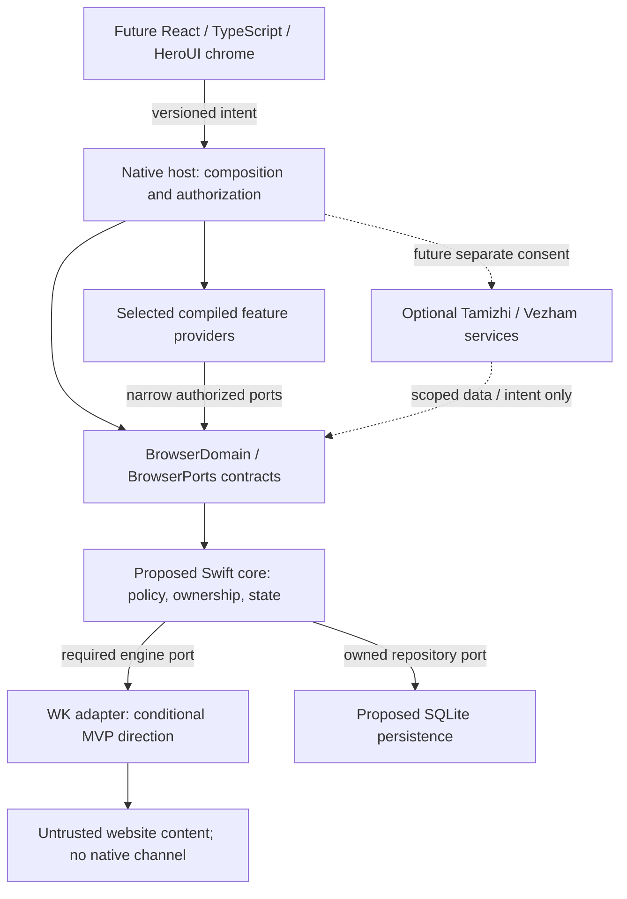

# Browser Capability Boundaries and Lifecycle

**Date:** 2026-11-07. **Status:** Proposed M1 architecture refinement; design only, no implementation or new feature authorization.

## Direction and terminology

This refines the [M1 module architecture](browser-core-architecture.md) and [contracts](core-boundary-contracts.md) under [Proposed ADR0005](../../../../decisions/0005-browser-capability-boundaries-and-lifecycle.md). Swift6 core and SQLite remain recommendations in Proposed ADR0003/0004; WKWebView remains conditionally accepted. No new package, provider, runtime, permission, plugin manager or event framework is implemented.

Keep four concepts separate:

| Concept                         | Meaning                                                                                   | Never implies                                                              |
| ------------------------------- | ----------------------------------------------------------------------------------------- | -------------------------------------------------------------------------- |
| Feature contract                | Versioned semantics of a specific browser operation and its result/events                 | A general tool/RPC invocation API                                          |
| Provider registration/readiness | A compiled implementation was bound by the host and initialized for its declared lifetime | Permission to read a page, access a file/device or operate another profile |
| Engine support                  | Runtime-supported/partial/unsupported facts and limitations                               | Provider readiness, a native grant, or a complete browser feature pass     |
| Operation authorization         | Native/core decision for this caller, scope, origin, target, purpose and lifetime         | A permanent grant because the feature is installed or ready                |

Here a capability means a bounded browser feature/service interface. It is not an AI tool, a runtime-installed plugin or an ambient native privilege. A small stable core has few reasons to change when an implementation changes; it still owns product invariants and the state of enabled features.

## Capability classes and non-optional safety

| Class                                    | Responsibilities / examples                                                                                                                                              | Composition, failure and authority                                                                                                                                                             |
| ---------------------------------------- | ------------------------------------------------------------------------------------------------------------------------------------------------------------------------ | ---------------------------------------------------------------------------------------------------------------------------------------------------------------------------------------------- |
| Core responsibilities and required ports | Browser/app/window/tab/navigation ownership, immutable profile/private scope, default-deny authorization, lifecycle coordination, durable-state policy and typed routing | Ordinary modules. Not unloadable policy plugins. Concrete engine/store backends are replaceable through typed required ports, not optional owners of data                                      |
| Built-in optional providers              | Find-in-page execution, download service/UX, supported permission-prompt/grant workflow, future search provider                                                          | Selected first-party compiled bindings. Absence/failure affects the declared feature, not policy enforcement. Required MVP features still block their acceptance/release gate when unavailable |
| Future trusted extensions                | Separately reviewed app-bundled feature implementations                                                                                                                  | Design category only. A future approved build may add a typed binding; no discovery/install API, arbitrary dynamic library/script or runtime code loading now                                  |
| Future AI-assisted providers             | Tamizhi through separately consented minimal page-content operations                                                                                                     | Disabled/out of production scope. No model/native bridge, credential access, broad tools, implicit profile visibility or mandatory service dependency                                          |

Permission **enforcement** always remains core/native. An unavailable grant UI/provider results in deny/cancel through the mandatory engine/native policy route; it must not fall back to an engine default prompt or allow. Download execution may be independently unavailable, but authorization, owned metadata transitions, cancellation and cleanup cannot be bypassed. Neither history/bookmark state nor private lifecycle moves into an optional provider.

Architectural replaceability is independent of product requirements: a missing required find/download/permission workflow is an unmet product gate even if basic navigation can continue. Do not silently reclassify it Out of Scope. A failed required engine/store port yields an explicit blocked/degraded operation and preserves known state; it does not qualify as a working browser or trigger a CEF/cloud fallback.

## Resulting dependencies and ownership

The conceptual Browser Core API maps to existing BrowserDomain/BrowserPorts values and the separate planned chrome protocol; it is not a new runtime or duplicate policy facade. BrowserCore depends on those contracts, never on React/HeroUI, Tamizhi, a concrete engine or a concrete optional module. The native host composes required port implementations and the selected feature services. Feature modules consume narrow domain/port interfaces and request authorized state changes; they cannot mutate core registries or open the database directly.

Arrows are proposed call/ownership paths, not process boundaries. Concrete engine/platform types stay adapter-private. A find/search/transfer provider uses portable ports; it must not downcast to WK objects or read cookies/paths by convenience. Engine replacement should leave unrelated providers unchanged where their port semantics are satisfied. Different capabilities, codecs, permission coverage or behavior still need explicit adaptation/requalification; no universal drop-in parity is promised.

## Typed registration without a plugin framework

Use explicit native constructors/bindings at the composition root and a small immutable inventory for diagnostics/availability. No public `register(anything)`, string-to-function resolver, service locator, config expression evaluator, auto-discovery or module loader. Ordinary features need not inherit a universal plugin base class. The following is metadata/design vocabulary, not a schema/code file created now:

| Registration metadata                     | Required rule                                                                                                                     |
| ----------------------------------------- | --------------------------------------------------------------------------------------------------------------------------------- |
| Fixed feature kind and contract version   | Known typed family; exact compatible version; unknown kind/version rejected                                                       |
| Provider identity and instance generation | Unique in the declared owner scope; reject duplicates instead of priority-based shadowing; new identity/generation on replacement |
| Lifetime                                  | App, persistent-profile, private-session or view; immutable scope and parent/child ownership, never inherited grants              |
| Required typed ports                      | Host supplies narrow constructor dependencies; validate the small explicit dependency plan for missing services/cycles            |
| Declared data/effects                     | Review inventory only, never authorization; no ambient whole-core/store/Keychain/context object                                   |
| Availability and cleanup owner            | Ready only after initialization completes; one accountable native owner tracks resources/failure                                  |

The native composition owner records the concrete provider lifecycle. Core validates those facts and alone updates browser-visible feature availability/state; providers cannot publish readiness straight to chrome or write core state. The immutable binding inventory and the core state projection are distinct ownership domains.

Registering a declaration exposes neither website commands nor data. Core/native authorization decides every actual operation. Initializers receive only their permitted port inputs; callbacks cannot add authority or intercept core policy. Fixed build-time replacement is the initial approach; no hot swap/HMR or on-the-fly provider installation. Future replacement requires quiescence, compatible contracts, new generations and revalidation, not preservation of old grants.

## Lifecycle convention and owned effects

| State / transition                  | Required behavior                                                                                                                                                        |
| ----------------------------------- | ------------------------------------------------------------------------------------------------------------------------------------------------------------------------ |
| Declared → validated → initializing | Validate known binding, version and dependencies. Track provisional subscriptions/resources before acquisition; publish no ready status early                            |
| Initializing → ready                | Publish the active instance/availability only after required setup succeeds; an async completion must still match owner/generation                                       |
| Initialization failure              | Reject dependent requests, undo every provisional registration/resource, report typed unavailable/failed. Optional dependent features stop; unrelated core work proceeds |
| Ready → quiescing                   | Atomically fence ingress, retire generation and revoke operation grants before awaiting cleanup; queued old work cannot acquire new authority                            |
| Quiescing → disposed                | Cancel tasks/prompts, stop subscriptions/timers/watchers, drain or reconcile already committed effects, release native scopes/resources, then release dependencies       |
| Cleanup failure/deadline            | Return cleanup-required/unavailable, retain safety fences and truthful owned-resource state; do not mark disposed/deleted/saved merely to meet a timeout                 |

Disposal is idempotent for the exact instance, including repeated stop and late callbacks. Ownership determines teardown, not global event order. Stop dependents before dependencies; serialize async cleanup where order matters. Independent resource release can be concurrent only when it has no safety-order dependency. The [DSH lifecycle tutorial](https://github.com/deepseek-ai/deepseek-harness/blob/fcc0ad462172522aaf5c93a7b2e01f6b9f0b0159/docs/cordis-tutorial/02-lifecycle-and-effects.md) illustrates effect ownership but notes concurrent async disposal; Vezham must explicitly preserve dependent ordering rather than assume reverse registration guarantees it.

The host keeps core authorization and required finalization/storage services available while dependents reconcile shutdown. Quiescing rejects new user work but permits narrowly scoped cancellation/finalization, not new browsing/data reads. No unbounded wait, automatic restart loop or silent private-session keepalive. Native OS shutdown limits and non-cooperative code remain real constraints.

Event subscriptions, tasks, timers, native request callbacks, security scopes and temporary artifacts all need an owner and disposer. Stopping a provider never reverses an already committed database write, completed user-approved download or prior network disclosure. Reconcile through core receipts/metadata and existing native broker rules. Private failures/cleanup must not persist browsing payloads or private identifiers in logs/status journals; actual staging/engine cleanup remains later M5 work.

## Typed operations and event subscriptions

Each feature gets its own explicit interface, for example find start/advance/cancel accepting validated query/options and a current owned view context, with found/unsupported/cancelled/unavailable results. No `execute(name, arbitraryPayload)` method. Downloads, permission grants and page extraction retain their separate constrained contracts; a common lifecycle convention does not merge their authority.

New provider status/event envelopes refine the existing M1 draft:

| Field / behavior | Recommendation                                                                                                                    |
| ---------------- | --------------------------------------------------------------------------------------------------------------------------------- |
| Identity         | Contract version, native provider instance/generation, AppRun, current immutable scope/target, request correlation where relevant |
| Ordering         | Per-instance sequence and explicit core snapshot revision; no global ordering claim across providers                              |
| Event type       | Closed discriminated availability/result family; payload bounded and schema-validated; unknown input fails closed                 |
| Delivery         | Owned subscription, bounded queue, cancellation, stale-generation rejection and explicit resnapshot on gaps                       |
| Data             | Minimum authorized projection; no raw native objects, credentials, cookie values, private recovery data or file paths             |

Facts/events are read-only notifications, not authorization middleware. A listener cannot veto or rewrite native/core decisions, change another provider's policy or acquire a grant by subscribing. Do not copy DSH waterfall/global-listener semantics into Browser security. Commands requiring authority return through the existing validated host/core route.

Check scope/authorization both at subscription and delivery, including already queued payloads after revocation. No wildcard all-profile/page-text feed. Dispose subscriptions on owner close; coalesce only advisory progress. A slow/failing optional consumer must not block the core actor, navigation completion or revocation; isolate bounded delivery work, mark unavailable/drop advisory work and require a fresh snapshot as specified. Terminal/cleanup outcomes remain truthfully represented by core state.

Events are transient by default. Core repositories alone persist selected approved browser facts under existing transactions/private exclusions; no append-every-event log, event-sourcing migration, new telemetry stream or plugin-owned history store is proposed.

## Security and failure isolation

Every capability operation reuses the host-issued authority context, profile/private/view ownership, epochs/generation, origin, request lifetime, consent and OS denial precedence. Provider metadata cannot forge those values. Feature policy must not grant the exact native authority it is requesting. Private state remains memory-only; any optional durable feature data uses an approved core-owned repository operation, never a provider-created DB/file namespace or sync client.

Tamizhi, if separately authorized later, receives only an explicitly selected, minimized content result under a purpose/source/profile/view/destination/expiry-bound grant. Revoke on navigation, session disposal, user cancellation or scope change. Model text is untrusted; it cannot supply native grants, arbitrary scripts, SQL or tool calls. No background extraction, unrelated-tab feed, private export by default, auto-cloud fallback or service dependency is introduced. Stopping access prevents future operations; it cannot recall information already transmitted.

Recoverable provider failures return typed errors/unavailability and have bounded cancellation/cleanup. Trusted Swift modules still share a process: fatal traps, memory corruption, main-thread blocking, deadlocks or resource exhaustion may affect the app. Interfaces and timeouts are **not** crash containment or a malicious-code sandbox; Swift cancellation is cooperative. Untrusted/non-cooperative third-party code would require a separately reviewed isolation/process design, not a relaxed registry. No such code or process runtime is introduced here.

## Compatibility, evidence and next gate

No M1 package/core/DB/provider implementation exists to migrate. Preserve the four-target proposal, schema/receipt/private invariants and ADR0003/0004 recommendations. The contract draft advances to0.2 for proposed provider lifecycle/availability semantics; planned wire v1 remains unreleased/unapproved and must receive paired binding/negative-case review before M3. Do not promise compatibility with an implementation that has not shipped.

[M1 plan](m1-implementation-plan.md) adds finite future fake-provider checks; [risk register](m1-decisions-and-risks.md) records composition, failure-isolation and release-feature decisions. All implementation/security/performance behaviors remain Not Tested. Approve the detailed ADR0005 mechanism/feature requirement matrix before relying on it and authorize implementation separately. No M2+, dependency, dynamic plugin system, AI agent loop, production Tamizhi, Aura, CEF implementation or release work follows from this design.
