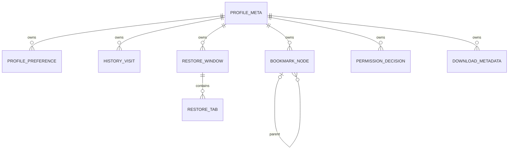

# Initial Browser Core Data Model

**Date:** 2026-11-07. **Status:** Proposed design only; no schema, migration, service or bridge implemented.

## Scope and versioning

This is a logical relational proposal, not executable DDL or a database file. Schema version 1 starts with catalog/profile metadata and an allowlisted preference repository in a later fixture-only implementation. History/bookmark, restore, permission and download tables below describe future ownership; add each only in its separately authorized feature slice. Do not create all tables because this document names them. [Persistence ADR](../../../../decisions/0004-browser-local-persistence.md) remains Proposed.

Runtime identity is different from durable entity identity. Opaque native-issued IDs identify objects but never authorize access. Use UUID-based durable entities, validated scalar/enum values, UTC timestamps for durable chronology, and nonnegative bounded revisions. Lease expiry uses an injected monotonic clock in the running process; persisted wall-clock expiry cannot make an old native capability valid after restart. The UI encodes potentially large sequence/revision/byte counts as bounded decimal strings, avoiding JavaScript integer precision loss.

## Runtime-only model

| Value                  | Key and relationships                                                                    | Lifetime / persistence                                                                   |
| ---------------------- | ---------------------------------------------------------------------------------------- | ---------------------------------------------------------------------------------------- |
| AppRun                 | New run epoch, core revision and pending effect registry                                 | Memory only; never resurrect an old authority context                                    |
| PersistentProfileLease | Persistent ProfileId + lease generation, active-owner set                                | Memory; durable profile identity exists separately                                       |
| PrivateSession         | New PrivateSessionId, private owner set, optional descriptive parent                     | Memory only; no catalog/profile DB row                                                   |
| Window                 | WindowId, immutable DataScope, selected TabId, ordered tabs                              | Runtime identity; opt-in persistent restore uses separate descriptors                    |
| Tab                    | TabId, owning window/scope, current view generation, navigation state                    | Memory; move only between compatible owned windows                                       |
| Navigation             | NavigationId, view generation, sequence, provisional/committed state, commit eligibility | Memory; no form bodies, credentials, engine navigation objects or pending network replay |
| ServiceRequest         | RequestId/effectId, owner, origin metadata, cancellation/revocation epoch, deadline      | Memory; scoped grants/tokens are never restore records                                   |

`DataScope` is a tagged persistent-profile lease or private-session lease, not a freely settable `isPrivate` boolean attached to a normal database. Private state cannot satisfy a persistent repository capability.

## Application catalog proposal

| Entity                    | Fields / constraints                                                                                            | Access / sequencing                                                                                                            |
| ------------------------- | --------------------------------------------------------------------------------------------------------------- | ------------------------------------------------------------------------------------------------------------------------------ |
| catalog_meta              | Single row: schema version, minimum reader/writer, catalog revision                                             | Storage-only, verified before opening profiles                                                                                 |
| profile_catalog           | ProfileId PK, bounded display name, opaque storage key, lifecycle state, privacy epoch, revision, creation time | Persistent profiles only. Storage key is host-generated, not a UI path. Lifecycle: creating, ready, deleting, cleanup-required |
| app_preferences           | Key PK, typed value, revision                                                                                   | Explicit allowlist: no arbitrary blobs, URLs, private window state or credentials                                              |
| profile_lifecycle_intents | IntentId PK, ProfileId, create/delete/clear kind, bounded phase, privacy epoch, coarse error code               | Native reconciliation metadata only. No browsing URLs/titles/transfer destinations                                             |
| engine_bindings           | ProfileId + adapter key, opaque native binding reference, lifecycle state                                       | Future adapter/native-owned extension, not a WK object or public core engine-store ID. Private bindings never enter this table |

Catalog-to-profile/engine relationships span stores and require the [lifecycle reconciliation protocol](migration-and-recovery-strategy.md), not SQL foreign keys pretending to cross files. A deleted identity is never silently reused.

## Persistent profile database proposal

All feature rows include ProfileId and refer to the store's single verified `profile_meta` row. Header identity must match the native lease before any repository operation. Composite keys/foreign keys include ProfileId wherever entities refer to one another, even though there is one profile per DB. Index every frequent ownership/order/time query and all applicable foreign-key child columns.

| Entity               | Keys / relationships / initial fields                                                                                                                | Important invariants and planned slice                                                                                                                                             |
| -------------------- | ---------------------------------------------------------------------------------------------------------------------------------------------------- | ---------------------------------------------------------------------------------------------------------------------------------------------------------------------------------- |
| profile_meta         | Single profile row: ProfileId, schema/minimum reader-writer, revision, privacy epoch, created time                                                   | First bootstrap. No mode allowing private rows                                                                                                                                     |
| schema_migrations    | Version PK, immutable migration checksum, completion timestamp                                                                                       | Storage-only; advances with the schema transaction; no URL data                                                                                                                    |
| profile_preferences  | (ProfileId, allowlisted key) PK, typed value, revision                                                                                               | Initial repository slice; private overrides use memory only                                                                                                                        |
| operation_receipts   | (ProfileId, native MutationId) PK, expected/committed revision, mutation kind, bounded payload digest/result code                                    | Storage retry reconciliation, no raw payload/URL or private receipts; proposed cap 4096 / 24h. No exactly-once claim after retention                                               |
| bookmark_nodes       | (ProfileId, NodeId) PK, parent node FK, folder/url kind, bounded title, credential-free URL for url kind, integer position, timestamps, revision     | Later history/bookmark slice. One explicit root, no cycles, folder-only parents, no cross-profile references; reorder in one transaction                                           |
| history_visits       | (ProfileId, VisitId) PK, unique (ProfileId, CommitId), eligible committed URL/title, visit time, transition                                          | Core generates CommitId after validated main-frame commit; never progress/provisional URL hints. Runtime view/engine pointers are not stored                                       |
| restore_windows      | (ProfileId, RestoreWindowId) PK, ordinal, bounded geometry descriptor, selected restore-tab ID                                                       | Later explicit restore slice, only if owner approves opt-in persistence                                                                                                            |
| restore_tabs         | (ProfileId, RestoreTabId) PK, parent restore-window FK, order, safe committed URL/title, restore-policy version                                      | No private data, capabilities, credentials, POST/form data, renderer memory, pending prompts or native IDs                                                                         |
| permission_decisions | Key: ProfileId + canonical requesting origin + top-level origin + kind; decision, expiry, revision                                                   | Future M5. Persisted allow requires supported kind and adequate trusted origin metadata. Unknown/opaque origin cannot become wildcard allow; one-time/private grants remain memory |
| downloads_metadata   | (ProfileId, DownloadId) PK, source origin, bounded suggested name, byte counts, state, timestamps, coarse error, optional opaque native resource ref | Future M5. No raw destination path, security-scoped bookmark blob, auth header or cookie. Broker completion proof required before completed                                        |

Recommended indexes: history `(ProfileId, visitedAt, VisitId)` and CommitId uniqueness; bookmark parent/order; restore parent/order; permission full decision key/expiry; downloads state/update time. No FTS, page-body index, favicon cache, sync outbox, spaces table or permissive JSON dumping ground is proposed initially. SQLite runtime feature availability must be checked before using optional SQL syntax.

The diagram includes planned feature entities; it is not evidence of their implementation. The private session and engine website store are intentionally absent from this durable entity graph.

## Write rules and privacy policy proposals

Within one profile transaction, enforce NOT NULL/range/enum constraints, profile foreign keys, expected store revision, uniqueness and bounds. Repository validation also rejects bookmark cycles/non-folder parents, stale ownership, forbidden private scope and unsupported types. SQLite's [foreign-key documentation](https://sqlite.org/foreignkeys.html) informs constraint design; enable and verify it per connection rather than assuming defaults.

A matching top-level commit creates at most one history visit per CommitId. Allocate and retain that CommitId once for the verified AppRun/view/generation/navigation commit identity; reuse it for duplicate callbacks rather than minting a new ID each time. Title updates require current commit identity. Provisional/failed-before-commit navigation does not produce history. Recovery/restore commits need an explicit cause policy; recommend suppressing automatic restore/recovery entries until the owner approves different semantics. Redirects do not create unrelated provisional visits. Same-document changes await explicit M2 mapping.

Recommended, unapproved defaults: 30-day history/download metadata retention; bookmarks/preferences until deletion; restore opt-in/off; no persistent grants by default. Proposed history/restore URLs may contain sensitive query values; credential-bearing URLs and known transient authentication flows are excluded, and no generic sanitizer can guarantee removal of all secrets. Approval of retained URL/query/title scope and encryption is required before real data. Tests use synthetic values until then.

Deleting history must also remove dependent suggestions/indexes and invalidate older app-owned backups; profile deletion spans catalog, browser DB, engine store and future broker resources. Deleting a bookmark does not silently delete a completed user file. No engine cookies, passwords or account secrets belong in these tables. [Recovery strategy](migration-and-recovery-strategy.md) specifies crash and privacy-clear reconciliation.
