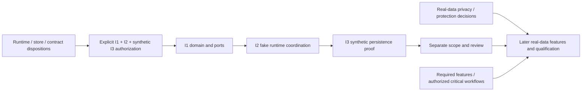

# M1 Owner Decision Packet

**Prepared:** 2026-11-08 (Asia/Kolkata; work started 2026-11-07). **Status:** Ready for owner review; decisions pending. **M1 implementation:** Not Started. **Execution authorization:** Not Granted.

This packet completes decision preparation, not owner approval. The task title does not close the outstanding choices. Proposed defaults below are recommendations; no real data, database, source target, build/test, bridge or feature is created. Existing ADR lifecycle labels remain unchanged.

## Read and decide

1. Review the single [decision matrix](#consolidated-decision-matrix), including dependencies and consequences of deferral.
2. Review the [launch feature matrix](m1-launch-feature-matrix.md). First implementation slice and first MVP are different scopes; later M2-M8 implementation can still supply required MVP features.
3. Review the [finite implementation authorization proposal](m1-implementation-authorization-proposal.md). Its existence grants no execution authority.
4. Record row-specific owner dispositions and any explicit execution instruction using the [recording rules](#owner-disposition-recording-rules).

`OD01-OD20` are this packet's owner-decision IDs. `M1:D01-D09` refers to the [M1 decision register](m1-decisions-and-risks.md); `Ledger:D01-D22` refers to the separate [historical acceptance ledger](../../../phase-3/browser-acceptance-gate-ledger.md). Their IDs must not be conflated.

## Settled authority and non-negotiable controls

Already settled: bounded Phase3 closure and architecture approval; WKWebView conditional acceptance for planning/implementation; macOS26.0+; Swift/AppKit host; future React/TypeScript/HeroUI v3 chrome; engine-independent core; internal-only distribution and local browsing independent of optional services. [Owner authority](../../../phase-3/owner-approval-decision.md), [approved boundaries](../../../phase-3/browser-mvp-architecture-baseline.md), [ADR0001](../../../../decisions/0001-browser-engine-strategy.md), [accepted ADR0002](../../../../decisions/0002-browser-distribution-and-platform.md).

Core/native authorization, immutable profile/private ownership, zero private/cross-profile leakage, no privileged website bridge, no secrets in frontend storage/logs, private nonpersistence and no unauthorized native actions are required controls, not owner options to waive. Registration/readiness cannot grant authority. Permission enforcement remains mandatory if permission UX is unavailable. Native/engine credentials and website data remain separate from core-owned product state.

No Aura, CEF implementation, dynamic third-party plugin installation/loading, agent loop/tool registry, production Tamizhi or public distribution. Identity/cloud remain optional and currently unimplemented. macOS26.0/latest supported26.x, DeveloperID/notarization, Gatekeeper/sandbox/Hardened Runtime/entitlements, release compatibility/performance and updater gates remain mandatory at final validation. No early release-signing requirement blocks unrelated synthetic core work.

ADR0001 remains Proposed, ADR0002 Accepted, ADR0003/0004/0005 Proposed. Those labels are not changed by this packet or by a source-control commit. Settled engine/closure/baseline decisions are not requested again.

## Consolidated decision matrix

Areas: **A** architecture/runtime; **B** persistence; **C** data/privacy lifecycle; **D** capabilities/launch scope; **E** execution. Existing proposals are in [ADR0003](../../../../decisions/0003-browser-core-runtime-and-language.md), [ADR0004](../../../../decisions/0004-browser-local-persistence.md), [ADR0005](../../../../decisions/0005-browser-capability-boundaries-and-lifecycle.md), [core architecture](browser-core-architecture.md), [persistence](local-persistence-architecture.md), [data model](browser-core-data-model.md), [migration/recovery](migration-and-recovery-strategy.md) and [contracts](core-boundary-contracts.md).

| Decision ID / area | Current status                                                    | Existing proposal                                                                              | Recommended option                                                                                                                                                                           | Alternatives and trade-offs                                                                                                                                | Security/privacy implications                                                                                                      | Dependencies                                                                    | Reversibility                                                                                 | Explicit owner approval required                                                                                                | Consequence of deferral                                                                |
| ------------------ | ----------------------------------------------------------------- | ---------------------------------------------------------------------------------------------- | -------------------------------------------------------------------------------------------------------------------------------------------------------------------------------------------- | ---------------------------------------------------------------------------------------------------------------------------------------------------------- | ---------------------------------------------------------------------------------------------------------------------------------- | ------------------------------------------------------------------------------- | --------------------------------------------------------------------------------------------- | ------------------------------------------------------------------------------------------------------------------------------- | -------------------------------------------------------------------------------------- |
| OD01 · A           | Proposed; M1:D01 / ADR0003                                        | Swift6 trusted core                                                                            | Swift6 values/actors; no added authority runtime                                                                                                                                             | JSCore/Node adds bindings/runtime; Rust/C++ adds FFI/toolchain                                                                                             | No policy authority in React or websites                                                                                           | Before I1; approved native boundaries apply                                     | Low cost before code; runtime replacement later needs requalification                         | Yes: runtime direction; no automatic ADR status transition                                                                      | Core implementation waits; documentation can continue                                  |
| OD02 · A           | Proposed; ADR0003 / R11/R15                                       | Host/core share native process                                                                 | One trusted process initially; explicit recoverable-failure boundaries                                                                                                                       | Separate process improves some containment but adds IPC/lifecycle cost                                                                                     | No fatal-trap, blocking or malicious-code sandbox guarantee                                                                        | OD01; before I2; untrusted extensions excluded                                  | Process split later requires contract/packaging review                                        | Yes: initial placement/residual-risk disposition                                                                                | Runtime composition waits; no covert new process/runtime                               |
| OD03 · A           | Proposed package detail; responsibilities already approved        | Domain/Ports/Core/Persistence in BrowserCoreKit                                                | Keep four targets and inward dependencies; Core API is logical values/ports                                                                                                                  | Fewer targets reduce files but blur boundaries; extra facade/plugin packages unnecessary                                                                   | No AppKit/WebKit/SQL/Keychain in Domain/Core; native authority retained                                                            | OD01; OD04 for Persistence implementation                                       | Layout is cheap now; public interface changes later require compatibility review              | Yes: concrete layout only; do not reapprove core ownership                                                                      | No package scaffold until scope is selected                                            |
| OD04 · B           | Proposed; M1:D02 / ADR0004                                        | SQLite repository adapter                                                                      | Public SDK SQLite behind typed repositories; no ORM/cloud dependency                                                                                                                         | CoreData/SwiftData remain viable; custom SQL needs disciplined maintenance                                                                                 | Prepared/bound queries, verified ownership and explicit errors                                                                     | OD01/OD03; before synthetic I3                                                  | No data migration now; changing populated stores later needs export/migration                 | Yes: store direction before I3                                                                                                  | I1/I2 can proceed if separately authorized; I3 waits                                   |
| OD05 · B           | Proposed; M1:D02                                                  | Small catalog + per-persistent-profile DB                                                      | Retain separate stores, checked identity headers and typed leases                                                                                                                            | Single DB simplifies coordination but increases namespace-filter reliance                                                                                  | Not separate OS accounts; cross-resource work needs reconciliation                                                                 | OD04; before synthetic I3 topology                                              | Low cost for fixtures; future populated-store conversion needs migration                      | Yes: topology/ownership before I3                                                                                               | No catalog/profile storage proof; unrelated domain work need not wait                  |
| OD06 · B           | Proposed representation; private nonpersistence already mandatory | Swift memory-only private core state; no store lease                                           | Keep private data in values; reject before file/receipt/migration access                                                                                                                     | In-memory SQLite adds configuration/temporary-file review; persistent private flag forbidden                                                               | No catalog/private DB/backup/restore/log/sync write; actual engine isolation still M5                                              | OD03; before I1 private-scope model and I3 refusal proof                        | Memory model replaceable; privacy exclusions cannot be weakened                               | Yes: representation; no new approval needed for privacy invariant                                                               | Hold affected model/store proof; never persist private data as fallback                |
| OD07 · B           | Open real-data policy; M1:D03                                     | Fixture-only first slice; protection before real data                                          | Approve only synthetic scope now. Before real data choose evidenced managed-device/FileVault/file protection, or require an evaluated encrypted provider                                     | DB encryption adds key/backup/search/migration costs; device protection has residual unlocked-host risks                                                   | Required key unavailable means inaccessible, not plaintext fallback or replacement/reset                                           | Before any real catalog/profile/browsing/backup data; not initial fixtures      | Later encryption migration cannot undo earlier exposure                                       | Yes with security reviewer before real data; not needed to use synthetic values                                                 | Real-data use remains blocked; fixture/domain work can continue                        |
| OD08 · C           | Proposed; M1:D04                                                  | History30 days; bookmarks/preferences until delete; restore/recovery history-cause policy open | History30-day maximum; bookmarks/preferences until explicit delete; propose suppressing automatic restore/recovery duplicates under reviewed cause policy                                    | Shorter/no history minimizes traces; longer retains more activity; record all restore loads versus suppress automatic duplicates changes history semantics | Private history always excluded; deletion must affect derived state/copies                                                         | OD07/OD10/OD13; before real history                                             | Future retention can change; deleted data cannot be recreated                                 | Yes: retention and restore/recovery cause policy before real history; no private-history waiver                                 | Real history stays disabled; required MVP history gate remains unmet                   |
| OD09 · C           | Proposed; M1:D04                                                  | Download metadata retention 30 days                                                            | 30-day metadata maximum; user-selected completed files have separate lifetime                                                                                                                | Session-only metadata reduces traces; longer records aid support but retain sensitive names/origins                                                        | No raw destination path/auth data; private metadata not persisted                                                                  | OD07/OD13 and actual M5 broker before use                                       | Policy change affects future retention; file deletion is a different user action              | Yes before real metadata persistence                                                                                            | No real metadata write; complete download feature cannot claim acceptance              |
| OD10 · C           | Open data inventory; M1:D04                                       | Committed credential-free URLs/titles; queries may be sensitive                                | For later history/bookmark/restore, retain only purpose-needed committed HTTP(S) URLs and bounded titles; include query/fragment only under explicit inventory approval for revisit fidelity | Strip query/fragment or retain origin/path only for minimization, with disclosed revisit loss; no claim of perfect secret filtering                        | Reject userinfo; exclude known transient auth flows; query/title data may still contain secrets; never log them                    | OD07/OD08; restore also OD12; before any real URL/query/title persistence       | Data already exposed cannot be recalled; future schema/policy can narrow                      | Yes: exact fields, query/fragment treatment and retention before real data                                                      | Persist no real URL/query/title; transient authorized navigation/display is separate   |
| OD11 · C           | Proposed; M1:D04                                                  | One pre-migration snapshot, at most24h                                                         | At most one protected app-owned pre-migration snapshot; expire within24h or earlier clear/delete; no private backup                                                                          | No backup reduces copies but increases upgrade recovery risk; longer TTL increases resurrection/exposure risk                                              | Backup protection matches source; schema/profile/privacy epoch verified; no automatic upload                                       | OD07/OD13/OD14; before real backups                                             | TTL can shrink; external/OS copies and SSD erasure are not guaranteed                         | Yes: backup scope/TTL/protection before real snapshots                                                                          | No real backup service; risky real-data migration cannot proceed without a safe plan   |
| OD12 · C           | Proposed UX/default; M1:D04/D05; Ledger:D14 remains required      | Restore opt-in/off by default; explicit recovery                                               | Provide required safe durable recovery; descriptor capture opt-in, automatic reopening off; ask before restoring validated persistent views                                                  | Automatic full-session reopening is convenience with more privacy/network effects; no restore feature would leave D14 unmet                                | Fresh IDs/epochs; no private state, forms/POST, grants, pending requests or old authorization replay                               | OD07/OD10/OD13/OD14 and later I5/M2/M5/M6 evidence                              | Change default prospectively; cannot undo prior snapshot/disclosure                           | Yes: exact UX/snapshot scope; no waiver of D14 or no-replay rules                                                               | Initial slice can proceed; durable recovery cannot qualify for MVP                     |
| OD13 · C           | Proposed mechanism; deletion/no-resurrection mandatory            | Privacy epochs + clear/delete intents + snapshot invalidation                                  | Retain checked epochs and explicit partial cleanup across stores/resources                                                                                                                   | Other reviewed mechanisms may meet same invariant; blind backup restore/reset is forbidden                                                                 | Do not acknowledge deletion while owned copies can resurrect data; no secure-erasure claim                                         | OD05/OD11; before actual clear/delete/backup recovery; not fixture header alone | Mechanism may migrate later; privacy deletion cannot be undone by rollback                    | Yes: mechanism before real feature; invariant itself is settled                                                                 | Real clear/restore/delete remains blocked or incomplete; never report success          |
| OD14 · C           | Proposed; M1:D02/D07                                              | Checksummed migrations, minimum writer, short transactions; receipt proposal4096 entries/24h   | Keep version/header checks, off-main I/O, bounded receipts and WAL/FULL proposal; injectable fixture bounds now, review production limits before use                                         | Framework migration remains a store alternative; weaker durability is not a benchmark shortcut                                                             | No automatic destructive reset/downgrade; no DB transaction pretending to include engine/Keychain/files                            | OD04/OD05; fixture subset before I3; actual platform qualification later        | Synthetic versions disposable; real schema/durability changes require migration/qualification | Yes: mechanism direction for I3; production tuning is not prequalified                                                          | I3 cannot claim transaction/migration proof; real migrations stay blocked              |
| OD15 · D           | Proposed; M1:D09 / ADR0005                                        | Static native bindings and owned capability lifecycle                                          | Compiled known bindings; readiness after setup; rollback/fence/revoke/order cleanup; no plugin framework                                                                                     | Ad-hoc lifetimes duplicate risk; dynamic container/install/HMR outside scope                                                                               | Registration gives no authority; incomplete disposal stays cleanup-required                                                        | OD02/OD03; before I2 fake-provider proof                                        | Convention can evolve before code; later changes need lifecycle revalidation                  | Yes: detailed mechanism, not reapproval of native authority                                                                     | Selected provider proof waits; no implicit dynamic loader                              |
| OD16 · D           | Proposed; M1:D07/D09; contract draft0.2                           | Typed ports/results/events, epochs and bounded scoped subscriptions                            | Use draft0.2 native values for the proof; per-feature APIs, validated readiness and read-only notifications                                                                                  | Generic command/event buses increase authority surface; concrete UI transport remains M3                                                                   | No global profile feed, policy-rewriting listener or privilege from subscription                                                   | OD03/OD15; before selected I1/I2 contracts                                      | No released ABI to migrate; future wire changes need paired compatibility review              | Yes: native proof contract direction; not release of wire v1 or bridge approval                                                 | Affected proof contracts wait; unrelated documented product obligations stay unchanged |
| OD17 · D           | Open minimum/subflow scope; existing obligations retained         | Required built-ins not yet consolidated into launch matrix                                     | Retain required local/security/recovery features; name critical workflows/permission kinds and grant lifetimes; recommend no persisted grants by default                                     | New optional convenience features may wait; modularity never removes required gates                                                                        | Required account/media workflows stay access-blocked until authorized; no landing-page substitution                                | Before affected M2/M5/M6 choices and MVP release; not synthetic first slice     | Scope can change only explicitly; never relabel missing evidence Passed                       | Yes: optional scope, minimum UX, critical set and supported grant/persistence policy; no repeat approval of settled constraints | First proof can proceed; capability/compatibility/MVP closure stays incomplete         |
| OD18 · D           | Not authorized; future trust design open                          | Future trusted extensions; M1:D06 spaces/workspaces; advanced search unscoped                  | Defer these additions outside first slice/MVP; require separate product/trust/storage review for each                                                                                        | Extensions may need process isolation; spaces/search require an approved data/UX model; no empty framework or placeholder                                  | No dynamic third-party loading or ambient native/profile access; new models need migration/privacy review                          | Separate future owner/security scope; none for initial proof                    | Cheap while absent; installed code would add update/migration obligations                     | Future approval only before changing extension scope; none to retain current exclusion                                          | No extension feature; core proof and local browsing do not depend on it                |
| OD19 · D           | No production scope; optional-service details open                | Future Tamizhi and optional Vezham services                                                    | Defer activation beyond required first-MVP core; keep zero service dependency                                                                                                                | Adding earlier needs separate data/trust/network/consent design and implementation scope                                                                   | Tamizhi source/profile/view/purpose/destination/expiry consent; no credentials/private/default export or unrestricted native tools | SG07 and separate future authorization; no dependency for current slice         | Absent feature reversible; already transmitted data cannot be recalled                        | Future explicit feature/access approval; packet grants none                                                                     | No production integration; local-first MVP remains required and independent            |
| OD20 · E           | Not Granted; M1:D08                                               | I1 + I2 + synthetic fixture-only I3                                                            | Authorize only the linked finite proposal, after entry decisions; exclude I4-I7/M2+ and M0 wiring                                                                                            | Domain-only I1/I2 may be separately authorized if store choice waits; broad M1 implementation exceeds this proposal                                        | Only fake services and controlled synthetic DB files; no real data, UI/engine/bridge/TCC/Keychain                                  | OD01-OD06, OD14-OD16 dispositions; explicit scoped execution instruction        | New isolated proof should be reviewable/reversible; no commit/push without authorization      | Yes: explicit execution authority naming exact slice/boundaries                                                                 | All implementation remains Not Started; preparation can be completed without approval  |

## Dependency and approval groups

- **Initial synthetic slice:** OD01-OD06 and OD14-OD16 need a sufficient approved disposition for I1/I2/I3; OD20 needs explicit execution authority. No production transport, whole feature ecosystem or real-data policy is approved by those choices. A narrower I1/I2 instruction can omit unresolved I3 choices explicitly.
- **Real-data features:** OD07-OD13, applicable OD14 validation and the safety gates below must be resolved before the affected collection/storage/backup/restore behavior. Deferring them is not approval of plaintext or unlimited retention. Bookmarks/preferences/profile labels are sensitive too, even when history is disabled.
- **MVP scope and access:** OD17 closes still-open classifications, exact supported permission/workflow scope and critical subflows. Existing required features and hard controls remain required; unknown account/media evidence is Blocked. This need not prevent synthetic core proof.
- **Future feature expansion:** OD18/OD19 retain exclusions and require separate future design/access authority. They cannot create a dependency on extensions, Tamizhi or identity/cloud.

The owner may approve choices and explicitly authorize the named slice in one later instruction. Do not request confirmation again when that instruction clearly supplies both. Approval of design alone, or this preparation request, grants no implementation authority.

## Security and privacy enablement gates

All listed implementation evidence is **Not Tested** for the new core. Owner policy selection never substitutes for technical validation. Validate affected controls with synthetic positive/negative cases before permitting real data; retain exact-revision provenance and named engineering/security review. [Mandatory security criteria](../../../../security/browser-security-acceptance-criteria.md) and [staged MVP requirements](../../../browser-mvp-acceptance-criteria.md) remain authoritative.

| Gate | Before enabling                                                            | Owner decisions and mandatory controls                                                                                                                                         | Required later evidence / boundary                                                                                                                                                                            |
| ---- | -------------------------------------------------------------------------- | ------------------------------------------------------------------------------------------------------------------------------------------------------------------------------ | ------------------------------------------------------------------------------------------------------------------------------------------------------------------------------------------------------------- |
| SG01 | Real browsing history                                                      | OD07/OD08/OD10/OD13; approved store/migration; only validated committed top-level records; private refusal and profile ownership                                               | Actual core/repository/adapter behavior and purge/delete/backup tests; provisional/duplicate/foreign/private records absent. Synthetic I3 preferences are not history authorization                           |
| SG02 | Persistent URLs, query strings or page titles, including bookmarks/restore | OD07/OD10 and feature retention/restore choices; purpose/field inventory, sensitive-flow exclusion, no credential-bearing URLs; no log/frontend-storage copy                   | Sensitive-data fixtures, authorized projection, storage/retention/deletion review. Transient authorized navigation/address display does not authorize durable storage or telemetry                            |
| SG03 | Real download metadata                                                     | OD07/OD09/OD13; origin/name/status inventory, no raw paths/auth material, private exclusion; actual M5 broker authorization and completion proof                               | Cross-profile/private/cancel/interruption/finalization and metadata cleanup cases; user-selected payload-file lifetime is separate from metadata TTL                                                          |
| SG04 | Real pre-migration backups                                                 | OD07/OD11/OD13/OD14; protected verified snapshot, profile/schema/privacy epoch, no private backup; invalidate older copies on clear/delete                                     | Consistent snapshot/restore, TTL and resurrection refusal, failure/rollback tests. Synthetic migration input copies are test artifacts, not a real backup service                                             |
| SG05 | Durable session restoration                                                | OD07/OD10/OD12/OD13/OD14; opt-in capture/default-off automatic reopen; explicit restore, fresh IDs/epochs, no private state/forms/POST/old grants/actions                      | Ledger:D14 host-crash/restart plus content-process recovery where applicable; unknown replay safety must stop/show error. Earlier 49/49 content-window checks do not satisfy this product gate                |
| SG06 | Private browsing with a real engine                                        | Existing approved nonpersistent/private rules plus reviewed M2/M5 scope; immutable owned engine store before view creation; last-owner cancellation/cleanup                    | Real profile A/B/private cookies, localStorage, IndexedDB, service-worker/cache, concurrent view, relaunch/deletion and app-owned artifact matrix. A Swift memory model or private DB refusal is insufficient |
| SG07 | Tamizhi page-content access                                                | Existing exclusion retained; future explicit feature/access instruction, source/profile/view/purpose/destination/expiry consent and minimization; no unrestricted native tools | Future egress/revocation/prompt-injection/native-boundary tests; exclude secrets/chrome/unrelated tabs/private data by default; model output cannot supply authority. No access granted now                   |
| SG08 | Internal MVP distribution                                                  | Complete applicable StageB controls/required features and authorized workflows, then StageC/macOS26/signing/notarization/OS protections/performance/update integrity           | Exact release candidate and separate release authority; synthetic proof and conditional engine direction are not release qualification                                                                        |

## Clarifications, contradictions and missing inputs

**Durable recovery versus automatic reopen:** Ledger:D14 requires durable recovery/session history across host crash/restart. M1's opt-in/default-off recommendation must not make that obligation optional. Recommended reconciliation is an available, explicitly opted-in safe durable restore path, with automatic reopening off. Exact snapshot/UX scope still needs OD12; D14 is unchanged and unpassed. Content-process recovery, host restart recovery and ordinary engine back/forward history need separate evidence.

**Modularity versus launch scope:** find, downloads and permission UX can be independent providers yet required product features. The feature matrix retains required gates; a missing provider yields unavailable/deny as appropriate, not Passed or implicit permission.

**Contract language/version:** old engine TypeScript declarations are illustrative; M1 native value-contract draft0.2 and the Swift runtime proposal do not install a TypeScript authority runtime or release wire v1. After runtime approval, reconcile concrete core/adapter bindings before dependent implementation; M1:R09 remains open. No ADR rewrite is necessary to prepare these choices.

**Required missing owner/engineering input:** actual OD dispositions; security reviewer and managed-device/encryption policy; exact allowed URL/query/title fields; retention/purge, restore/recovery history-cause policy and backup operational ownership; durable restore UX; supported permission kinds; launch-critical account/media/subflows and authorized environments; meaning/provider/privacy of optional browser search; later transport/budgets and extension trust model. No assignees, device compliance or approved accounts are invented. Public-pages-only restrictions persist.

M0 demonstrates its bounded native foundation only. Phase3's distinct49/49 actual-window and48/48 regression suites and historical performance stay frozen; no aggregate or new-core/performance pass is inferred. macOS26 runtime and signing/notarization remain final-stage gates. See [M0 report](../M0/README.md), [Phase3 review](../../../phase-3/phase-3-exit-review.md) and [historical ledger](../../../phase-3/browser-acceptance-gate-ledger.md).

## Owner disposition recording rules

Current record: **all new choices Pending/Proposed; no implementation authority granted; no ADR lifecycle transition.** This is a template for a future explicit owner response, not a completed approval record:

| Record field                                                        | Current value / required future input                                                                                         |
| ------------------------------------------------------------------- | ----------------------------------------------------------------------------------------------------------------------------- |
| Decision authority                                                  | Product Owner; actual explicit response required                                                                              |
| Decision date                                                       | Not supplied; record actual owner decision date when supplied                                                                 |
| OD row dispositions                                                 | Pending. Record each approved/revised/deferred choice, selected alternative and conditions; do not turn silence into approval |
| Feature matrix                                                      | Existing obligations retained; remaining recommendations/critical-set details pending OD17                                    |
| Execution instruction                                               | Not Granted. Must explicitly name I1/I2/synthetic I3 or a narrower scope and its boundaries                                   |
| Real data, engine, UI, bridge, accounts/media, services and release | Not authorized by the first-slice proposal or this packet                                                                     |
| ADR lifecycle actions                                               | None requested/performed; any formal transition requires explicit disposition. ADR0001 remains Proposed                       |

A later response may authorize the precise slice while leaving real-data policies open; that authorizes fixtures only. Revised choices must be reflected in the packet/ADRs before dependent implementation, without rewriting historical evidence. A refusal/defer stops only its dependent work unless a mandatory safety condition affects the whole slice.

## Review baseline, deliverables and verification

Started clean on `timeline` at `6f5f8400b16bbe78d0aecd430eddfdc8c7aedbab`, expected origin/upstream unchanged;645 tracked-file hashes captured. Created this packet, [feature matrix](m1-launch-feature-matrix.md) and [authorization proposal](m1-implementation-authorization-proposal.md); only [M1 decision/risk cross-references](m1-decisions-and-risks.md) are modified. All existing ADRs, M0, original M1/DSH reports, prototype source/evidence/archives and other maintained documents remain unchanged.

The [reviewed-source inventory](../../evidence/20261107T182225Z-m1-owner-packet/reviewed-source-files.json), [documentation verification](../../evidence/20261107T182225Z-m1-owner-packet/documentation-review.json), [preservation/change review](../../evidence/20261107T182225Z-m1-owner-packet/preservation-and-change-review.json) and [review manifest](../../evidence/20261107T182225Z-m1-owner-packet/review-file-manifest.json) record exact files/checks. No new ADR or dependency; no source implementation, DB, build, launch or product test. No commit/push/reset/stash/branch switch.

**Owner-review preparation complete; approvals still pending. Stop here. M1 implementation remains Not Started.**
