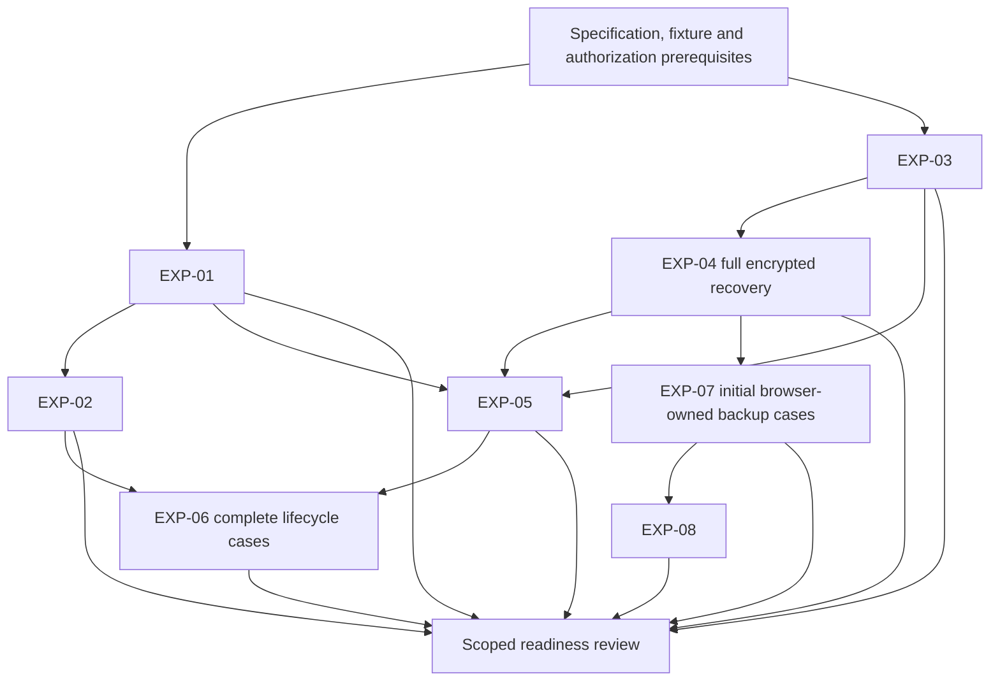

# M1 Validation Plan v1.0 — Proposed

## 1. Executive summary

This plan defines the validation needed to assess M1 implementation readiness against the current **M1 Developer Specification v1.0 — Proposed**, including **REQ-22 → SPEC-08 → AC08**.

All eight experiments remain **Proposed / Not Run**.

The recommended first wave is:

- **EXP-01:** WebKit persistent profile isolation.
- **EXP-03:** SQLite encryption, WAL and temporary-file protection.
- **EXP-04:** Keychain and independent offline recovery.
- **EXP-07:** Consistent encrypted backup and cross-Mac restore.

Locking, private cleanup, downloads and deletion reconciliation remain mandatory before relying on their corresponding behavior. First-wave success must not be represented as complete browser, security or recovery qualification.

The eight experiments address risk-specific feasibility. Supporting validation is also required for package boundaries, the chrome bridge, complete permission-kind coverage, offline product operation and durable host recovery. Final-release qualification remains a separate stage.

**The plan supplies proposed procedures—not results, execution permission or implementation authorization.**

## 2. Scope and authorization boundary

Repository reference:

`/Users/vigneshwaranbhoj/Downloads/repo-labs/vx-browser`

### Scope

The plan covers:

| Domain | Subject |
|---|---|
| A | Cryptography and persistent-profile protection |
| B | Profile lifecycle and locking |
| C | WebKit website-data protection |
| D | Private browsing |
| E | Permissions and origin security |
| F | Backup, restore, migration and deletion reconciliation |
| G | Downloads and filesystem lifecycle |
| H | Capability contracts and event lifecycle |

### Execution boundary

This task authorizes only read-only inspection and a response-only plan.

It does not authorize repository writes, scaffolding, implementation, builds, tests, benchmarks, experiments, dependency changes, Git mutations, distribution or deployment.

A future experimental task must explicitly authorize its disposable harness, environments, access, case inventory and cleanup boundaries. Such authorization must remain separate from production implementation authorization.

The existing I1–I3 proposal is not sufficient authorization for these experiments: it expressly excludes real Keychain, encryption-provider and native-engine work. [Existing proposal boundaries](/Users/vigneshwaranbhoj/Downloads/repo-labs/vx-browser/docs/architecture/phase-5/reports/M1/m1-implementation-authorization-proposal.md:56).

### Source and evidence qualification

Primary baseline: the supplied developer specification, including REQ-01–REQ-22, its owner register, historical crosswalk and F01–F17 reconciliation.

During this task, selected existing ADR headers, contracts and implementation-scope passages were read. No Git commands, file-count audit or hash-preservation audit was performed.

Prior claims concerning 665 unchanged files or historical repository state remain attributed to earlier reports.

### ADR status preservation

| ADR | Observed status | Plan treatment |
|---|---|---|
| [ADR-0001](/Users/vigneshwaranbhoj/Downloads/repo-labs/vx-browser/docs/decisions/0001-browser-engine-strategy.md:3) | Proposed; conditional owner decision recorded | WKWebView remains conditional; staged gates preserved |
| [ADR-0002](/Users/vigneshwaranbhoj/Downloads/repo-labs/vx-browser/docs/decisions/0002-browser-distribution-and-platform.md:3) | Accepted | Internal distribution/macOS baseline preserved |
| [ADR-0003](/Users/vigneshwaranbhoj/Downloads/repo-labs/vx-browser/docs/decisions/0003-browser-core-runtime-and-language.md:3) | Proposed | Runtime direction does not imply lifecycle acceptance or execution |
| [ADR-0004](/Users/vigneshwaranbhoj/Downloads/repo-labs/vx-browser/docs/decisions/0004-browser-local-persistence.md:3) | Proposed | Current encryption policy governs; provider qualification pending |
| [ADR-0005](/Users/vigneshwaranbhoj/Downloads/repo-labs/vx-browser/docs/decisions/0005-browser-capability-boundaries-and-lifecycle.md:3) | Proposed | Static composition/lifecycle mechanism requires evidence |

No ADR status was changed.

## 3. Experiment inventory

The titles below retain the existing experiment subjects and intent.

| Experiment | Title | Primary question |
|---|---|---|
| EXP-01 | WebKit persistent profile isolation | Do assigned persistent stores isolate the required website-data classes? |
| EXP-02 | Private website-data cleanup | Does private state remain nonpersistent and clean up under its lifecycle contract? |
| EXP-03 | SQLite encryption, WAL and temporary-file protection | Does the selected provider protect every declared database artifact? |
| EXP-04 | Keychain and independent offline recovery | Can authorized access and independent recovery work without source Keychain/cloud dependence? |
| EXP-05 | Profile locking and key lifecycle | Does a completed lock enforce the required access barrier? |
| EXP-06 | WebKit download lifecycle | Are file, metadata, resume and interruption outcomes safe and truthful? |
| EXP-07 | Consistent encrypted backup and cross-Mac restore | Can selected data be backed up coherently and restored safely? |
| EXP-08 | Deleted-data reconciliation | Are known deletions applied and unknown coverage disclosed before restoration? |

### Common prerequisites

Before any future execution:

- Freeze a finite case inventory and its requirement mappings.
- Complete the technical specifications needed by those cases.
- Identify the exact disposable harness and owned resources.
- Record selected provider/configuration and supported public APIs.
- Assign engineering/security review roles.
- Establish evidence redaction and preservation rules.
- Obtain separate execution/access authorization.

### Common macOS and hardware policy

- Minimum product target remains **macOS 26.0**.
- Record actual hardware architecture, macOS build, SDK and harness identity.
- Bounded discovery may use an explicitly authorized newer development host, with results labelled accordingly.
- Required macOS 26.0/latest supported 26.x qualification remains at the approved final stage.
- One architecture or OS result does not qualify another.
- Native authentication, lock, sleep and session-switch cases require an interactive Mac environment.
- Cross-Mac recovery requires a genuinely independent destination Mac for the cross-device claim.
- OS-affecting cases must not run concurrently with other experiments on the same Mac.
- Loopback servers are website fixtures only. Offline product validation must also run with those fixtures stopped; no production local-server dependency is permitted.

## 4. EXP-01 through EXP-08 detailed charters

Coverage below distinguishes direct experiment coverage from supporting observations. A supporting observation does not pass an entire requirement or acceptance criterion.

### EXP-01 — WebKit persistent profile isolation

**Status:** Proposed / Not Run.

**Objective:** establish profile-to-store ownership, expected sharing, isolation and scoped website-data deletion.

**Hypothesis:** persistent profiles A and B remain isolated, while views deliberately assigned to A share A’s data as specified.

**Requirements and acceptance:** directly REQ-04 and REQ-22; AC03/AC08. Supports authority, permission-context and event-isolation checks under REQ-03/10/18 and AC09/AC14/AC15.

**Owner decisions/policies:** OD-R02/05/10/11/16; WS01.1. No retention default is needed. OP-01 real history fields remain outside this experiment.

**Dependencies:** SPEC-02/06/08; reviewed store-binding and callback contracts. Full cross-resource profile publication additionally depends on storage/key validation elsewhere.

**Environment:** interactive Mac under the common OS policy; public WebKit APIs; isolated harness identity and local test origins.

**Fixtures:** persistent profiles A/B; two A views and one B view; synthetic cookies, LocalStorage, IndexedDB, cache and service-worker markers where supported; forged/stale context controls.

**Proposed procedure:**

1. Record the required data-class inventory and native store bindings.
2. Create A/B stores and publish readiness only after required initialization.
3. Write unique markers in A; prove same-A visibility with a positive control.
4. Probe B and independent origins for foreign markers.
5. Reopen views/harness and verify intended persistence.
6. Exercise concurrent views, navigation replacement and stale callbacks.
7. Delete selected website data; verify the selected scope and unrelated-profile preservation.
8. Inject store-initialization failure and reconcile only owned resources.

**Evidence:** source/OS/SDK context, binding inventory, per-class observations, deletion/reopen results, callback generations and initialization-failure outcomes.

**Expected outcomes:** intended sharing works; cross-profile access fails; deletion is scoped; incomplete initialization is not usable.

**Pass criteria:** every required case in the declared inventory meets those outcomes with functioning positive controls.

**Fail criteria:** foreign data, wrong-store binding, unrelated deletion, premature readiness or stale authority acceptance. Unsupported required behavior remains a capability blocker.

**Stop/safety:** stop on access outside test stores, unexpected real data or ambiguous ownership. Do not delete engine files directly to create a successful result.

**Risks/limitations:** identifiers alone prove nothing; storage classes may have different lifecycle behavior; this is not OS-account or process-isolation qualification.

**Follow-up:** pass → review bounded store capability findings; fail → isolate the class/binding defect; inconclusive → improve controls/observability before a named rerun. No outcome authorizes implementation.

### EXP-02 — Private website-data cleanup

**Status:** Proposed / Not Run.

**Objective:** assess private website storage and browser-owned cleanup without durable private browsing metadata.

**Hypothesis:** private data remains within its declared live session and is unavailable after required teardown/restart.

**Requirements and acceptance:** REQ-09/22; AC04/AC08/AC14. Supports private permission, transfer and event checks under REQ-10/12/18/20.

**Owner decisions/policies:** OD-R06/10/11/13/16. Private persistence remains prohibited regardless of OP-01/02/04.

**Dependencies:** SPEC-06/08; explicit private-group ownership; store-mapping fixtures from EXP-01. Transfer staging cases depend on the relevant SPEC-11 contract.

**Environment:** isolated native harness on an interactive Mac; local website fixtures; controlled restart of the harness only.

**Fixtures:** persistent A control; two independent private groups; multiple views in one intentionally shared private group; synthetic permissions and staging resources.

**Proposed procedure:**

1. Verify each private view uses its assigned nonpersistent store.
2. Establish expected same-group sharing and independent-group isolation.
3. Exercise temporary/private permission decisions without modifying persistent grants.
4. Close owners in sequence; verify teardown starts at the defined last-owner boundary.
5. Deliver late callbacks and queued events after teardown.
6. Restart after normal closure and an authorized abrupt harness termination.
7. Inspect defined browser-owned durable stores and staging locations.
8. Verify deliberately saved private files remain separate from private history.

**Evidence:** resource/owner inventory, marker results, persistent-store observations, grant isolation, callback rejection and cleanup outcomes.

**Expected outcomes:** no private history, session metadata, grant history or download history enters durable browser-owned storage.

**Pass criteria:** all declared normal/interrupted cases meet the nonpersistence and cleanup contract.

**Fail criteria:** private payload persistence, cross-group leakage, stale reactivation or false cleanup acknowledgement.

**Stop/safety:** stop on real browsing data or uncertain staging ownership. Cleanup is restricted to registered test resources.

**Risks/limitations:** OS diagnostics, swap, snapshots and intentionally saved files remain outside an absolute forensic-erasure claim.

**Follow-up:** pass → qualify only demonstrated private behavior; fail → block the private feature; inconclusive → refine artifact boundaries and controls. Do not repeat unchanged runs.

### EXP-03 — SQLite encryption, WAL and temporary-file protection

**Status:** Proposed / Not Run.

**Objective:** qualify selected-provider protection, integrity and failure behavior across declared browser-owned persistent artifacts.

**Hypothesis:** correct authorized access works, while invalid access never produces accepted plaintext or destructive fallback.

**Requirements and acceptance:** REQ-05/06/19; AC05/AC15. Supplies prerequisites for key/recovery and backup qualification.

**Owner decisions/policies:** OD-R04/05/07/08. OP-01/02 do not prevent fixed synthetic artifact tests; OP-03 still gates real app-owned snapshot lifecycle.

**Dependencies:** SPEC-03/04 and relevant SPEC-05 interfaces; provider/configuration selection, licensing/provenance review and finite artifact inventory.

**Environment:** isolated native storage harness; test-owned paths/volume; pinned provider, compile options and journaling configuration. Storage faults must use controlled injection or bounded test storage.

**Fixtures:** synthetic catalog/profile stores, correct/incorrect keys, known data markers, unencrypted detection controls, corrupted copies and supported migration/rekey fixtures.

**Proposed procedure:**

1. Record protected assets and actual main/WAL/journal/temp/staging paths.
2. Round-trip synthetic data with the correct key.
3. Prove the detection method using an unencrypted control.
4. Exercise real workloads that produce declared associated artifacts.
5. Test missing/wrong keys and authenticated-integrity failures.
6. Interrupt supported rekey/migration phases on disposable copies.
7. Inject busy/full/I/O failures and reopen.
8. Verify profile publication/rollback and preservation of inaccessible originals.

**Evidence:** provider/configuration provenance, artifact inventory, coverage argument, integrity outcomes, revisions/receipts and reopen results.

**Expected outcomes:** no plaintext fallback, regenerated key over existing ciphertext, silent reset or false commit.

**Pass criteria:** provider-backed coverage and all mandatory positive/negative/fault cases agree with the declared contract.

**Fail criteria:** uncovered plaintext artifacts, accepted tampering, destructive recovery, wrong-profile access or inconsistent transaction/version state.

**Stop/safety:** stop on writes outside owned paths or uncontrolled storage consumption. Never fill the user’s disk or delete live journals to manufacture a result.

**Risks/limitations:** marker absence is not encryption proof; injected faults are not hardware durability proof; WebKit/external downloads are separate domains.

**Follow-up:** pass → submit provider qualification for security review; fail → revise/reject the configuration; inconclusive → resolve instrumentation or coverage gaps. No parameters become owner-approved merely through testing.

### EXP-04 — Keychain and independent offline recovery

**Status:** Proposed / Not Run.

**Objective:** qualify normal key access, recovery-material verification and independent cross-device recovery.

**Hypothesis:** authorized normal and recovery paths reach the correct profile key without the source Mac’s Keychain or a cloud account.

**Requirements and acceptance:** REQ-07/19; AC06/AC15. Supports REQ-08/14 and AC07/AC12.

**Owner decisions/policies:** OD-R07/08/09/19. No separate browser password at every launch is introduced.

**Dependencies:** SPEC-04/05; selected test identity/access controls; EXP-03 for end-to-end encrypted profile recovery. Provider-independent Keychain cases may be prepared separately.

**Environment:** source and independent destination Macs; approved local authentication; isolated Keychain entries; network disabled for recovery cases. Record actual test signing/entitlements without treating them as release qualification.

**Fixtures:** synthetic profile keys A/B, wrapped key versions, printable-kit representation, encrypted recovery files, wrong/corrupted material and interrupted replacement states.

**Proposed procedure:**

1. Create only registered test key material and verify profile binding.
2. Exercise authorized normal access, denied/cancelled authentication and unavailable key conditions.
3. Generate and save synthetic recovery outputs through the defined verification flow.
4. Verify recovery material reconstructs access to the intended profile.
5. Recover on the destination Mac without source Keychain material or cloud.
6. Test wrong-profile, corrupted and incomplete recovery material.
7. Interrupt wrapper replacement/rotation and verify the surviving recovery path.
8. Verify failed creation/recovery cannot overwrite existing material.

**Evidence:** opaque identities/versions, authentication outcomes, export-verification records and exact recovered-data integrity—never raw secrets.

**Expected outcomes:** independent offline recovery succeeds; invalid attempts preserve ciphertext and existing paths.

**Pass criteria:** declared normal/recovery/rotation cases meet authorization, independence and integrity requirements.

**Fail criteria:** unauthorized key use, source/cloud dependence, profile-key confusion, secret exposure or destroyed sole recovery path.

**Stop/safety:** stop on real Keychain access, unapproved authentication interactions or recovery output to an unapproved destination.

**Risks/limitations:** successful saving cannot guarantee future custody; file verification is not physical-print/custody qualification; a same-Mac account test does not prove cross-Mac recovery.

**Follow-up:** pass → review bounded key/recovery design; fail → block dependent encrypted recovery/backup; inconclusive → resolve identity, access-control or format ambiguity.

### EXP-05 — Profile locking and key lifecycle

**Status:** Proposed / Not Run.

**Objective:** qualify the actual lock barrier across Core, repositories, keys, views and owned effects.

**Hypothesis:** completed locking prevents new profile access and stale disclosure while unrelated scopes remain correct.

**Requirements and acceptance:** REQ-08/18/22; AC07/AC08/AC14/AC15. Supports REQ-03/10/17/19 and applicable permission checks.

**Owner decisions/policies:** OD-R09/11/15/16/18. Explicit fixture timeout values are test inputs, not factory defaults.

**Dependencies:** SPEC-05/06/07/09/14/15; relevant EXP-01/03/04 results; defined lock linearization and cleanup completion.

**Environment:** interactive test Mac; approved lock, sleep and macOS-session transitions; serialized OS-affecting runs; authorized supported permission interactions only.

**Fixtures:** profiles A/B, active database reads/writes, pending callbacks, subscriptions, capability dependencies, grants and transfer stubs/approved native cases.

**Proposed procedure:**

1. Establish unlocked A/B controls and record access generations.
2. Trigger manual and configured-inactivity lock for A; verify B remains usable.
3. Exercise macOS lock, sleep and session transitions for affected scopes.
4. Race reads, commits, permission responses, events and callbacks against fencing.
5. Verify key/database access closes before successful lock acknowledgement.
6. Exercise expiry/revocation and OS-denial precedence where authorized.
7. Inject cleanup failure/deadline and repeated disposal.
8. Restart while locked; unlock through fresh valid macOS authentication.

**Evidence:** trigger observations, generations, resource/lease state, transaction receipts, grant outcomes and sanitized projections.

**Expected outcomes:** no stale authority or false Locked result; committed effects reconciled; no unrelated scope corruption.

**Pass criteria:** every approved trigger and mandatory in-flight case satisfies its defined barrier.

**Fail criteria:** post-barrier access, restart bypass, retained unrestricted key access, stale grant/result acceptance or false cleanup success.

**Stop/safety:** stop on uncontrolled OS interaction, unexpected hardware activation or native access outside the test identity.

**Risks/limitations:** public WebKit/OS behavior may not support assumed suspension; actor timeouts are not crash containment; lease traces are not universal memory-erasure proof.

**Follow-up:** pass → qualify demonstrated barriers; fail → block affected locking behavior; inconclusive → resolve signal/observability gaps. Return to owner review only if required policy cannot be met or must change.

### EXP-06 — WebKit download lifecycle

**Status:** Proposed / Not Run.

**Objective:** qualify destination authority, byte integrity, metadata separation, interruption and cleanup.

**Hypothesis:** supported transfers produce correct selected files without unauthorized writes, silent overwrite or private-history persistence.

**Requirements and acceptance:** REQ-12/13; AC11. Supports REQ-08/09/16/18/19 and relevant AC04/AC07/AC12/AC14/AC15.

**Owner decisions/policies:** OD-R06/07/13/18/20. OP-02 gates real metadata retention; OP-03 gates retained app-owned recovery copies.

**Dependencies:** SPEC-07/11/14/15; encryption/key contracts for persistent metadata; EXP-02/05 for complete private/lock claims.

**Environment:** interactive Mac, native destination authorization, controlled resumable/nonresumable fixture server and owned directories. The fixture is not a production dependency.

**Fixtures:** known-hash files, duplicate/hostile names, moved/missing files, partial staging, persistent/private scopes and wrong-scope resource tokens.

**Proposed procedure:**

1. Verify default/configured destination authorization without treating paths as grants.
2. Complete a control download and verify bytes/finalization.
3. Exercise duplicates, overwrite conflicts and hostile path-like names.
4. Interrupt/cancel/resume supported and unsupported cases.
5. Lock or retire the owner during transfer/finalization.
6. Test missing/moved files and restart reconciliation.
7. Verify private metadata does not persist.
8. Delete metadata/profile fixtures and verify external files remain.
9. Supply selected-file fixtures to EXP-07 without moving originals.

**Evidence:** file hashes, native authorization scope, attempts/state transitions, metadata protection and staging/quarantine observations.

**Expected outcomes:** exact files, truthful resume/completion, scoped cleanup and metadata/file separation.

**Pass criteria:** all declared supported cases meet integrity and authority rules; unsupported resume is reported honestly.

**Fail criteria:** unauthorized path writes, silent overwrite, false completion, durable private history or unowned cleanup.

**Stop/safety:** stop on writes outside approved paths or unapproved file/device access. Do not auto-open downloaded content.

**Risks/limitations:** resume depends on engine/server/context; saved external payloads are not automatically profile-encrypted; TTL remains undecided.

**Follow-up:** pass → qualify only demonstrated capabilities; fail → block the affected transfer path; inconclusive → pin the server/capability/finalization uncertainty before rerun.

### EXP-07 — Consistent encrypted backup and cross-Mac restore

**Status:** Proposed / Not Run.

**Objective:** qualify coherent selected backups, independent restoration, integrity and failure preservation.

**Hypothesis:** declared catalog/profile/file coverage can be restored offline on another Mac without source Keychain dependence or silent destructive replacement.

**Requirements and acceptance:** REQ-06/14/16/19/22; AC12/AC15 and declared AC08 coverage. Supports offline, key, deletion and recovery requirements.

**Owner decisions/policies:** OD-R05/07/08/14/17/19/20. OP-01–OP-04 gate their affected real-data cases.

**Dependencies:** SPEC-03/05/08/12/13; EXP-03/04; coherent snapshot/promotion format. Complete lock-sensitive or website claims also require applicable EXP-01/02/05 evidence.

**Environment:** source/destination Macs; network-off restore; protected staging; selected supported migration formats; native destination authorization.

**Fixtures:** catalog and two profiles, selected/unselected profiles, file-selection variants, known record/file inventories, old/new/corrupt/missing archives and destination conflicts.

**Proposed procedure:**

1. Freeze declared coverage, versions, selection and expected catalog projection.
2. Capture consistent snapshots while exercising allowed concurrent mutations.
3. Verify files excluded by default; test all/individual selection and size estimate.
4. Create/authenticate the archive and preserve originals.
5. Restore on the destination without source Keychain/cloud.
6. Test supported older-format migration and unsupported versions.
7. Test missing/truncated/tampered archives, path/link attacks and identity conflicts.
8. Interrupt staging, key protection and promotion; verify recoverable original state.
9. Include WebKit classes only through explicit supported-case qualification.
10. Apply EXP-08 deletion handling before claiming complete reconciliation.

**Evidence:** manifest/coverage, revisions/key versions, hashes, compatibility results, destination authorization and promotion checkpoints.

**Expected outcomes:** coherent authenticated restoration with truthful exclusions and preserved inputs on failure.

**Pass criteria:** required declared cases restore exact expected data; no unauthorized write, silent overwrite or false success.

**Fail criteria:** inconsistent catalog/profile state, integrity bypass, hidden exclusions, source dependence or destructive failed restore.

**Stop/safety:** stop on plaintext leakage, path escape, unexpected existing-data replacement or ambiguous resource ownership.

**Risks/limitations:** browser-owned backup proof is not WebKit qualification; estimates are not exact-size guarantees; source-path provenance is not destination authority.

**Follow-up:** pass → review explicit coverage; fail → block affected recovery claims; inconclusive → resolve format/snapshot/promotion ambiguity. Do not broaden claims from a subset pass.

### EXP-08 — Deleted-data reconciliation

**Status:** Proposed / Not Run.

**Objective:** qualify known-deletion application, incomplete-knowledge handling and deletion-safe recovery.

**Hypothesis:** applicable deletion records are honored and unknown coverage requires explicit bound confirmation.

**Requirements and acceptance:** REQ-11/15/19; AC13/AC15. Supports permission deletion, backup and durable-recovery checks.

**Owner decisions/policies:** OD-R12/14/17; relevant OD-R11/13/20. OP-01/02/03/04 remain gates for their real-data policies.

**Dependencies:** SPEC-06/10/12/13; usable EXP-07 fixtures; protected record lineage/coverage and interruption protocol.

**Environment:** original and fresh-Mac destinations; offline restoration; isolated stores/archives and explicitly owned saved files.

**Fixtures:** entry/range/all/profile deletion, older archives, current/stale/missing/forged records, independent clear-data categories and replayed confirmations.

**Proposed procedure:**

1. Create synthetic data and an older verified archive.
2. Delete selected data and record the declared reconciliation intent.
3. Verify live deletion, derived-state cleanup and stale-write rejection.
4. Restore with applicable records; verify known deletion handling.
5. Restore on a fresh Mac with incomplete knowledge; require archive/selection-bound confirmation.
6. Cancel/replay confirmation and change archive/selection.
7. Test forged records and identity remapping.
8. Interrupt ledger/database cleanup and restore.
9. Verify independent clear categories and that external downloads survive metadata/profile deletion.

**Evidence:** lineage/coverage, expected versus restored identities, confirmation binding, category outcomes and incomplete-cleanup state.

**Expected outcomes:** no silent resurrection in defined cases; known deletion and unknown knowledge remain distinct.

**Pass criteria:** all defined cases preserve those distinctions without security/integrity bypass.

**Fail criteria:** silent restoration, accepted forged authority, confirmation replay, lineage bypass or false deletion completion.

**Stop/safety:** stop on unowned deletion or trusted-record replacement. Unknown-coverage confirmation cannot override archive integrity or native authorization failure.

**Risks/limitations:** old offline archives cannot know future deletion; confirmation is not global-freshness proof; key destruction does not erase independently recoverable copies.

**Follow-up:** pass → qualify the declared reconciliation protocol; fail → block affected restore/deletion claims; inconclusive → revise coverage/lineage observability. Do not reopen the already selected OD-R17 policy merely to improve implementation detail.

## 5. Consolidated validation matrix

“Supporting” coverage is partial; it does not pass a whole requirement.

| Experiment | Validation domain | Requirements | Acceptance criteria | Dependencies | Priority | Status |
|---|---|---|---|---|---|---|
| EXP-01 | B/C; supporting E/H | REQ-04/22; supporting 03/10/18 | AC03/08; supporting 09/14/15 | SPEC-02/06/08; binding fixtures | First-wave critical | Proposed / Not Run |
| EXP-02 | C/D; supporting E/G/H | REQ-09/22; supporting 10/12/18/20 | AC04/08/14; supporting 09/11/15 | SPEC-06/08; explicit group ownership | Second-wave mandatory | Proposed / Not Run |
| EXP-03 | A/B | REQ-05/06/19; supporting 07 | AC05/15; supporting 06 | SPEC-03/04/05; selected provider | First-wave critical | Proposed / Not Run |
| EXP-04 | A/B/F | REQ-07/19; supporting 08/14 | AC06/15; supporting 07/12 | SPEC-04/05; EXP-03 for full recovery | First-wave critical | Proposed / Not Run |
| EXP-05 | A/B/C/E/H | REQ-08/18/22; supporting 03/10/17/19 | AC07/08/14/15; supporting 09 | SPEC-05/06/07/09/14/15; applicable 01/03/04 | Second-wave mandatory; design early | Proposed / Not Run |
| EXP-06 | D/G/H; supporting B/F | REQ-12/13; supporting 08/09/16/18/19 | AC11; supporting 04/07/12/14/15 | SPEC-11; metadata/key contracts; applicable 02/05 | Second-wave mandatory | Proposed / Not Run |
| EXP-07 | A/C/F/G | REQ-06/14/16/19/22; supporting 01/07/15/20 | AC12/15; declared AC08; supporting 01/11/13 | SPEC-03/05/08/12/13; 03/04; conditional 01/02/05 | First-wave critical | Proposed / Not Run |
| EXP-08 | B/E/F/G | REQ-11/15/19; supporting 10/14/20 | AC13/15; supporting 09/10/12 | SPEC-06/10/12/13; EXP-07 fixtures | Second-wave mandatory; design early | Proposed / Not Run |

Priority is sequencing, not permission to weaken a hard security or data-loss gate.

## 6. Dependency graph and execution sequence

### Critical path

1. Freeze necessary contracts, configuration and finite cases.
2. Qualify persistent storage protection.
3. Qualify independent recovery.
4. Qualify consistent portable backup.
5. Qualify deletion reconciliation.
6. Combine applicable lock/private/download/WebKit evidence before relying on complete behavior.

Initial EXP-07 browser-owned cases may precede complete EXP-05/06. They cannot qualify later lock-sensitive, file-lifecycle or website-data claims without those applicable results.

### Recommended sequence and parallelism

- EXP-01 and EXP-03 can run independently after prerequisites.
- Provider-independent EXP-04 Keychain cases may overlap EXP-03; full profile recovery cannot.
- EXP-02 can proceed once ownership/store fixtures are defined.
- EXP-05 and initial EXP-07 can proceed on separate resources once their prerequisites exist.
- Native download byte cases may precede full EXP-06 lifecycle qualification.
- EXP-08 can develop model fixtures early; end-to-end restoration requires EXP-07 fixtures.
- OS lock/sleep/session cases must be serialized on a shared Mac.

### Blocking conditions

A missing critical contract/configuration blocks the relevant experiment. A required unsupported capability or unresolved hard failure blocks the affected readiness claim.

Passing a finite subset does not make the whole experiment Passed. Final-release requirements remain separately mandatory.

## 7. OP-01 through OP-04 policy gates

| Policy | Affected experiments | What can be validated without resolution | What remains gated |
|---|---|---|---|
| **OP-01 History fields/query/fragment** | EXP-03/07/08; related fixture observations elsewhere | Synthetic marker protection, generic record integrity, deletion lineage and fixed test inventories | Real history field selection/capture/projections and corresponding full AC10 |
| **OP-02 Download-metadata retention** | EXP-03/06/07/08 | Encryption, profile/private separation, transfer state and explicit fixture deletion | Product TTL, automatic expiry/purge and real durable-history retention |
| **OP-03 App-owned snapshot retention/deletion** | EXP-03/04/07/08 | Controlled owned fixture snapshots, failure preservation and explicit test cleanup | Automatic real-data retention/expiry/deletion and migrations relying on that policy |
| **OP-04 Durable restore/reopening/recovery history** | EXP-02/05/07/08; supporting host-recovery validation | Fake descriptors, no-private-replay checks, archive data restoration and stale-authority rejection | Real capture/reopening defaults and recovery-generated history behavior |

Rules:

- Developers may not select permanent defaults without owner authorization.
- Fixture inputs are not product defaults.
- Resolving a policy does not authorize implementation.
- Existing Forever history, private exclusion, backup-file selection and source-preservation decisions remain approved.
- Durable host recovery remains required; it is not made optional by OP-04.

## 8. Evidence and reporting requirements

### Future run record

Each authorized run must record:

- Experiment and case IDs.
- REQ/AC/SPEC/OD-R/F/OP/ADR references.
- Exact authorized scope and exclusions.
- Source/build/provider/configuration identity.
- Actual OS/SDK/hardware and test identity.
- Fixtures and ownership boundaries.
- Expected and actual results.
- Positive/negative controls.
- Injected versus actual faults.
- Required data-class coverage and unsupported/unverified classes.
- Redacted artifacts and integrity hashes.
- Cleanup outcome, defects and review disposition.

These are proposed records; none is created by this task.

### Evidence protection

- Never include raw keys, recovery secrets or real browsing content.
- Use synthetic names/origins/files.
- Retain failed evidence without overwriting earlier attempts.
- Cleanup only explicitly owned resources.
- Record secret-output verification without reproducing secrets.
- Keep historical Phase 3/M0 evidence separate.

### Result semantics

Current experiment status is **Proposed / Not Run**.

Future case results may be Passed, Failed, Blocked, Inconclusive, Deferred or Not Run, with explicit scope.

An experiment may be called Passed only when all mandatory cases within its approved scope have qualifying evidence and review. Required blocked/unexecuted cases prevent an unqualified pass.

No pooling across revisions or transferring Phase 3 counts/performance is permitted.

### Evidence required before readiness review

- Reviewed contracts and declared protection/backup coverage.
- Critical experiment results with valid controls.
- Applicable lock/private/deletion/download evidence.
- Exact failure and unsupported-capability inventory.
- Policy-gated feature list.
- Requirement-to-case-to-artifact links.
- Engineering/security review of unresolved risks.
- Clear scope of any proposed implementation task.

## 9. Failure handling and escalation

| Observation | Required response |
|---|---|
| Cross-profile/private leakage or unauthorized native access | Stop affected testing path; preserve redacted evidence; block affected readiness |
| Destructive loss, reset or premature cleanup | Stop; preserve surviving originals; investigate before retry |
| Wrong key/identity or integrity failure | Preserve ciphertext; no replacement/reset fallback |
| Unexpected device/prompt/access | Stop unauthorized interaction; do not broaden permission |
| Missing/failed positive control | Mark inconclusive; do not blame the product or claim pass |
| Unsupported required public API behavior | Record capability gap; hold affected acceptance |
| Policy-dependent uncertainty | Gate dependent cases under OP-01–OP-04 |
| Harness defect or contamination | Isolate method defect; rerun only after a named correction |
| Timeout/incomplete cleanup | Retain safety fences and truthful cleanup-required state |

Retries require a documented code, environment or diagnostic-method change. No repetitive unchanged testing loops.

Return to owner review when:

- Evidence requires changing an approved product/security requirement.
- Required WKWebView behavior cannot be met within the conditional strategy.
- One of OP-01–OP-04 needs resolution.
- New account, device, data-access or execution scope is needed.
- Launch scope or intended user-visible behavior must change.

Routine technical refinement does not require reapproving Swift 6, SQLite, Forever retention, selected lock triggers, recovery custody or unknown-deletion confirmation.

Hard security failures cannot be accepted as Passed. CEF implementation does not become authorized if WKWebView has a gap.

## 10. Requirement-to-validation traceability

### 10.1 REQ-01–REQ-22 and acceptance criteria

| Requirement | AC | Validation route | Qualification/gap |
|---|---|---|---|
| REQ-01 Offline operation | AC01 | EXP-04/07 offline recovery plus separate integrated offline-operation charter | Recovery offline is not complete product-offline proof |
| REQ-02 Runtime/target boundaries | AC02 | Package/dependency/conformance cases | Not established by WebKit experiments |
| REQ-03 Native authority/bridge | AC09/14 | Authority fixtures within 01/05; later hostile-message integration | Actual chrome bridge remains separate |
| REQ-04 Profile isolation | AC03/14 | EXP-01 plus repository A/B cases | Store names alone insufficient |
| REQ-05 Profile encryption | AC05 | EXP-03 | Actual artifact coverage required |
| REQ-06 Catalog protection | AC12/14/15 | EXP-03 scoped catalog assessment; EXP-07 consistency | Protection design remains open |
| REQ-07 Keys/recovery | AC06 | EXP-04/07 | Independent destination required |
| REQ-08 Locking | AC07/14/15 | EXP-05; relevant 04/06/07 cases | Public OS/WebKit behavior unqualified |
| REQ-09 Private lifecycle | AC04/14 | EXP-02/06 | OS artifacts/intentional files bounded |
| REQ-10 Permissions | AC09/14 | Scoped cases in 01/02/05/07/08 plus per-kind contract/native matrix | Fake policy results do not prove OS/device behavior |
| REQ-11 History | AC10/13 | Supporting retention/commit fixtures; EXP-08 | OP-01/04 |
| REQ-12 Download metadata | AC11 | EXP-03/06/07/08 | OP-02 |
| REQ-13 Downloaded files | AC11 | EXP-06 | External payload not automatically profile-encrypted |
| REQ-14 Archive integrity | AC12/15 | EXP-04/07 | Declared coverage only |
| REQ-15 Deletion reconciliation | AC13 | EXP-08/07 | Unknown confirmation is not completeness proof |
| REQ-16 Backup file selection | AC11/12 | EXP-06/07/08 | No path-as-authority or overwrite |
| REQ-17 Static capabilities | AC02/15 | Supporting lifecycle fixtures; relevant EXP-05 | Fakes do not prove crash containment |
| REQ-18 Events/cancellation | AC14/15 | Contract fixtures and EXP-01/02/05/06/07 | Exact ordering/bounds still required |
| REQ-19 Migration/resource consistency | AC15 | EXP-03/04/07/08 plus fault fixtures | No global transaction or hardware-durability inference |
| REQ-20 Durable recovery | AC15 | Supporting host/content-process recovery charters; negative cases in 02/05/07/08 | OP-04; portable backup does not replace host recovery |
| REQ-21 Release protection | Final Stage C gates | Actual candidate qualification | Outside these eight feasibility experiments; remains mandatory |
| **REQ-22 WebKit protection/deletion/backup** | **AC08** | **EXP-01/02/05/07; SPEC-08** | Per-data-class criteria/evidence; unsupported or unverified required behavior cannot pass |

Supporting procedures are validation work within the existing requirements, not additional EXP identifiers or current execution permission.

### 10.2 SPEC-01–SPEC-16

| Specification | Required before relying on | Validation route |
|---|---|---|
| SPEC-01 Package graph | Target/composition claims | Dependency/conformance fixtures |
| SPEC-02 Engine contract | Store/events/authority claims | EXP-01/02/05/06 |
| SPEC-03 Database | Artifact/transaction/snapshot claims | EXP-03/07/08 |
| SPEC-04 Cryptography | Protection/integrity claims | EXP-03 |
| SPEC-05 Key lifecycle | Normal/recovery/rotation claims | EXP-04/05/07 |
| SPEC-06 Profile lifecycle | Publication/cleanup/ownership claims | EXP-01/02/05/07/08 |
| SPEC-07 Lock enforcement | Completed lock claims | EXP-05; relevant 06/07 |
| SPEC-08 WebKit storage | AC08 class-specific claims | EXP-01/02/05/07 |
| SPEC-09 Permissions | Origin/grant/OS claims | Supporting per-kind matrix and scoped experiment cases |
| SPEC-10 History | Retention/deletion claims | Supporting fixtures and EXP-08; policy gates |
| SPEC-11 Downloads | File/resume/finalization claims | EXP-06/07 |
| SPEC-12 Backup | Archive/coherent restore claims | EXP-07/08 |
| SPEC-13 Deletion reconciliation | Known/unknown coverage claims | EXP-08/07 |
| SPEC-14 Events | Delivery/order/revocation claims | Contract fixtures and EXP-05 |
| SPEC-15 Errors | Truthful terminal/failure claims | Fault cases throughout |
| SPEC-16 Charters | Executable case coverage | Frozen case inventory/evidence procedure |

### 10.3 OD-R01–OD-R20

| Owner disposition | Plan treatment |
|---|---|
| OD-R01 Swift runtime | Preserve; validate boundaries/concurrency through supporting fixtures |
| OD-R02 Same process | Preserve; no sandbox/crash-containment claim |
| OD-R03 Four targets | Preserve; SPEC-01 conformance |
| OD-R04 SQLite/offline | EXP-03/07 plus actual offline-operation charter |
| OD-R05 Topology | EXP-01/03/07 resource/store checks |
| OD-R06 Private storage | EXP-02/06 |
| OD-R07 Encryption | EXP-03; separate WebKit/external-file domains |
| OD-R08 Keychain/recovery | EXP-04/07 |
| OD-R09 Unlock | EXP-04/05; no new browser-password default |
| OD-R10 WebKit stores | EXP-01/02/05/07 and REQ-22 |
| OD-R11 Permissions | Profile/private/lock/delete cases plus per-kind native matrix |
| OD-R12 History | Approved Forever baseline; OP-01/04 and retention/deletion evidence |
| OD-R13 Downloads | EXP-06; OP-02 |
| OD-R14 Portable backup | EXP-04/07/08 |
| OD-R15 Static composition | Supporting lifecycle fixtures; no dynamic runtime |
| OD-R16 Typed events | Contract fixtures and scoped race/cleanup cases |
| OD-R17 Deletion knowledge | EXP-08; confirmation policy preserved |
| OD-R18 Lock triggers | EXP-05; no trigger reapproval |
| OD-R19 Recovery custody | EXP-04/07; no custody guarantee |
| OD-R20 Backup files | EXP-06/07/08; default exclusion/optional selection preserved |

### 10.4 WS01.1 and historical crosswalk

Historical IDs retain their original meanings. This crosswalk is carried forward from the supplied specification, not inferred from equal suffixes.

| Historical ID | Historical meaning | Current correspondence |
|---|---|---|
| OD01 | Swift 6 trusted core | OD-R01 |
| OD02 | Host/core same process | OD-R02 |
| OD03 | Four-target package | OD-R03 |
| OD04 | SQLite repository adapter | OD-R04 |
| OD05 | Catalog/per-profile DB topology | OD-R05 |
| OD06 | Memory-only private core/no store lease | OD-R06 |
| OD07 | Fixture-first; real-data protection choice | OD-R07/08/09/18/19; optional encryption alternative superseded |
| OD08 | 30-day history; bookmark/preference lifetime; recovery-history cause | OD-R12 supersedes history default; OP-04 remains |
| OD09 | 30-day download metadata; separate files | OD-R13/20; OP-02 remains |
| OD10 | Retained URL/title/query/fragment inventory | OD-R07/12; OP-01 |
| OD11 | Single pre-migration snapshot, at most 24h | Expanded OD-R14/17/20; OP-03 remains |
| OD12 | Opt-in capture/default-off reopening proposal | No direct replacement; OP-04 |
| OD13 | Privacy epochs/deletion intents/snapshot invalidation | OD-R12/17 |
| OD14 | Migration checksums/minimum writer/transactions/receipts | Supports OD-R04/05/14; not equal to current OD-R14 |
| OD15 | Static bindings/owned lifecycle | OD-R15 |
| OD16 | Typed ports/events/bounded subscriptions | OD-R16 |
| OD17 | Launch-critical built-ins/workflows/permissions | Related OD-R10/11/13/15/16; exact scope open |
| OD18 | Extensions/spaces/advanced search deferred | No implicit new feature approval |
| OD19 | Future optional Tamizhi/services | OD-R04 |
| OD20 | Proposed I1–I3 execution, not granted | Authorization remains separate; not current OD-R20 |

Historical source: [owner packet](/Users/vigneshwaranbhoj/Downloads/repo-labs/vx-browser/docs/architecture/phase-5/reports/M1/m1-owner-decision-packet.md:26). Historical recommendations are not retroactively approved.

### 10.5 F01–F17

| Finding | Validation-plan response |
|---|---|
| F01 | Preserve namespaces, source attribution and crosswalk |
| F02 | Separate Swift/engine/chrome contracts; supporting boundary checks |
| F03 | Separate experimental authorization, feasibility and production scope |
| F04 | Concrete composition/target conformance remains required |
| F05 | EXP-03 artifact/provider coverage |
| F06 | EXP-04/07 independent recovery and Keychain behavior |
| F07 | EXP-05 actual barrier; no UI-only lock |
| F08 | Origin/per-kind/native permission coverage remains explicit |
| F09 | EXP-02/06 private metadata refusal and cleanup |
| F10 | Cross-resource/fault cases in 01/03/04/07/08 |
| F11 | OP-01–OP-04 remain feature gates |
| F12 | EXP-07/08 archive/ledger/restore qualification |
| F13 | EXP-06/07 native files/resume/conflicts |
| F14 | SPEC contract completion before execution |
| F15 | Event/cancellation/finalization cases, especially EXP-05 |
| F16 | Finite charters, evidence rules and case-level mappings |
| F17 | Safari/Arc remain references; no proprietary inference/Spaces authorization |

This routing does not close findings through documentation alone.

## 11. Readiness assessment

| Assessment | Current conclusion |
|---|---|
| **1. Architecture established** | Approved direction established; concrete mechanisms remain proposed |
| **2. Developer specification completeness** | Requirement coverage established, including REQ-22; implementation bindings/configurations remain incomplete |
| **3. Security validation readiness** | Conditional; provider, contracts, test identity, case inventory and authorization still needed |
| **4. Data lifecycle validation readiness** | Conditional; snapshot/ledger/promotion contracts and policy gates remain |
| **5. Experiment plan completeness** | Consolidated charter-level plan prepared; executable case/configuration readiness incomplete |
| **6. Experiment execution status** | All eight **Proposed / Not Run** |
| **7. Implementation readiness** | Not established; requires scoped evidence review and unresolved-gate disposition |
| **8. Implementation authorization** | **Not Granted** |

A documented plan does not establish a working protection mechanism, safe data lifecycle or passed acceptance criterion.

## 12. Open questions and remaining gaps

Remaining engineering work:

- Select and review the cryptographic provider/configuration without inventing parameters.
- Finalize Keychain, recovery and rotation formats.
- Finalize actual public WebKit lock/protection/deletion/backup contracts.
- Define coherent catalog/profile snapshots and interrupted promotion.
- Define independent deletion-record protection and coverage propagation.
- Complete supported permission-kind/origin contracts.
- Freeze finite case IDs, fixtures, controls, evidence and completion bounds.
- Pin future Mac hardware/OS/SDK and reviewer roles.
- Complete supporting offline, bridge, package, history and host-recovery charters.
- Obtain separate bounded experimental authorization.

Remaining owner-policy work is OP-01–OP-04. Existing approved decisions are not reopened.

No additional AC criterion lacking a requirement route was identified in this plan: **REQ-22 explicitly owns AC08**. Case-level artifact links and experimental results remain absent because execution has not occurred.

Mandatory macOS 26/signing/notarization and release controls remain final-stage obligations. No public distribution, Aura, Chromium/CEF implementation or production Tamizhi work is introduced.

## 13. Final authorization statement

This validation plan remains **Proposed** and was returned only in this response.

No repository files were created or modified. No implementation, scaffolding, builds, tests, benchmarks, experiments, dependency changes, Git mutations or release activities were performed. No Git commands or preservation hash audit were run during this task.

**M1 Developer Specification v1.0 — Proposed. Owner dispositions are discussion-only. Implementation remains Not Started. Repository changes are Not Authorized. Implementation authorization is Not Granted. No builds, tests, experiments, commits, pushes or release activities are authorized.**