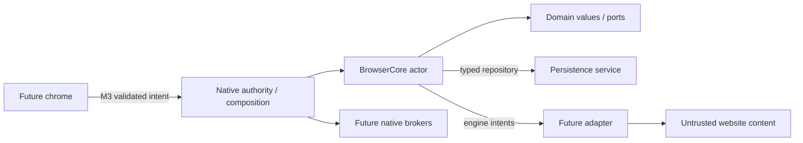

# Browser Core Module Architecture

**Current baseline (2026-11-08):** supporting Proposed design; [owner register](m1-owner-decision-register.md) and [Developer Specification](m1-developer-specification.md) govern current policies/scope. Documentation/isolated validation/planning Authorized; no product implementation or release. Original draft is preserved in the evidence source archive.
**Date:** 2026-11-07. **Status:** Proposed M1 design for owner review; not approved or implemented.

## Authority, scope and design basis

Follow the [approved architecture boundaries](../../../phase-3/browser-mvp-architecture-baseline.md), [M0 decisions](../M0/m0-foundation-decisions.md) and [proposed Swift runtime ADR](../../../../decisions/0003-browser-core-runtime-and-language.md). The core is a product policy/state machine, not an engine wrapper, UI store or source of native privilege. No module/package or browser feature is implemented here.

## Proposed module dependencies

| Future target / owner                     | Responsibility and permitted dependencies                                                                                                  | Prohibited dependencies                                              |
| ----------------------------------------- | ------------------------------------------------------------------------------------------------------------------------------------------ | -------------------------------------------------------------------- |
| BrowserDomain / core                      | Opaque identities, immutable values, validation, lifecycle and policy transitions; Swift standard library and a reviewed Foundation subset | AppKit, WebKit, engine objects, SQL, Keychain, network, React        |
| BrowserPorts / core and native            | Typed persistence, engine-intent and native-service requests/results using domain values                                                   | Concrete adapters, general RPC, raw paths/pointers, cloud client     |
| BrowserCore / core                        | Actor-coordinated registries, sequencing, authorization-aware policy, effects and sanitized projections; Domain + Ports                    | Concrete database/engine/UI or direct platform calls                 |
| BrowserPersistence / storage              | Repository implementation, migrations, transaction/durability/backup discipline; Domain + Ports + SQLite/Foundation                        | Website data-store internals, UI access, private-session persistence |
| Swift/AppKit host / native                | Composition, authoritative caller context, actual windows, service and engine lifetimes                                                    | Delegating authorization to React or arbitrary selectors             |
| Future engine adapter / adapter           | Public engine mapping and private engine objects; Domain + Ports plus WebKit                                                               | Defining durable product history or core policy                      |
| Future platform brokers / native-security | File/Keychain/TCC authorization and scoped tokens                                                                                          | Website-native dispatch, uncontrolled path access                    |
| Future React/TypeScript/HeroUI v3 / UI    | Presentation and bounded intent through the M3 transport                                                                                   | Direct store/core authority, native objects, credentials             |

Propose the first four targets inside `apps/browser-macos/Packages/BrowserCoreKit/`; actual layout/Nx wiring must be reviewed before a later generator/build task. Ports depend inward on domain; concrete implementations satisfy ports, while the host injects them. Do not create empty future packages.

Arrows show proposed calls/ownership, not separate processes. The Swift host/core share trusted-process authority; native modules are not security sandboxes. Website content never obtains a chrome command channel.

## Capability-oriented composition refinement

The [DSH-inspired assessment](dsh-architecture-assessment.md) justifies explicit feature contracts, availability and owned cleanup under [Proposed ADR0005](../../../../decisions/0005-browser-capability-boundaries-and-lifecycle.md). Keep Browser Core API as the logical BrowserDomain/BrowserPorts and chrome protocol surface; it is not an additional execution runtime. Preserve the four-target proposal and core-owned state/persistence.

The native host binds selected compiled providers through narrow feature ports. Domain/core depend on those interfaces, not on concrete optional implementations. Registration, runtime engine support, provider readiness, product-required feature support and operation authorization remain distinct. No service locator, dynamic loader, hot swap, agent loop, tool registry or every-subsystem-plugin conversion is proposed.

Permissions policy/default-deny and native OS enforcement remain mandatory even if a grant/prompt feature is unavailable. Download execution/find/search providers may fail independently, while core owns their relevant state, authorization and repository transitions. Optional architecture does not remove required MVP feature gates. A failing required engine/store dependency yields an explicit blocked/degraded operation, not a fabricated working capability.

See [capability architecture](browser-capability-architecture.md) for core/built-in/future-trusted/AI categories, static binding rules, initialization rollback, per-instance epochs, owned subscriptions and dependency-ordered disposal. Recoverable optional failures should not block unrelated core work; same-process Swift modules do not provide fatal-crash or malicious-code isolation. Engine substitution preserves unrelated feature implementations only where the agreed ports and capabilities remain satisfied.

## Product responsibilities and sequencing

| Area                             | Core owns                                                                                                           | Outside core / sequencing                                                                                                                             |
| -------------------------------- | ------------------------------------------------------------------------------------------------------------------- | ----------------------------------------------------------------------------------------------------------------------------------------------------- |
| Application/runtime coordination | Running/quiescing/stopped state, intent admission, effect tracking, snapshot revisions, idempotent shutdown         | Host owns NSApplication, deadlines and OS termination. M1 foundation only after approval                                                              |
| Windows and tabs                 | Window/tab identities, ordering/selection, profile-bound ownership, per-tab view generation                         | Native windows/views remain host-owned. Moving a tab across profiles means a new owned tab/view; no live profile rebinding. M1 model; actual UI later |
| Navigation                       | Current/provisional/last-committed state, request cancellation, explicit terminal state, history eligibility        | Engine callback translation and native URL opening belong to adapter/host. M1 pure policy, M2 actual navigation                                       |
| Browser sessions                 | App-run identity; persistent restore descriptors separately from live runtime sessions                              | Fresh runtime IDs/epochs on every restart; never persist capabilities or pending effects. M1 model; real restoration later                            |
| Profiles and private sessions    | Persistent/private tagged scope, immutable ownership, owner counts, lifecycle policy and deletion refusal           | M5 engine-store creation/isolation/cleanup. M1 can later test model/store refusal using fakes, not claim private browsing                             |
| Spaces/workspaces                | Basic Spaces/workspaces selected by current OD17; no implementation here                                                                                | Historical OD18 deferral preserved; current scoped basic organization requires explicit domain/UX/schema and functional acceptance. Advanced automation deferred |
| Bookmarks                        | Profile-scoped stable entities, folder/order validity and explicit user intent                                      | Repository stores metadata; UI/import/export later. Initial M1 foundation does not implement bookmark UX                                              |
| History                          | Accept only validated main-frame committed navigations; deduplicate commit events; profile/private/retention policy | Never engine-owned global history, cookie-derived history or frontend local storage. Feature storage slice requires separate scope                    |
| Downloads                        | Metadata state transitions and policy; ownership, terminal-state rules and cancellation intent                      | M5 broker owns bytes, staging, native destinations, quarantine and completion proofs. No pause/resume promise without capabilities                    |
| Permissions                      | Origin/profile/frame/kind/expiry policy, request and revocation generations                                         | Host/TCC/adapter authorize actual devices; unknown/missing capability fails closed. No grant implementation in M1                                     |
| Preferences                      | Typed allowlist, validated values, explicit app/profile scope and ephemeral private overrides                       | No arbitrary key/value control surface. Native secrets and service accounts excluded                                                                  |
| Recovery                         | Correlated crash/error state, explicit safe recovery intent, last committed descriptor and private exclusions       | M2/M5/M6 engine/host recovery and exact-candidate tests; no pending form/POST/prompt replay                                                           |

## State, authority and concurrency

Use immutable tagged `DataScope`: persistent profile + lease generation, or private session + lease generation. Optional parent-profile information is descriptive, not a persistent-storage route. Windows and views keep their assigned scope for their lifetime; a private session is shared only when native ownership explicitly identifies the same intended group.

A single core actor initially serializes ownership and policy transitions across in-memory registries. Never infer FIFO completion order across `await`. Intake verifies the host-issued authority context, live scope, object generation and expected state revision. It records a bounded pending effect, then performs external work; completion must revalidate owner/generation and mutation identity before changing state. Persistence operations use revision checks and commit receipts so a cancelled/stale caller cannot misreport a committed write as rolled back. See [contracts](core-boundary-contracts.md).

The core actor does not hold a SQL transaction or native callback open while awaiting user interaction. Main-actor engine/host work and serialized database work report typed results; queues have finite capacity and cancellation/backpressure. Later performance testing must assess contention before adding actors, threads or caches.

## Lifecycle examples and invariants

- A top-level provisional navigation gets a new NavigationId. Redirects retain it. Only a matching current main-frame commit may update last-committed state or request a history write; progress/title/url hints are not commits. Duplicate callbacks do not duplicate history. Same-document navigation needs an explicit M2 mapping, not inference from URL change.
- A stopped/cancelled/disposed/retired navigation cannot resurrect loading state. Crash increments the view generation; recovery only affects the current owned view. Restoring a URL never restores renderer memory, form bodies or credentials.
- A persistent mutation is reported saved only after the repository commit receipt. Rendering may continue if history persistence fails, but UI distinguishes degraded persistence from saved state; no unbounded retry loop.
- Profile deletion is refused while windows/views/transfers or pending effects own it. Later native services must reconcile actual owners; a zero count inside core alone is insufficient evidence.
- Private state cannot be routed into any durable repository. Closing the last private window initiates cancellation/revocation of outstanding private operations, followed by last-owner teardown; user-approved output files are a disclosed external artifact, not secretly restorable private history.

## Open choices and acceptance

Core runtime/storage direction and privacy defaults are Proposed; UI origin/transport, actual permissions/transfers, restore UX and critical site capabilities remain open. Engine neutrality does not claim universal extensions, identical back/forward stacks or engine-store migration. No Aura, CEF implementation, production Tamizhi or cloud dependency is introduced.

[M1 implementation sequence](m1-implementation-plan.md) defines later bounded slices and meaningful verification. This document establishes design coverage only: profile isolation, private cleanup, engine integration, performance and security remain Not Tested for a future implementation.
