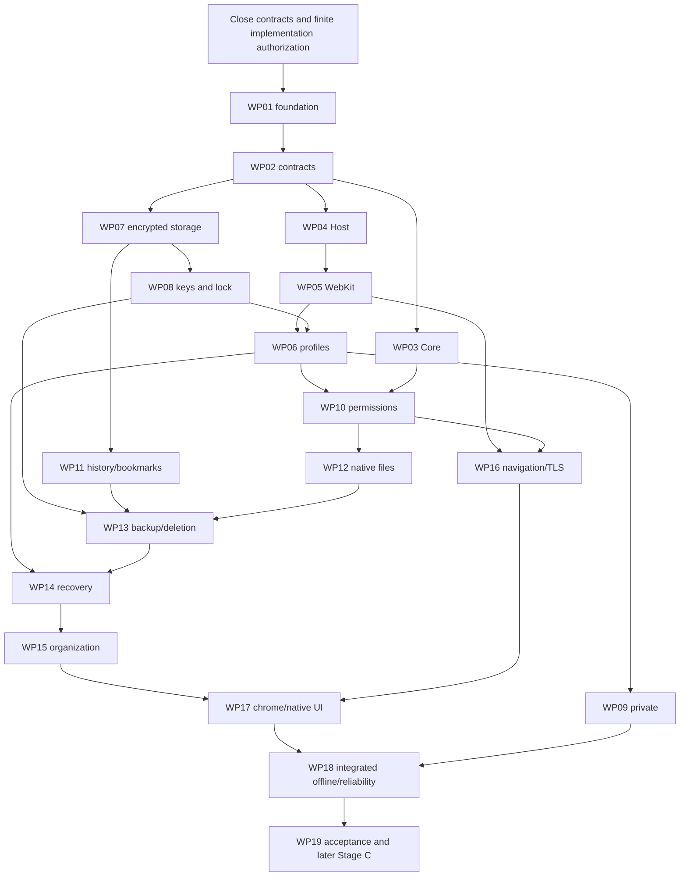

# M1 Implementation Plan v1.1 — Proposed

2026-11-08. **Planning Authorized; product implementation Not Started/Not Authorized; release Not Authorized.** This replaces the prior proposed I0–I7 breakdown as the maintained planning view. [Original plan](../../evidence/20261108T094414Z-m1-consolidated-closeout/supplied/repository-original-m1-implementation-plan.md) remains historical; no earlier implementation proposal is retroactively granted. All19 packages below are backlog tasks, not instructions to execute now.

## Evidence-backed disposition

The M0 app still contains three AppKit Ready-host sources and no Core/bridge/persistence package. Native WebKit seed observations succeeded; verify encountered store-removal failure with live handles. Cleanup-only follow-up crashed after boot, so cleanup completion is unknown. EXP-01 is FAIL for that retained bounded run; EXP-02 INCONCLUSIVE; other EXPs/SVCs BLOCKED. No full requirement/AC or product readiness is passed. See [closeout](m1-closeout-report.md), [activity reports](../../evidence/20261108T094414Z-m1-consolidated-closeout/reports/), [matrix](m1-case-level-traceability.md) and [current owner register](m1-owner-decision-register.md).

## Work package backlog

Readiness is technical readiness for a future finite authorization; even Conditional packages are not authorized to implement. Relative complexity M/L/XL is not a schedule or staffing estimate. Every package inherits: separate implementation authorization, reviewed scope, source-pinned meaningful tests, no cross-profile/private leakage or unauthorized native effects, truthful partial outcomes and independent security review where required.

### WP01 — Package/dependency foundation

- **Objective/scope:** Create future four-target package/manifests and native composition only after separate implementation authorization.
- **Requirements/decisions/specifications:** REQ-02/17; AC02/15; SPEC-01; OD-R01/02/03/15
- **Dependencies:** None beyond finite implementation authorization and final graph review
- **Relevant evidence:** PKG-001–005; current SVC-01 BLOCKED
- **Readiness / complexity:** Conditional / M
- **Acceptance:** Four targets obey reviewed DAG; no AppKit/WebKit/SQL/Keychain object leaks or cycles; missing required providers fail explicitly.
- **Deliverables / definition of done:** Reviewed manifests/interfaces, valid+invalid dependency/provider controls and source-scoped evidence.
- **Risks/unresolved questions:** dependencies/evidence limitations above must close; a missing functional mapping is Unspecified, not replaced by a related security AC. Product implementation remains Not Authorized.

### WP02 — Domain and typed contracts

- **Objective/scope:** Define IDs/scopes, authority contexts, command/event/result/error schemas without concrete native handles.
- **Requirements/decisions/specifications:** REQ-02/03/18; AC02/14/15; SPEC-01/02/14/15; OD-R01/03/16
- **Dependencies:** WP01; exact bounds/version/origin and event/error contract closure
- **Relevant evidence:** PKG-002/006; BRIDGE schema/fence routes BLOCKED
- **Readiness / complexity:** Blocked / L
- **Acceptance:** Native-issued ownership; exact schemas; stale/foreign contexts rejected; cancellation/terminal outcomes explicit.
- **Deliverables / definition of done:** Reviewed contract package and finite conformance fixtures; no generic privileged RPC.
- **Risks/unresolved questions:** dependencies/evidence limitations above must close; a missing functional mapping is Unspecified, not replaced by a related security AC. Product implementation remains Not Authorized.

### WP03 — Core runtime/state coordination

- **Objective/scope:** Implement actor-owned browser state/effects, revisions, cancellation and scoped subscriptions.
- **Requirements/decisions/specifications:** REQ-03/17/18/19; AC14/15; SPEC-06/14/15; OD-R01/02/15/16
- **Dependencies:** WP02; event/reentrancy/error contract closure
- **Relevant evidence:** PKG-005/006; BRIDGE-004–008 BLOCKED
- **Readiness / complexity:** Blocked / L
- **Acceptance:** Revalidate after await; bounded events/gaps→snapshot; no stale effect or false committed rollback.
- **Deliverables / definition of done:** Race/retirement/overflow/receipt evidence with truthful lifecycle state.
- **Risks/unresolved questions:** dependencies/evidence limitations above must close; a missing functional mapping is Unspecified, not replaced by a related security AC. Product implementation remains Not Authorized.

### WP04 — Native Host/lifecycle

- **Objective/scope:** Integrate Core composition, window/view owners and quiesce with existing AppKit foundation.
- **Requirements/decisions/specifications:** REQ-02/03/19/20 security/lifecycle portions; AC02/14/15; SPEC-02/06; OD-R02/16
- **Dependencies:** WP01/02; exact shutdown/recovery contracts; preserve M0 until explicitly changed
- **Relevant evidence:** Current M0 three-source Ready host; integration absent
- **Readiness / complexity:** Conditional / M
- **Acceptance:** Native host retains platform authority; required finalization survives quiesce; normal quit vs crash distinguishable.
- **Deliverables / definition of done:** Native lifecycle/integration evidence; no production edit under current task.
- **Risks/unresolved questions:** dependencies/evidence limitations above must close; a missing functional mapping is Unspecified, not replaced by a related security AC. Product implementation remains Not Authorized.

### WP05 — WebKit adapter/views

- **Objective/scope:** Map typed engine effects/callbacks to MainActor WKWebView and verified capabilities.
- **Requirements/decisions/specifications:** REQ-03/04/20/22; AC03/08/14/15; SPEC-02/08; OD-R02/10
- **Dependencies:** WP02/04; actual binding/generation contracts and cleanup blocker disposition
- **Relevant evidence:** EXP-01 FAIL on cleanup; native isolation observations only; RECOVERY-001 BLOCKED
- **Readiness / complexity:** Blocked / L
- **Acceptance:** Correct store assignment; no retired callbacks; no implicit unsafe POST/form/regrant recovery.
- **Deliverables / definition of done:** Engine adapter conformance, per-class runtime and safely attributed process recovery evidence.
- **Risks/unresolved questions:** dependencies/evidence limitations above must close; a missing functional mapping is Unspecified, not replaced by a related security AC. Product implementation remains Not Authorized.

### WP06 — Profiles/website-data isolation

- **Objective/scope:** Implement catalog/profile/key/store lifecycle, scoped clearing and deletion.
- **Requirements/decisions/specifications:** REQ-04/08/09/19/22; AC03/04/07/08/14/15; SPEC-03/06/07/08; OD-R05/06/09/10/18
- **Dependencies:** WP05/07/08; lifecycle/schema/lock/cleanup contracts
- **Relevant evidence:** ISO-001 FAIL; PRIV-001 INCONCLUSIVE; native removal-live-handle refusal and cleanup-only crash
- **Readiness / complexity:** Blocked / XL
- **Acceptance:** No cross-profile/private leakage; publish only fully ready resources; exact cleanup completion; other profiles unaffected.
- **Deliverables / definition of done:** Profile saga/failure/lock/deletion evidence, independent category clearing and no false cleanup.
- **Risks/unresolved questions:** dependencies/evidence limitations above must close; a missing functional mapping is Unspecified, not replaced by a related security AC. Product implementation remains Not Authorized.

### WP07 — SQLite persistence/encryption

- **Objective/scope:** Implement typed catalog/profile repositories over selected authenticated encrypted SQLite configuration.
- **Requirements/decisions/specifications:** REQ-04/05/06/19; AC03/05/14/15; SPEC-03/04/06; OD-R04/05/07
- **Dependencies:** WP02; provider/configuration/provenance/license; EXP-03 qualification
- **Relevant evidence:** CRYPTO-001/EXP-03 BLOCKED; stock sqlite3 no cipher_version
- **Readiness / complexity:** Blocked / XL
- **Acceptance:** Protected main/WAL/journal/temp artifacts; no plaintext fallback/reset; profile/lease/revision/receipt integrity.
- **Deliverables / definition of done:** Provider/artifact/fault/reopen evidence and reviewed schema/migrations; private refusal before disk.
- **Risks/unresolved questions:** dependencies/evidence limitations above must close; a missing functional mapping is Unspecified, not replaced by a related security AC. Product implementation remains Not Authorized.

### WP08 — Keychain/recovery/locking

- **Objective/scope:** Implement secure profile keys, independent printable/encrypted recovery and real lock barrier.
- **Requirements/decisions/specifications:** REQ-07/08/18; AC06/07/14/15; SPEC-05/07/14/15; OD-R08/09/18/19
- **Dependencies:** WP07 encrypted fixture; key/ACL/format/trigger contracts; independent Mac for recovery claims
- **Relevant evidence:** EXP-04/05 BLOCKED; no Keychain/OS-session actions performed
- **Readiness / complexity:** Blocked / XL
- **Acceptance:** Keychain access independent of offline recovery; no UI-only lock; wrong/corrupt material preserves originals.
- **Deliverables / definition of done:** Native deny/cancel/unlock/trigger/rotation/loss and independent recovery evidence; no secret diagnostics.
- **Risks/unresolved questions:** dependencies/evidence limitations above must close; a missing functional mapping is Unspecified, not replaced by a related security AC. Product implementation remains Not Authorized.

### WP09 — Private browsing

- **Objective/scope:** Implement memory-only Core state and correctly owned nonpersistent engine/session resources.
- **Requirements/decisions/specifications:** REQ-09/22; AC04/08/14; SPEC-06/08; OD-R06/10
- **Dependencies:** WP03/05/06; private owner/staging/last-release contracts
- **Relevant evidence:** EXP-02 INCONCLUSIVE normal native subset; abrupt/product paths absent
- **Readiness / complexity:** Blocked / L
- **Acceptance:** No private durable history/grants/session/download metadata; explicit saved files separate; no restart restoration.
- **Deliverables / definition of done:** Normal/abrupt teardown, scoped leakage/staging and late-callback evidence; OS limits disclosed.
- **Risks/unresolved questions:** dependencies/evidence limitations above must close; a missing functional mapping is Unspecified, not replaced by a related security AC. Product implementation remains Not Authorized.

### WP10 — Permissions/native authorization

- **Objective/scope:** Implement per-kind Core Ask/grant/deny/revoke/reset plus native enforcement and truthful support inventory.
- **Requirements/decisions/specifications:** REQ-03/10/17/18; AC09/14/15; SPEC-02/07/09/14/15; OD-R11/15/16/18; current OD17
- **Dependencies:** WP02/03/05/06/08; per-kind API/origin/lifetime mapping
- **Relevant evidence:** All120 PERM cases BLOCKED; no policy-negative substitute; header inventory not positive proof
- **Readiness / complexity:** Blocked / XL
- **Acceptance:** Supported new requests Ask; unsupported/ambiguous deny; OS independent; private/profile/lifecycle isolation.
- **Deliverables / definition of done:** Actual per-kind A–J/cross-cutting evidence; native notifications separate from website notifications.
- **Risks/unresolved questions:** dependencies/evidence limitations above must close; a missing functional mapping is Unspecified, not replaced by a related security AC. Product implementation remains Not Authorized.

### WP11 — History/bookmarks/deletion

- **Objective/scope:** Implement encrypted full-URL history, configurable retention/search/deletion, bookmarks/favorites and separately specified saved pages.
- **Requirements/decisions/specifications:** REQ-11/15 plus REQ-01/04 boundary portions; AC10/13 plus applicable01/03; SPEC-03/10/13; OD-R12/17; OP-01; OD17
- **Dependencies:** WP03/07/08; field/clock/index/cause contracts; saved-page/bookmark functional extension review
- **Relevant evidence:** OFFLINE-005/DELETE-001/RECOVERY-004 BLOCKED
- **Readiness / complexity:** Blocked / L
- **Acceptance:** Strip credentials, retain query/fragment per owner, no URL logs/private history; deletions fence derived/backup state.
- **Deliverables / definition of done:** Retention/cutoff/search/deletion evidence; bookmark/favorite/saved-page acceptance remains proposed extension until approved.
- **Risks/unresolved questions:** dependencies/evidence limitations above must close; a missing functional mapping is Unspecified, not replaced by a related security AC. Product implementation remains Not Authorized.

### WP12 — Downloads/native files

- **Objective/scope:** Implement progress/cancel/supported resume, destinations/upload/opening, encrypted manual metadata and payload separation.
- **Requirements/decisions/specifications:** REQ-12/13/16/19; AC11/12/14/15; SPEC-07/11/12/15; OD-R13/18/20; OP-02
- **Dependencies:** WP05/07/08/10; native token/resume/staging/finalization contract
- **Relevant evidence:** EXP-06/XFER-001/PERM-021/RECOVERY-005 BLOCKED
- **Readiness / complexity:** Blocked / XL
- **Acceptance:** No silent overwrite/path-as-grant; actual bytes/finalization; metadata deletion/profile deletion never silently deletes external files.
- **Deliverables / definition of done:** Native authorization/hash/quarantine/collision/cancel/resume/restart/private evidence; explicit open/upload functional extension.
- **Risks/unresolved questions:** dependencies/evidence limitations above must close; a missing functional mapping is Unspecified, not replaced by a related security AC. Product implementation remains Not Authorized.

### WP13 — Backup/restore/migration

- **Objective/scope:** Implement coherent encrypted profile/full backups, selected files, independent restore and deletion reconciliation.
- **Requirements/decisions/specifications:** REQ-06/07/14/15/16/19/22; AC06/08/11/12/13/15; SPEC-03/05/08/11/12/13; OD-R14/17/19/20; OP-03
- **Dependencies:** WP06/07/08/11/12; archive/ledger/promotion/migration; EXP-03/04 prerequisites; second Mac
- **Relevant evidence:** EXP-07/08 and BACKUP/DELETE references BLOCKED
- **Readiness / complexity:** Blocked / XL
- **Acceptance:** Authenticated versioned archive; payload exclusion default/explicit selection; source/destination preserved; unknown deletion needs confirmation.
- **Deliverables / definition of done:** Coherence/tamper/path/conflict/interruption/migration/cross-Mac evidence; only proven WebKit coverage included.
- **Risks/unresolved questions:** dependencies/evidence limitations above must close; a missing functional mapping is Unspecified, not replaced by a related security AC. Product implementation remains Not Authorized.

### WP14 — Session restore/crash recovery

- **Objective/scope:** Implement normal/restart restore, crash prompt, recently-closed retention and safe content recovery.
- **Requirements/decisions/specifications:** REQ-19/20; AC15 plus scoped04/07/14; SPEC-03/06/07/10/14/15; OP-04; OD-R06/16/18
- **Dependencies:** WP03/05/06/07/08; checkpoint/recently-closed/quit/crash/replay contracts
- **Relevant evidence:** SVC-05/RECOVERY cases BLOCKED; Phase3 not transferable
- **Readiness / complexity:** Blocked / XL
- **Acceptance:** Keep entries when page unavailable; private discard; fresh identities; no auto form/POST/grant/operation replay; respect locks/deletion.
- **Deliverables / definition of done:** Separate content-process and host fault evidence; RECOVERY-010 OP-04 only.
- **Risks/unresolved questions:** dependencies/evidence limitations above must close; a missing functional mapping is Unspecified, not replaced by a related security AC. Product implementation remains Not Authorized.

### WP15 — Tabs/windows/groups/basic Spaces

- **Objective/scope:** Implement owner-selected organization with profile/private ownership and persistent state where approved.
- **Requirements/decisions/specifications:** Current OD17 items2/3/4/11/12; SPEC-01/03/06; REQ-02/03/18/20 boundary portions; dedicated functional REQ/AC/cases Unspecified
- **Dependencies:** WP03/04/06/07/14; basic Spaces/group/saved/recently-closed domain and functional extension review
- **Relevant evidence:** No dedicated functional acceptance; historical OD18 deferred preserved, current scope refined
- **Readiness / complexity:** Blocked / XL
- **Acceptance:** Ownership never silently crosses profiles; basic Spaces only; advanced automation excluded.
- **Deliverables / definition of done:** Approved functional extension plus lifecycle/persistence/offline/private/lock/deletion workflow evidence; no invented AC/case IDs.
- **Risks/unresolved questions:** dependencies/evidence limitations above must close; a missing functional mapping is Unspecified, not replaced by a related security AC. Product implementation remains Not Authorized.

### WP16 — Navigation/address bar/TLS

- **Objective/scope:** Implement direct URL/search navigation, redirects, history controls, external schemes and certificate fail-closed behavior.
- **Requirements/decisions/specifications:** Current OD17 items1/17/18; SPEC-02/09/10; REQ-03/20 authority/recovery portions; dedicated functional AC/cases Unspecified
- **Dependencies:** WP02/05/10; URL/search-provider/external-handler/TLS contract and functional extension review
- **Relevant evidence:** Existing engine contract only; M1 functional evidence absent
- **Readiness / complexity:** Blocked / L
- **Acceptance:** No silent TLS bypass/unsafe external handoff; strip embedded credentials from durable URLs; navigation state truthful.
- **Deliverables / definition of done:** Approved functional controls for redirects/search/back-forward/reload/TLS/external URLs and scoped security evidence.
- **Risks/unresolved questions:** dependencies/evidence limitations above must close; a missing functional mapping is Unspecified, not replaced by a related security AC. Product implementation remains Not Authorized.

### WP17 — Chrome/native integration

- **Objective/scope:** Implement React+TypeScript+HeroUI v3 chrome and native panels/notifications only after secure dispatcher.
- **Requirements/decisions/specifications:** REQ-03/10/18 boundary portions; AC09/14/15; SPEC-02/09/14/15; current OD17; dedicated UI acceptance Unspecified
- **Dependencies:** WP02/03/04/05/10/12/15/16; exact origin/codec/CSP and extension review
- **Relevant evidence:** SVC-02 BLOCKED; no production chrome/bridge; native notifications not PERM-005
- **Readiness / complexity:** Blocked / XL
- **Acceptance:** Bundled trusted UI only; websites get no bridge; no UI secrets/SQLite/paths; native notification OS authorization independent.
- **Deliverables / definition of done:** Hostile-message/ownership/lifecycle/UI workflow/accessibility evidence; polished product work remains separately authorized.
- **Risks/unresolved questions:** dependencies/evidence limitations above must close; a missing functional mapping is Unspecified, not replaced by a related security AC. Product implementation remains Not Authorized.

### WP18 — Offline/reliability/compatibility

- **Objective/scope:** Integrate local product without server/account dependency; verify critical site workflows and resilience.
- **Requirements/decisions/specifications:** REQ-01/04/09/19/20; AC01/03/04/14/15; SPEC-06/08/15/16; OD-R04/06/10; current OD17
- **Dependencies:** Integrated WP03–17; approved fixtures/accounts where needed
- **Relevant evidence:** SVC-04 BLOCKED; public-pages-only does not qualify account/MFA/media workflows
- **Readiness / complexity:** Blocked / L
- **Acceptance:** Local features usable with servers/cloud disabled; truthful remote failures; actual required workflows qualified.
- **Deliverables / definition of done:** OFFLINE campaign and authorized compatibility/reliability results; access-blocked requirements remain open.
- **Risks/unresolved questions:** dependencies/evidence limitations above must close; a missing functional mapping is Unspecified, not replaced by a related security AC. Product implementation remains Not Authorized.

### WP19 — Integrated acceptance and Stage C

- **Objective/scope:** Review all M1 functional/security/recovery evidence, then separately qualify final internal-release candidate.
- **Requirements/decisions/specifications:** REQ-01–22; AC01–15 only for implementation acceptance; REQ-21 Stage C has no AC assignment; all existing EXP/SVC; ADR0002
- **Dependencies:** All required packages and proposed functional extension approved/qualified; actual candidate; macOS26/architecture/signing/updater environments
- **Relevant evidence:** No release candidate or authorization; native discovery not final qualification
- **Readiness / complexity:** Blocked / XL
- **Acceptance:** All applicable mandatory gates; no unqualified required behavior or leaked/private data; no historical aggregate proxy.
- **Deliverables / definition of done:** Candidate-pinned OS/signing/notarization/Gatekeeper/sandbox/runtime/entitlement/performance/compatibility/update/provenance evidence and separate owner release decision.
- **Risks/unresolved questions:** dependencies/evidence limitations above must close; a missing functional mapping is Unspecified, not replaced by a related security AC. Product implementation remains Not Authorized.

## Sequencing and critical path

Before any production package, close the relevant contracts/provider/recovery prerequisites and obtain a finite implementation instruction. Package/domain work can be planned independently of crypto-provider investigation; no actual code begins now. UI visual planning can be independent, but privileged UI integration waits for the secure bridge. Security lifecycle and safe cleanup precede profile/data-deletion reliance.

Critical security/recovery path: encrypted-provider/configuration qualification → key/recovery format and independent recovery → profile/key/view barrier and resource saga → coherent archive/deletion ledger → session/file recovery → integrated offline/functional acceptance → separately authorized Stage C. Native cleanup failure is an early lifecycle investigation dependency, not grounds to relax isolation or sandboxing.

Implementation sequencing uses observed failures/blocked prerequisites; it does not require every package to be built in numeric order. Future isolated SDK/protection investigations may proceed independently within existing authorization if their procedures become ready; full product integration cannot be simulated by those harnesses.

## Integration milestones and exits

- Foundation/contracts: reviewed target graph and native-owned authority; PKG cases qualify actual targets.
- Engine/profile security: scoped website data, true private cleanup, native permissions and actual key/view lock barrier; no release or UI-only substitutes.
- Durable data/recovery: encrypted repositories, independent recovery, correct file finalization, deletion-aware backup and OP-04 checkpoints.
- Functional browser: owner-approved extension coverage for26 capabilities; basic Spaces scoped separately from advanced automation; account workflows still need authorized environments.
- Offline/reliability: SVC-04/05 and required compatibility/performance against actual integration, never historical Phase3 transfers.
- Stage C: actual macOS26.0/latest supported26.x and selected architectures, Developer ID/nested code/notarization/Gatekeeper/sandbox/Hardened Runtime/entitlements, candidate performance/reliability/compatibility, updater/replay/expiry/channel/minimum-version/revocation/rollback, provenance/license/security review, then separate internal-release decision. REQ-21 has no AC01–15 assignment.

## Minimum next engineering action

Investigate the retained owned-store cleanup failure/crash in a finite isolated lifecycle procedure with exact source/binary context; complete selected encrypted-SQLite provider and recovery/archive specification before reauthorizing dependent procedures as executable. In parallel, review the proposed functional acceptance extension and package/bridge contracts. Existing validation authorization does not authorize product fixes. No repeated unchanged testing loop.
