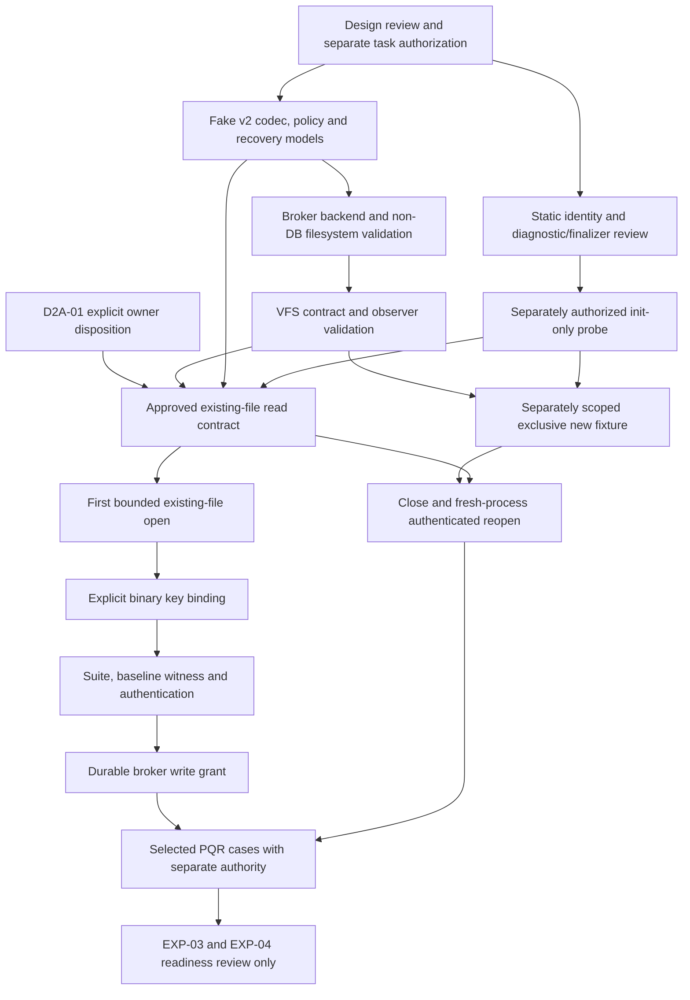

# M1 Phase 2A dependency and implementation-readiness matrix

Version 1.0 — Proposed, 2026-11-09. **Design only; no implementation or execution authority.** [Primary review](m1-sqlcipher-critical-safety-contracts-phase2a.md).

## 1. Gate assessment

| Gate | Contract disposition | Owner dependency | Technical / experimental dependency |
|---|---|---|---|
| OPEN-01 | Blocked | D2A-01 literal rule retained or exact bounded exception explicitly approved | No supported existing-file literal path established; fresh source review and observable read ordering required for any candidate |
| OPEN-02 | Resolved as proposed contract | No new owner policy selected; OPEN-01 still governs reads | Broker deny-before-auth, all-artifact mutation matrix, key-applied/hash ordering and failure witnesses need implementation/negative evidence |
| OPEN-03 | Partially resolved | Existing trusted-native threat model preserved | Custom VFS/broker correctness, descriptor/sidecar races, RAM WAL index, locking, direct-I/O and trace-pressure evidence pending |
| OPEN-04 | Resolved as proposed qualification contract | No automatic stale-worker adoption or security waiver | Durable480-byte journal, no PID-only signaling, independent key availability and restart/quarantine behavior need evidence |
| OPEN-05 | Partially resolved | No new owner decision needed for v2 fake slice | Single-worker framing/IDs/outcomes specified; future maintenance multi-handle/two-key/promotion extension remains excluded |
| OPEN-06 | Pending, preserved | None inferred | Genuine provider bind-failure instrumentation feasibility; fake pre-call failures not equivalent |
| OPEN-07 | Pending, preserved | No host configuration change authorized | Default/device/crash diagnostic and direct-output coverage; child pipes alone insufficient |
| OPEN-08 | Pending, preserved | Existing OP policies unchanged | Freeze real-case resource/deadline/format/offset/record/fault oracles before each bounded run |

All gate statuses concern specification scope only. No native capability, case or release gate is newly Passed. WKWebView remains conditional; no ADR status changes.

## 2. Dependency graph

The graph reflects the real API order: a real key call requires a handle, so it cannot be promised before a normal file open. OPEN-01 is resolved by an explicit decision or a future supported key-aware API, not a cyclic dependency or fake early binding. A fresh create cannot be published as a usable fixture until its existing-file reopen path is permitted and qualified.

## 3. Exact freeze and execution prerequisites

| Activity | Contracts that must be frozen first | Required evidence before moving onward | Current authority/status |
|---|---|---|---|
| Fake-provider implementation | C01/C04/C08–C15; v2 control/key/broker format, state/outcome/error enums, finite fake manifest, journal parser/model and no-real-I/O boundary | Code review plus separately authorized fake conformance results; full UUID preservation; no SQLCipher includes/linkage/backend or accidental calls | Not Authorized by this task; proposed smallest next milestone |
| VFS implementation | C03/C05–C07; OPEN-02 matrix, virtual resource grammar, broker dispatch/lock/memory/overflow contract, finite non-DB backend manifest | Policy and filesystem-negative controls on ordinary synthetic non-DB files; all callbacks/optional controls reviewed; no path delegation gap | Not Authorized; design partial until compatibility evidence |
| SQLCipher initialization only | Pinned archive/header/ABI/link identity; once-only init/shutdown; automatic finalizers; bounded output and no-core/resource plan | Separately approved init-only actual identity/init/shutdown records with no handle/DB/key; default logging coverage | Not Authorized; does not require weakening OPEN-01 |
| First existing DB open | D2A-01 decision or established supported literal API; broker/VFS/diagnostics safety; exact key channel and OpenExisting mode; finite approved resource/case scope | Broker-fenced read sequence and zero mutation; unexpected pre-key range blocks immediately | Blocked; no supported literal path/owner exception approved |
| Real key binding | Prior allowed connection construction; full key/resource/lease identity; buffer lifetime, exact suite/settings order and copy/failure instrumentation | Checked key result, scratch retirement; no auth inference; settings and actual identity still required | Blocked; no API call authorized |
| Encrypted fixture creation | Exclusive-new contract, CreateInitialize grant, complete synthetic schema/recipes, budgets and artifact visibility; independent key custody; permitted fresh reopen | Initial create/commit/close plus fresh-process correct-key full identity/record verification; no existing-file adoption | Blocked; no fixture created or authorized |
| Selected PQR runtime | All case-specific prerequisites/original definitions, working controls, trace coverage, clean/error oracles and finite approved cutpoints | Exact per-case evidence and cleanup disposition; no aggregate Phase 1/provider pass rate | Blocked; all50 Proposed / Not Executed |
| Full EXP-03/04 | Separate campaign scope and all charter dependencies, not PQR planning coverage alone | Actual complete charter evidence; EXP-04 needs authorized Keychain/recovery/custody and independent destination Mac | Unexecuted; no automatic campaign |

“Frozen” means a reviewed explicit contract, not a speculative default. Design approval alone does not authorize code changes, builds, fake tests, process launches or file-backend probes. The separate task must name its permitted activities. No software installation/host change is part of this package.

## 4. Smallest safe next milestone: M2A-F0 (proposed)

After design review and **separate explicit implementation authorization**, prepare a new isolated fake-only v2 qualification slice, prospectively under `qualification/sqlcipher-phase2/`. Preserve all Phase 1 files. This local milestone label is not a new product milestone/owner decision or PQR case.

Permitted proposed scope: binary frame codec, full UUID context validation, control state transitions, RAM resource-policy model, RAM journal/intent parser/replay model, bounded fake diagnostics and cancellation/retirement coordination. No filesystem backend, VFS registration, provider symbols/linkage, SQLite includes, key API, real DB path resolution, durable journal writes, fixture or product module.

Proposed exit criteria:

- Every frame boundary/length/version/reserved-field/EOF/replay/UUID mismatch rejected under a finite fake manifest; two UUIDs sharing the last byte remain distinct.
- KeyAccepted/KeyApplied/Authenticated/WriteGranted cannot collapse; forged or out-of-order events cannot enable the modeled write grant.
- Every pre-auth persistent mutation class denied, including SHM mapping, delete/truncate/replacement, temp/scratch and close/recovery cleanup attempts.
- CANCEL_ACK cannot become NotCommitted without a state witness; known committed results survive lost ack and late/retired delivery is fenced.
- Torn/unknown/hash-invalid modeled journal state yields quarantine; restart does not clear leases or authorize stale-PID signaling.
- Diagnostic/trace pressure, partial frame, interrupt-versus-close and wait-error models cannot falsely report cleanup; no source/provider runtime claim follows from fake success.
- Source/link review proves the real provider and filesystem backend are absent. All actual fake executions/builds, if requested later, have their own finite authority and evidence; none are performed now.

This milestone does not depend on approving a weaker pre-key rule because it performs no target-byte read or provider operation. It can make useful implementation progress while D2A-01 remains pending. It cannot establish PQR provider behavior or remove the need for VFS/backend qualification.

## 5. PQR and historical traceability preservation

The original50 cases remain E12 + K16 + T10 + R12. [Phase 2 crosswalk](m1-sqlcipher-phase2-pqr-crosswalk.md) and original definitions are unchanged. The six admission-only K05/K06/K07/K08/K09/K14 routes can contribute to a separately authorized fake slice; K13 delivery fencing is partial without actual commit reconciliation. No case is marked executed here.

| Route | Phase 2A consequence |
|---|---|
| E01 and K01/K16 | Runtime identity versus keyed settings/copy/auth remain separate; exact version stays4.20.0 community |
| E02/E11 and K02–K04/K10 | New creation/fresh reopen and wrong-key/identity preservation depend on OPEN-01 plus write fence |
| E04/E05 | RAM-only index is a proposed different storage route, not automatic coverage of the original live multi-handle/disk-SHM oracle; exact applicability review needed |
| E06/E07/T09 | Journal observation and hot-journal recovery are different. Denying source writes protects data but cannot count as successful recovery qualification |
| E08/E09 | No disk temp spill or unknown VACUUM staging; refusal is not proof of successful supported workload |
| K11/K12/K13 and R01–R08 | Real close, durable receipt, precise faults, supervisor restart and outcome witnesses remain mandatory |
| K15 | Genuine provider bind failure still needs instrumentation; fake injected failure is insufficient |
| R09–R12 | Maintenance/two-handle/two-key/copy/promotion protocol excluded from this initial v2 slice; remains blocked until separately specified and authorized |
| REQ-21 / REQ-22 | Separate Stage C release qualification and WebKit data protection remain unchanged; no PQR route supplies a release or AC08 pass |

No original test charter, acceptance mapping, owner disposition, historical crosswalk meaning or original50-case expected result is rewritten. Current OP-01–OP-04 remain owner-decided. Synthetic broker journal checksums do not replace the product authenticated recovery/deletion/backup contracts.

## 6. Final readiness verdict

**Specification package prepared for review; not runtime-ready or production-ready.** OPEN-01 needs exactly the owner disposition in its dedicated report. OPEN-02/04 now have explicit proposed contracts; OPEN-03/05 retain identified implementation/maintenance boundaries. Source inspection supports the negative API-order conclusion and candidate VFS architecture, not provider behavior. Existing OPEN-06/07/08 remain prerequisites.

Remain prohibited: provider-linked launch/init/shutdown/finalizers, any provider/key call or DB open/create, encrypted fixtures, PQR/EXP execution, VFS/adapter/product implementation, real Keychain/WebKit, installs/host changes, ADR/owner changes, commits/pushes and release. These restrictions describe this task's authority, not a claim that every future step requires a new owner policy decision.

**No real SQLCipher provider operations, database opens, encryption tests, fixtures or PQR runtime cases were executed. EXP-03 and EXP-04 remain unexecuted.**
