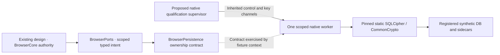
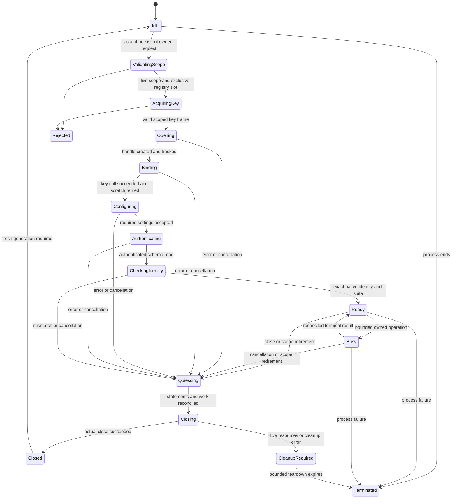

# M1 isolated SQLCipher worker and key-binding design

**DESIGN READY FOR OWNER REVIEW**  
8 November 2026 · Proposed technical design v1.0  
Repository `vezham-labs/vx-browser`, branch `timeline`, baseline `85bdcf55a0e671424ecd284bb26a8263c9316845`, parent `670bebd4b4f7e878674e7588ddcb7e6aa4a86d32`.

This design specifies the native qualification worker, its scoped key ownership, exact candidate linkage, initialization sequence, synthetic data and fault controls. The preceding readiness assessment records 3 PASS, 5 BLOCKED and 4 INCONCLUSIVE prerequisites, with 50 proposed cases and zero executions. Those historical results stand. The design now supplies implementation contracts for G01–G08. Building the worker, qualifying its behavior and executing EXP-03 require subsequent authorization.

The source-authenticity PASS and complete 2,325-file signed-archive comparison are retained inputs. The current source pin is `355d4db92d3404e71faa8088d071a71d767807f4`. [Readiness assessment](m1-sqlcipher-provider-runtime-readiness.md) · [Source verification](m1-sqlcipher-publisher-authenticity-evidence.md)

## 1. Inspected baseline and existing contracts

| Inspected resource | Actual finding and design consequence |
|---|---|
| Native app sources | ApplicationMain, ApplicationDelegate and MainWindowController implement the AppKit Ready host. Base.xcconfig selects Swift 6, macOS 26.0, App Sandbox and Hardened Runtime. The inventory contains no BrowserCoreKit implementation, SQLCipher target or native key broker. |
| Browser Core architecture and Developer Specification §§4–11 | BrowserDomain owns values, BrowserPorts owns typed contracts, BrowserCore owns policy and state, and BrowserPersistence owns SQL and connection lifetime. These target boundaries are documented proposals. |
| Core-to-Persistence Boundary D | PersistentStoreLease binds native profile/store identity and generation. Mutation identity, revision and receipt belong to one transaction. Core checks authorization again before publishing a result. |
| Key/recovery specification §§1–6 | Per-profile and catalog 32-byte DEK inputs are independent. Native Keychain KEKs wrap the normal-access DEK ring. Independent recovery uses the approved recovery material and envelopes. |
| Provider qualification report and retained C fixture | Two static archives match. The helper type-checks `sqlite3_key` and `memset_s`. It has no open/authenticate/scope/close implementation. Its early invalid-input returns require an explicit caller cleanup owner. |
| Encryption specification §§3–6 | Profile and catalog data require encryption. The suite, memory temp policy, WAL/FULL, scoped failure handling and copy-and-promote direction govern this design. |
| ADRs 0001–0005 and owner register | 0001 Proposed, 0002 Accepted, 0003–0005 Proposed. OD-R01–20 and OP-01–04 are retained. The same-process product Host/Core boundary remains the approved direction. |
| Validation Plan EXP-03 and canonical CRYPTO-001 row | Provider artifact, authentication and failure checks map to REQ-05/06/19 and AC05/14/15. The 50 PQR scenarios remain subordinate proposed checks. |

The earlier ADR 0004 and generic persistence design retain historical system-SQLite and fixture-only recommendations. The later owner dispositions and encryption/key specifications require the encrypted provider for this candidate. This precedence is recorded here without changing those ADRs or treating their old wording as permission for plaintext product storage.

The exact document/source hashes and retained native-source excerpts are recorded in the evidence inventory. [Input inventory](../../evidence/20261108T160235Z-m1-sqlcipher-worker-design/sources/input-inventory.json) · [Source inspection](../../evidence/20261108T160235Z-m1-sqlcipher-worker-design/sources/pinned-source-inspection.json)

## 2. Worker boundary and ownership

Propose a C11 qualification executable and a small native C11 supervisor. C directly exercises the selected provider ABI and owns mutable buffers without adding a Swift wrapper dependency. This language choice applies to qualification tools. Browser Core retains its Swift 6 direction.

The supervisor owns a fresh temporary run root, case manifest, registered child identities, expected records and disposable key leases. One worker serves one immutable persistent scope and generation. Each worker runs all ordinary SQLite calls on one dedicated execution thread. A control thread handles cancellation through a lifetime-protected interrupt reference. A/B/catalog scopes use different workers and independent keys. A same-profile second connection is allowed only for the declared WAL/locking scenario. Copy operations may hold source and destination connections for the same scope and distinct key versions.

The future BrowserPersistence implementation uses these ownership and lifecycle semantics behind its existing typed ports. Moving product persistence into a helper process would require a separate architectural decision. The proposed child-process arrangement supplies termination and isolation controls for qualification.



### Responsibilities and admission

| Component | Owns | Admission rule |
|---|---|---|
| Core | Product policy, profile lifecycle and authoritative revision | Native authority and current scope/generation required |
| Persistence service | Store registry, serialized DB operations and commit receipts | A PersistentStoreLease must resolve to one live registered store |
| Native key service | Key acquisition, unwrap authority and secret leases | Fresh approved key-management context required for the requested scope/version |
| Test supervisor | Synthetic authority and key fixtures, run manifest, fault selection | Only a predeclared PQR scenario and its registered worker may execute |
| Worker | Private connection handles, prepared statements, bounded scratch and actual provider calls | Immutable run/scope/store/generation tuple, valid key lease and allowed operation enum |
| VFS observer | File confinement, scoped I/O classification and selected I/O faults | All opens and sidecar operations must derive from the worker's registered resource set |

The worker receives bounded operations such as open-existing, create-fixture, read-corpus, apply-fixture-mutation, checkpoint, copy-scope and close. SQL text, filesystem paths, engine objects and keys never enter Domain/Core values or frontend channels. Test SQL is compiled into the future qualification tool and parameter-bound. Adding a generic execute-SQL interface would break this design.

A persistent registry entry contains the native run identity, worker instance, scope kind, scope UUID, store UUID, lease epoch, DEK version and current operation. User-provided IDs cannot select another registry entry. Private DataScope is refused before acquiring a persistent key, resolving a DB path or registering a worker.

### Process, files and resource limits

The supervisor creates a native-owned `mkdtemp` run directory with mode 0700 and explicit per-case children. Files use 0600, exclusive creation and owner/type/link-count checks. The worker uses a confinement VFS over the system Unix VFS. Its policy accepts only the registered main files, their actual sidecars, copy candidates and mapped temporary resources beneath the run root. Resolve and verify parents, reject symlinks/hard-link aliases and reject external URI/path claims. The worker's private current directory and TMPDIR point into the run. Product Application Support roots are never searched or registered.

This is application-enforced confinement within a test process. The future implementation must verify that every relevant filesystem operation passes through that boundary. A supervisor remains capable of accessing its own account's files, so the test process boundary supplies no OS sandbox guarantee. Record unexpected paths, terminate the owned run and retain artifacts.

Carry forward the proposed bounds of 64 MiB per DB, 256 MiB per case, 512 MiB active artifacts, 128 MiB worker memory, 32 pending control requests and a 60-second case watchdog. These are reviewable test guards. Use injected FULL/NOMEM or bounded allocations instead of exhausting the user's disk or memory. At watchdog expiry, fence new work and allow up to five seconds for cancellation/cleanup before terminating the registered child. Timeout is an incomplete result until state is reconciled.

## 3. Static integration and library identity

Use the existing static build without changing its source or macros.

| Input | Required value |
|---|---|
| Archive | `/private/tmp/vx-m1-provider-fixtures-20261108T113403Z/provider-build-1/libsqlite3.a` |
| Archive SHA-256 | `ac0fed4b3c47b6259a87504b318fd4546018c880b0d60331a47e92c3f7a9856c` |
| Archive bytes | 1,651,288 |
| Header directory | `/private/tmp/vx-m1-provider-fixtures-20261108T113403Z/provider-build-1` |
| sqlite3.h SHA-256 | `e36eb6ed4de77e56a633866a8f84ed339785662d0cf79cf099f420b638bf28ec` |
| Compiler | `/Applications/Xcode.app/Contents/Developer/Toolchains/XcodeDefault.xctoolchain/usr/bin/clang`, Apple clang 21.0.0 (clang-2100.4.1.1) |
| SDK | `/Applications/Xcode.app/Contents/Developer/Platforms/MacOSX.platform/Developer/SDKs/MacOSX27.2.sdk` |
| Target | `arm64-apple-macosx26.0` |
| Provider compilation | SQLITE_HAS_CODEC, SQLCIPHER_CRYPTO_CC, SQLITE_EXTRA_INIT=sqlcipher_extra_init, SQLITE_EXTRA_SHUTDOWN=sqlcipher_extra_shutdown, SQLITE_OMIT_LOAD_EXTENSION, SQLITE_TEMP_STORE=3, SQLITE_THREADSAFE=1 |
| Link libraries | Exact archive, Security.framework, CoreFoundation.framework and compiler-selected platform runtime |

The build-2 archive is an equal-hash retained repeatability input. If temporary inputs disappear, recovery or a separately authorized rebuild must preserve the recipe and establish new hashes. Historical paths supply provenance, not authority to select arbitrary replacement files.

The proposed qualification build has four C translation units, `worker_main.c`, `worker_store.c`, `worker_vfs.c` and `worker_control.c`. They are prospective design filenames only. Resolve `<new-workspace>` once to a fresh owned absolute path and substitute it into this command. The concrete compiler, SDK, archive and header inputs below are fixed. No invocation was executed.

```text
/Applications/Xcode.app/Contents/Developer/Toolchains/XcodeDefault.xctoolchain/usr/bin/clang
  -std=c11 -O2 -g0 -Wall -Wextra -Werror
  -target arm64-apple-macosx26.0
  -isysroot /Applications/Xcode.app/Contents/Developer/Platforms/MacOSX.platform/Developer/SDKs/MacOSX27.2.sdk
  -DSQLITE_HAS_CODEC -D__STDC_WANT_LIB_EXT1__=1
  -I/private/tmp/vx-m1-provider-fixtures-20261108T113403Z/provider-build-1
  <new-workspace>/worker_main.c
  <new-workspace>/worker_store.c
  <new-workspace>/worker_vfs.c
  <new-workspace>/worker_control.c
  /private/tmp/vx-m1-provider-fixtures-20261108T113403Z/provider-build-1/libsqlite3.a
  -framework Security -framework CoreFoundation
  -Wl,-map,<new-workspace>/worker-link.map
  -o <new-workspace>/sqlcipher-worker
```

The supervisor uses the same compiler/target/SDK and C flags, links Security for SecRandomCopyBytes, and has no SQLCipher connection dependency. The worker header exposes codec APIs through SQLITE_HAS_CODEC. The provider's initialization hooks are already compiled into the retained archive. The worker calls `sqlite3_initialize` once and relies on those hooks. It must not call SQLCipher initialization twice or compile another SQLite amalgamation.

### Verification before any fixture access

1. Hash the archive/header and record the compiler/SDK, complete argv and resulting executable hash.
2. Inspect archive and executable symbols with `nm`, architecture with `lipo`, and deployment/link records with `otool`. The link map must resolve SQLite/codec definitions to the exact retained archive. Do not add `-lsqlite3`, another SQLite framework, a system shell or an ORM dependency.
3. Require sqlite3_initialize/shutdown, sqlite3_open_v2, sqlite3_key or key_v2, prepare_v2/step/finalize, bind/column functions, extended_errcode, get_autocommit, next_stmt, close, interrupt, progress_handler, wal_checkpoint_v2, backup_init/step/finish, vfs_find/register and set_authorizer symbols. Require codec/provider symbols from the retained archive. The worker only uses the audited public subset.
4. Inspect loaded images and direct dependencies to detect an unintended system SQLite definition. System frameworks may transitively load SQLite. A transitive image alone is not a failure if the link map and call bindings prove all worker SQLite references resolve to its static definitions. Ambiguous resolution blocks testing.
5. Call sqlite3_libversion, sourceid and compileoption_get before DB access. Compare with the generated header, including its exact source ID. That ID describes the modified SQLite baseline and must not be substituted for the SQLCipher Git commit.
6. After keyed connection setup, require `cipher_version = 4.20.0 community`, `cipher_provider = commoncrypto` and the exact suite readbacks in §5. A missing getter row blocks qualification.

Pinned `crypto_cc.c:50–82` returns `commoncrypto` and may return `unknown` for provider_version if the OS bundle lookup fails. Record the actual value and OS build. An `unknown` provider_version by itself is a metadata limitation, while absent/wrong provider identity is a failure of candidate identification. Never invent a CommonCrypto semantic version from the SDK.

## 4. Key ownership and lifecycle

### Acquisition, transfer and release

Production-oriented acquisition follows the existing native key-service contract. Verify the scope in the native registry, authenticate the Keychain-protected normal slot, unwrap the correct DEK version, and issue an opaque generation-bound lease. The worker receives only the selected 32-byte input through the native execution boundary. Recovery unwrap remains the existing separately qualified path.

For synthetic qualification, the native supervisor substitutes independent CSPRNG-generated A, B, catalog and wrong-key inputs. It checks RNG failure and rejects accidental duplicate scope keys by a memory-only comparison. A malformed fixture changes pointer/length framing explicitly. Public database inputs and expected records are deterministic. Keys, IVs, salts and ciphertext remain fresh, so a fixed ciphertext checksum is not a fixture oracle.

Use an inherited socketpair for secret transfer and a separate control/event channel. Spawn from the supervisor without a shell, close unrelated inherited descriptors, and verify child PID/start identity. Bind the key message to the supervisor-owned run/worker/scope/lease/version registry and accept it once. The descriptor number may be a launch argument. Key bytes never appear in argv, environment, disk files, logs, stdout, Core events or key hashes.

The local secret message uses a bounded framing version, the registered tuple, a length and exactly 32 bytes. This describes an internal IPC envelope and preserves the existing key format. The worker allocates one owned mutable buffer, reads a complete bounded frame and rejects excess/truncated/foreign/stale input. A socket carries kernel copies of the bytes. The threat model includes those copies and assumes the trusted local process/account has not been compromised.

Propose one fixed 133-byte key frame. Its ordered fields are ASCII magic VXK1 (4 bytes), protocol version 1 (uint16), run UUID (16), worker UUID (16), scope kind (uint8), scope UUID (16), store UUID (16), lease epoch (uint64), DEK version (uint32), opening operation UUID (16), key length 32 (uint16) and key input (32). Integers use big-endian encoding. Verify every field against the inherited-channel registry before binding. Receive under a bounded deadline, reject a second frame, and clear any partial buffer on EOF/timeout. This transport record never enters persistent evidence. Control records use fixed typed operation enums with explicit length bounds, while opaque keys use this separate channel.

Ownership transfers to the worker's scratch buffer only after a complete validated frame. The supervisor retains its own separately owned lease for the declared reopen/fault cases and wipes it when that case family ends. Closing a worker releases the worker's ownership, while the supervisor's retained reopen lease is explicitly recorded. A future product key broker may retain approved scoped authority according to its own lock contract.

Call `sqlite3_key(db, scratch, 32)` once. The pinned source copies input into its provider context and derives on later access. Clear the worker scratch with checked `memset_s` after the binding call, including failure. A failed wipe is CleanupRequired. For null/invalid-length input, the frame allocator's owner clears every allocated bounded buffer without using an attacker-declared length. No caller may assume that the old syntax fixture consumes all rejected inputs.

Observe zeroization in the live owned scratch buffer and emit only its pass/fail boolean. Clear plaintext row buffers after their bounded use. The provider owns its own derivation/key/page buffers until release. Memory-security activation and real connection destruction are required observations. No universal RAM/swap/crash-dump erasure guarantee follows. Set the test process core-file limit to zero and avoid secret serialization in diagnostics.

### States and legal transitions



Any live worker state may terminate unexpectedly. The supervisor records the last observed state and marks open/commit/cleanup outcomes unknown where necessary. A restart always creates a new worker and access epoch. No outgoing state resumes with the old lease.

| Condition | Required transition and outcome |
|---|---|
| Wrong or missing key | Missing key rejects before open. Wrong key reaches authenticated read failure, then Quiescing/Closed or CleanupRequired. No plaintext fallback or replacement key is generated. |
| Malformed pointer/length | Reject before key binding. The current buffer owner still clears and releases its allocation. |
| Profile, store or key-version mismatch | Reject registry/lease mismatch before open. An authenticated DB-header mismatch fails CheckingIdentity and returns no records. |
| Repeated open/close | Each real close retires the old generation. Reopening needs a newly issued lease and a new keyed handle. Run the existing ten-cycle scenario without an automatic retry loop. |
| Concurrent open requests | Supervisor/Persistence registry serializes per-store admission. Same operation ID and identical tuple may join the pending result. Different request or stale tuple gets Busy/InvalidLease. No second independent owner or implicit key replacement is created. |
| Cancellation before handle creation | Revoke pending acquisition, clear any delivered buffer and emit Cancelled. |
| Cancellation with live handle | Fence new operations and enter Quiescing. Do not publish Ready after a late successful open. Retire resources and reconcile committed results. |
| Stale key lease | Reject before bind and recheck before Ready, mutation admission, commit boundary and result delivery. Revocation immediately fences admission. An already entered commit needs receipt reconciliation. |
| Termination during open | No Ready acknowledgement is inferred. Supervisor preserves baseline/working files, retires IPC/lease generation and verifies a fresh reopen only under the separately authorized scenario. |
| Close with cursor/backup handle | Finalize or finish tracked resources. sqlite3_close returning BUSY means the key/DB barrier is incomplete. Do not use close_v2's zombie-handle success as proof of retirement. |
| DEK replacement | Quiesce, produce a verified encrypted destination under the next approved key version, then follow the copy/promotion protocol in §8. No in-place rekey on the active handle. |

### Concurrency, cancellation and errors

The DB thread owns all handles, statements, backup objects and transaction state. A mutex-protected handle registry lets the control thread temporarily pin a live handle for `sqlite3_interrupt`. Close waits until interrupt references are released and marks a handle unavailable before freeing it. This prevents interrupt racing with a freed pointer.

Cancellation sets an atomic flag checked before each admitted operation and at a progress handler. An idle sqlite3_interrupt can be a no-op, so the flag also fences later starts. A late interrupt cannot revoke a completed commit. A deadline requests cancellation, then actual cleanup. If the native call cannot return safely, terminate the registered child and classify the outcome for reconciliation.

Use one public outcome per operation with request ID, native scope/epoch, phase, coarse code, mutation ID and committed revision where known. Coarse failures include InvalidInput, InvalidLease, KeyUnavailable, AuthenticationOrCorruption, UnsupportedFormat, Busy, Full, IOFailure, Cancelled, OutcomeUnknown and CleanupRequired. Retain numeric SQLite primary/extended codes only in restricted synthetic evidence. Avoid raw error strings that may include paths or SQL.

Committed means COMMIT returned success and the same transaction includes its revision/receipt. If the response is lost, query that receipt on the next authorized open. A failed/terminated COMMIT with unknown completion is OutcomeUnknown until the working copy is reopened and reconciled. Cancellation never fabricates rollback.

## 5. Exact connection initialization sequence

The order below applies to the isolated candidate and is proposed for review. It adds concrete test settings where the preceding readiness report left technical choices open. The existing encryption suite and owner decisions stay the source of authority.

SQLite requires a handle before sqlite3_key. Handle construction can inspect filesystem metadata and encrypted header bytes. The guarantee is that no schema/row SQL, plaintext fallback, initialization write or Ready result occurs before key binding and required suite configuration. VFS traces must establish the actual pre-bind I/O. Unexpected pre-bind writes stop the case.

1. **Validate and acquire.** Refuse private/foreign/stale scope, acquire the exclusive registry slot and native key lease, validate exactly 32 bytes, and establish the owned path/operation manifest. Any refusal clears delivered owned key material.
2. **Initialize process.** Validate binary/header identity and compile options. Call sqlite3_initialize once, verify success and register the confinement/observation VFS. The selected archive runs its compiled SQLCipher extra-init hook.
3. **Resolve create versus existing.** Existing opens use READWRITE | FULLMUTEX without CREATE or URI. Create-fixture first reserves a new zero-length regular file with exclusive native creation beneath the owned directory, then uses the same READWRITE open. An existing zero-length file is malformed unless it is this operation's recorded new reservation. Never adopt an orphan path.
4. **Create and register the handle.** Call sqlite3_open_v2 with the explicit observer VFS. Track even an error-returned non-null handle for cleanup. Enable extended result codes. Install a default-deny authorizer that permits only the declared fixture operations. Codec configuration PRAGMAs are a narrow startup allowlist. ATTACH/DETACH, key/rekey SQL, extension loading and arbitrary paths are denied.
5. **Apply key.** Call the length-explicit key function before preparing any SQL, reject non-OK, and clear owned scratch on every terminal binding path. Binding success leaves the connection unpublished.
6. **Configure memory/log and cipher suite.** Execute the exact settings in the following table without schema access. SQLCipher 4 compatibility precedes individual cipher settings. These commands operate on the keyed connection before its first page read. Verify getters with exact row/value expectations.
7. **Authenticate or initialize.** Existing files force a real read of sqlite_schema and the test identity row, check schema/scope/suite/key version and validate record structure before Ready. Before a fresh reservation's first transaction, apply and verify foreign_keys, temp_store, synchronous, fullfsync, busy timeout and mmap settings, and verify initial DELETE mode. Then create the synthetic schema and identity in an explicit transaction, commit, and close/reopen under the same independently held case key before accepting a created encrypted fixture. Empty SQLite schema success alone cannot authenticate a zero-length file.
8. **Configure operational mode.** Before application transactions set foreign keys, memory temp behavior, durability and the case's journal mode. WAL cases use journal_mode WAL, rollback cases DELETE. Record actual return values and file activity. Use a bounded explicit checkpoint policy and disabled auto-checkpoint for deterministic qualification.
9. **Validate final readiness.** Read all required settings again, verify identity and lease epoch, and complete the authorized positive-control read. For full fixture validation also perform the appropriate integrity checks and complete expected-record comparison. Publish Ready only after every required step.
10. **Operate, checkpoint and close.** Revalidate leases on admission and delivery. Resolve transactions, finish backups, finalize statements/BLOB handles, invoke the selected checkpoint where appropriate, then sqlite3_close. Normal quiesced WAL closure uses sqlite3_wal_checkpoint_v2 in TRUNCATE mode after all reader leases retire. Record the return code and log/checkpoint counts. The checkpoint-interruption case uses FULL mode with a named VFS write/sync barrier and retains WAL for recovery. BUSY is an explicit incomplete checkpoint, and any remaining resources require reconciliation before reporting clean closure. Clear worker-owned secret/plaintext buffers and retire the registry slot after actual destruction. sqlite3_shutdown occurs only after all handles are closed and the worker is leaving.

Normal new fixture creation is configured in DELETE mode with synchronous FULL before its first transaction. It switches to WAL only after initial identity commit. This initial rollback path remains part of artifact coverage. Existing-file authentication can invoke provider recovery, which may modify a working file or sidecars before a subsequent error. Preserve an untouched owned baseline and record before/after bytes. Do not promise a read-only failure merely because the open omitted CREATE.

### Required setting, authority, timing, readback and failure

| Setting | Required authority and timing | Verification | Failure |
|---|---|---|---|
| Key input | Encryption §4 and key specification §1. Exactly 32 binary passphrase bytes at step 5 | Correct-key authenticated identity/records, independent wrong/missing-key controls and length-preservation test with embedded zeros | Binding error or wrong/missing-key acceptance blocks Ready. No raw-key/hex/URI conversion |
| cipher_memory_security = ON | Proposed qualification setting. First PRAGMA after key, before first derivation/read. Process-global enable-only in this pin | Expect getter 1 after the provider allocator has run and verify it again after authenticated access. Record early 0 as initialization-stage information, with final 1 mandatory | Missing getter/final 0 stops the configuration. Best-effort memory handling remains bounded |
| cipher_log_level = NONE | Proposed test secret-handling setting during startup | Getter returns NONE. Inspect the pinned source defaults and observe only whitelisted evidence output | SQL/key/path leakage stops the run and restricts affected evidence |
| cipher_compatibility = 4 | Encryption §4 before individual suite settings | Setter success plus effective individual settings below. Do not rely on a compatibility getter that this pin does not supply | Any effective mismatch fails initialization |
| cipher_page_size = 4096 | Encryption §4 before first database page access | cipher_page_size and page_size both report 4096 on initialized database | Unexpected size stops open/copy |
| kdf_iter = 256000 | Encryption §4 before derivation | Exactly one integer readback 256000 and cipher_settings agreement | Missing/different value stops |
| cipher_use_hmac = ON | Encryption §4 before read/write | Getter 1, effective cipher_settings and occupied-page/tag mutation negatives | Disabled authentication or accepted tamper fails |
| cipher_hmac_algorithm = HMAC_SHA512 | Encryption §4 before derivation | Named getter and cipher_settings agree with pinned-source label | Unknown/empty/different result stops |
| cipher_kdf_algorithm = PBKDF2_HMAC_SHA512 | Encryption §4 before derivation | Named getter and cipher_settings agreement | Unknown/empty/different result stops |
| cipher_plaintext_header_size = 0 | Encryption §4 before first read/write | Getter 0 and actual protected main/header coverage | Nonzero or unverified header exposure stops |
| foreign_keys = ON | Persistence contract before any fixture transaction | Getter 1 and a deliberately invalid child-row insert is rejected in its negative fixture | Unexpected acceptance fails constraint control |
| temp_store = MEMORY | Encryption §5 before TEMP workload | Getter 2 plus compiled TEMP_STORE=3 and observed transient I/O | Missing compile proof or plaintext spill stops |
| journal_mode = WAL / DELETE | Encryption §5 and separate diagnostic mode, after authentication/initial creation | Exactly one normalized wal/delete result and actual artifact observations | Mode mismatch stops. No off/memory journal fallback |
| synchronous = FULL | Encryption §5 before first creation transaction and operational writes | Getter 2 on every participating connection | Lower/unknown level stops |
| fullfsync = ON | Proposed conservative macOS qualification choice before durable writes | Getter 1 and observer traces of sync delegation. Actual hardware durability remains separate | Unsupported getter blocks this macOS setting. No silent downgrade |
| checkpoint_fullfsync = ON | Same proposed macOS choice before checkpoints | Getter 1 and actual checkpoint I/O traces | Missing effective evidence remains blocked |
| wal_autocheckpoint = 0 | Proposed deterministic harness policy before WAL workload | Getter 0. Parent schedules explicit checkpoints | Unexpected automatic checkpoint invalidates intended fault window |
| busy timeout = 0 | Proposed deterministic qualification policy | sqlite3_busy_timeout(db, 0), PRAGMA readback 0 and controlled BUSY case. No retries in worker | Unbounded retry or false commit fails |
| load extensions and cross-profile ATTACH | Encryption §5 and static OMIT_LOAD_EXTENSION. Deny in operation/authorizer surface | Static symbols/options and rejected forbidden-op controls | Any alternate provider or attachment path fails |
| cipher_version/provider/settings | Pinned candidate at steps 6–9 | Exact version, commoncrypto, six suite-setting rows, SQLite baseline and header source-ID comparison. Provider_version unknown may be recorded with OS build | Empty required result or mixed library fails identity |
| cipher_integrity_check and integrity_check | EXP-03 after genuine authenticated fixture initialization and on disposable fault copies | Clean cipher check returns no error rows, structural check returns its expected ok result, and the full fixture corpus matches. Capture separate raw outputs and use fresh connections after errors | Authentication failure cannot be overridden by a structural check. Missing evidence is incomplete |

All proposed getter outputs must be confirmed against the retained pin during implementation review. SQLite silently ignores unknown PRAGMAs. An empty result is never treated as an effective setting merely because statement execution succeeded.

The memory and macOS sync choices above are technical proposals for this qualification configuration. They require review as part of the design, while their runtime behavior still needs evidence. No new key derivation or cryptographic primitive is selected.

## 6. Synthetic fixture specification

Reuse the existing 50 PQR identifiers and fixed group sizes. This design adds concrete fixture definitions and exact checkpoint semantics. It does not append canonical acceptance rows.

Define test schema version 1 with four fixed tables, specified here as data contracts rather than executable DDL.

| Table | Exact conceptual fields and invariants |
|---|---|
| fixture_identity | Singleton integer primary key 1. scope_kind integer 0 catalog or 1 profile. scope_uuid and store_uuid are exactly 16-byte BLOBs with individual UNIQUE constraints. suite_id integer 1. schema_version integer 1. dek_version positive integer. fixture_generation positive integer. Exactly one row |
| fixture_state | Singleton primary key 1. committed_revision unsigned-in-contract integer beginning 0. SQLite signed integer range bounds apply. Each successful mutation advances by one |
| fixture_rows | Integer primary key row_id 1..4096. scope_uuid 16-byte BLOB referencing fixture_identity(scope_uuid). payload 1536-byte BLOB. generation positive integer. CHECK constraints enforce lengths and ranges. Expected native identity is checked independently of the table's claims |
| fixture_receipts | operation_uuid 16-byte primary key, expected_revision, committed_revision and public-operation-digest 32-byte BLOB. Receipt and mutation share one transaction. At most 64 receipts, evict oldest only in the same new commit. A repeated retained operation/digest returns its committed outcome. A changed digest rejects. Evicted-old expected revisions conflict |

Scope UUID inputs use public fixture values `00000000-0000-4000-8000-00000000000a`, `...000b` and `...000c` for A, B and catalog. Distinct store UUIDs end `001a`, `001b` and `001c`. These identities exist only in an owned run registry and confer no product authority. Each case has a fresh run and generation even where the public scope values repeat.

For row i, construct the UTF-8 public prefix `VX-M1|<scope A/B/C>|row=<8-digit decimal i>|v1|`. Repeat its bytes and truncate to exactly 1536 bytes. Add a distinct binary-control row only in the explicitly labeled detector fixture. Canonical logical digest input is rows ordered by row_id, with each integer encoded as fixed eight-byte big-endian, each UUID as its exact 16 bytes and each payload preceded by its eight-byte length. This serializes public test expectations. Encryption/KDF and approved key envelopes retain their existing formats.

A populated baseline has 4096 rows at generation 1, state revision 1 and its seed receipt. An empty encrypted fixture has the identity/state/receipt schema, state revision 0, zero receipts and zero data rows, and still requires an authenticated closed-file reopen. Bound all logical counters to SQLite's nonnegative signed-64-bit range and fail before overflow. Store BLOB values with the exact declared lengths. Baseline ciphertext can have different hashes across runs because fresh keys/salts/IVs are expected. Full logical record equality governs correctness.

For the fixed second mutation, update rows 1 through 16 to generation 2 and replace the payload suffix marker v1 with v2 using the same repeat/truncate construction. In that transaction advance state revision from 1 to 2 and insert its receipt. Seed and second-operation UUIDs are fixed public values ending 0101 and 0102 within the owned fixture namespace. Hash the public operation kind, sorted row IDs and replacement values for receipt comparison. Before commit, a rollback restores all 16 original records and revision 1. A completed commit retains all 16 replacements, revision 2 and the second receipt together. No mixed branch is acceptable.

| Fixture family / PQR cases | Preparation specification | Expected result |
|---|---|---|
| Empty/populated · E02/E03/E11, K01 | Exclusive create, apply suite, initialize exact schema, seed optional rows and commit, close/reopen | Exact identity, row count, records and expected revision |
| Wrong/missing/malformed keys · K02–K08 | Preserve baseline, use independent B/W inputs or explicit malformed frame/null/31/33-byte test inputs | Zero accepted data for invalid input. Correct-key control remains recoverable |
| Wrong profile/epoch/header · K03/K09/K10 | Supply a foreign native lease or a separately created validly encrypted identity-mismatch DB | Registry rejection before access or post-auth identity rejection before publication |
| WAL/SHM · E04/E05 | Initialize WAL, disable auto-checkpoint, commit a declared second mutation, hold a live reader and writer until observation barrier | New acknowledged rows survive WAL replay, actual WAL/SHM classes are inventoried |
| Rollback/statement journal · E06/E07 | DELETE mode, explicit transaction, multi-page update and constraint-triggered statement rollback. Observe journal writes before rollback | Prior committed logical state after rollback, protected page payload in any disk journal |
| TEMP/vacuum · E08/E09 | Bounded sort/distinct/TEMP/materialization/index workload and vacuum on copies | Correct results with covered memory/temp I/O and no plaintext disk spill |
| Close/reopen/cancellation · E10, K11–K16 | Ten fixed serial cycles, intentionally outstanding cursor, retired generation and binding failures | Real close evidence, correct reacquisition and no stale delivery |
| Truncation · T06 | On a stopped disposable copy cut 17 bytes from the final occupied page, retain before hash/length and baseline | Explicit corruption/incomplete outcome, no recreation |
| First-page/ciphertext/tag · T01–T03 | Source/format-derived offsets under 4096-page suite. Flip one byte. Salt offset 0, nonheader occupied page ciphertext offset page-start+32, tag offset determined from exact reserved-byte layout rather than guessed | Tamper detected when affected pages are read. Record mutation offset and page occupancy proof |
| Page swaps · T04/T05 | Same-file equal-size occupied pages or one B page substituted into A. Preserve physical file length | No substituted protected records accepted |
| Malformed input · T07 | Existing-file path containing fixed public ASCII bytes `VX-M1-NOT-A-DATABASE` | AuthenticationOrCorruption without reset |
| Corrupt WAL/journal · T08/T09/T10 | At the exact stopped write barrier, copy coherent synthetic main/sidecar set, mutate one occupied page-payload byte. Record frame/header/checksum consequences | Either exact frozen prior/committed state or explicit unavailable/corrupt result. Rejection may arise from WAL checksums before page MAC and must be attributed honestly |
| Interrupted transaction/write/checkpoint · R01–R08 | Use the barrier and receipt rules in §7, with baseline revision 1 and one operation targeting revision 2 | Pre-commit has revision 1, post-successful-commit/pre-ack has revision 2. During commit permits either complete branch until reconciliation |
| Snapshot/rotation · R09–R12 | Same-profile destination version 2, distinct key, public copy API and preserved old version-1 directory | Exact data under new key, old key rejected for destination and retained old branch still readable with its own lease |

Exact HMAC/reserved-byte offsets, hot-journal checkpoints and occupied-frame identification are implementation-time derived fixture metadata. If the implementation cannot establish them against the pinned format, those cases stay blocked. The design forbids guessing offsets or counting an untouched page as an exercised negative.

A controller copies a baseline only while its owner is stopped and the complete declared main/sidecar set is frozen. Such copies are fault fixtures, never claimed portable backups. Untouched originals and failure branches remain available until the case is reviewed.

## 7. File observation and controlled faults

The named test VFS delegates to the platform Unix VFS and preserves locking, sync, shared-memory and sector semantics. It observes xOpen, xRead, xWrite, xTruncate, xSync, xDelete, xAccess, xFileControl, xShmMap/Lock/Unmap, xFetch/Unfetch and close. Temporary xOpen with a null filename must receive a generated owned pathname or be rejected before delegation. The observer records a file class, native resource ID, byte range, phase, sequence and return code.

For this qualification configuration, set mmap_size=0 and require getter 0 so page reads do not bypass the VFS read path through memory mapping. Any xFetch use despite this setting is recorded and must have explicit coverage. Shared-memory mapping still needs dedicated SHM inspection. Inspect observed write buffers and post-write/readback files for known public markers and accidental equality with key bytes, emitting only detector booleans. Never save keys or key-buffer hashes. Capture transient DELETEONCLOSE contents only after bounded classification and only within the synthetic run. Memory-only temporary operations need positive path/operation evidence even when no disk file is observed.

Classify data pages, operational headers, path/size metadata and synthetic controller records separately. WAL/rollback payload claims need actual occupied data writes. Marker absence is supplementary to source/provider/configuration and authentication evidence. Test the observer on deliberately plaintext synthetic controls before accepting its encrypted-case results.

### Fault registration and activation

A fault descriptor binds run UUID, worker instance, PQR case, resource class, operation phase, event ordinal, injected error and occurrence count. It is fixed before case start and permits one fault at the declared ordinal. The controller can pause at a named barrier using acknowledgements, then release or terminate only its registered child. Child identity combines PID and a supervisor-held process record/start token. Kill-by-name and broad process cleanup are prohibited.

| Fault | Trigger and observation | Terminal and cleanup rule |
|---|---|---|
| Before binding | Reject/timeout a key frame at the admission barrier | Clear delivered scratch, no bind/data SQL, preserve existing working file |
| During binding phase | Wrapper-controlled failure before call or after actual sqlite3_key result, separately tagged synthetic. A genuine provider failure needs a verified allocator/RNG fault mechanism against the unmodified pin | Exercise adapter cleanup with explicit injected provenance. A simulated error cannot prove internal provider failure handling. The provider-internal fault subcase remains conditional until its mechanism is demonstrated |
| Authentication | Known ciphertext corruption or correct-length wrong key, or VFS read failure at the authenticated-read ordinal | Record real provider code, no Ready/result publication, close or CleanupRequired |
| Transaction before COMMIT | Pause after acknowledged dirty-page writes, cancel/rollback or terminate | Reopen must show revision 1 and no operation-2 receipt |
| COMMIT in progress | Pause a VFS write/sync ordinal during COMMIT, terminate child | Reopen may show revision 1 or 2, each with its matching atomic receipt. Mixed state fails. Lack of reconciliation remains unknown |
| After COMMIT returned OK, before parent acknowledgement | Flush a control barrier after success while withholding public acknowledgement, terminate | Reopen must show revision 2 and matching receipt. Retry must reconcile instead of duplicate |
| Write I/O error / FULL | VFS returns declared SQLITE_IOERR_WRITE or SQLITE_FULL at one ordinal. It delegates nothing for that failing write unless an explicit partial-write variant was registered | Preserve previously acknowledged records, report the operation outcome and all residual artifacts. Quota simulation never fills host storage |
| Checkpoint | Pause before/after one delegated write/sync, terminate while committed WAL remains | All acknowledged rows/receipts must survive through the declared complete DB/WAL set, without sidecar deletion |
| Worker termination | Bound registered termination at opening, operation or cleanup barrier | Supervisor records signal/exit status, fences generation and closes channels. It never claims the worker wiped its memory on forced exit |
| Cleanup failure | Deliberately retain one owned cursor or inject close-path I/O error | sqlite3_close BUSY or pending resource yields CleanupRequired. Release only the registered test fault, attempt one bounded cleanup, otherwise retain files and terminate child |
| Reopen | Fresh worker and new epoch, exact original authorized case key | Full identity/receipt/record check determines recovered versus failed/unknown state |

Injection at the call boundary, injected VFS errors and actual process termination have different evidence. Record which occurred. They provide bounded software-failure evidence and cannot establish physical power-loss durability or platform sandbox correctness.

Per-operation evidence uses CFG, FX, HASH, STATE, TRACE and FAULT categories already present in the validation matrix. Add operation phase, native generation, VFS event ordinal, actual/injected outcome, current known commit state and cleanup status to each trace. A missing/truncated critical event stream leaves the relevant observation inconclusive. Diagnostics use opaque identifiers and no raw SQL expansion or sensitive values.

## 8. Copy, DEK rotation and promotion

Select `sqlite3_backup_init/step/finish` between separate, already keyed source and destination handles in the same immutable profile scope as the candidate public copy mechanism. The pinned `src/backup.c:145–178` checks encrypted/plaintext compatibility, and lines270–315 restrict page-size/reserved-space differences. Use identical suite/page/reserve settings. This source inspection justifies testing the candidate; runtime encrypted-output verification is mandatory.

Quiesce all normal writes and revoke ordinary operation admission before copy. Retain an authenticated source read snapshot and stable revision. Acquire a fresh independently generated destination DEK under the existing key-service direction, with a new DEK version. Create only a new owned candidate directory. Apply the required key and suite on both connections. Initialize/authenticate the destination before backup so encryption readiness is explicit, and allow backup to replace only this disposable candidate.

Copy in fixed 32-page steps with bounded cancellation, then require SQLITE_DONE and successful backup_finish. There is no automatic fallback to plaintext staging, ATTACH, sqlcipher_export, in-place rekey or another copy method if this API fails. Preserve source and candidate and report the incompatibility for technical review.

After copy, update the candidate's DEK version/fixture generation and rotation receipt in its own transaction under the new key. Close both handles, verify the destination with a fresh handle/new key, inspect every destination artifact, compare the entire expected logical corpus, and prove old/wrong-key rejection there. The old retained source must remain readable with its old key/version. Snapshot tests without rotation retain the original key-version semantics and use a distinct protected copy lease.

For synthetic promotion, use versioned sibling directories and one scope-local active-generation record controlled by the supervisor. Stage a complete candidate and append a prepared intent with source/destination resource IDs, versions, expected revision and candidate manifest digest. Persist it before changing the active-generation record. Publish the new generation through atomic replacement of that small record on the same owned filesystem and perform the reviewed native sync operation. Keep the old generation and key dependency until a restart verifies the selected complete branch. Never claim one atomic operation spans the DB, manifest, key service and directory entries.

The synthetic intent contains only public fixture metadata and is authorized by the live supervisor registry. A production rotation intent must use the authenticated encryption/recovery contract and durable native authority; the public test record cannot supply that product authority.

Before active-record replacement, recovery selects the old branch. After successful replacement, recovery selects the complete destination after verifying its identity, version, digest and receipt. At an interrupted/unsynced boundary, the controller accepts either complete branch only if the recovered active record and all content checks agree. Missing, torn or contradictory records produce OutcomeUnknown/AccessBlocked and retain both branches. No branch is chosen by filename recency.

The ordinary supervisor retains synthetic reopen keys in memory while the worker dies. Cross-supervisor/host-crash independent key recovery and encrypted production intent serialization remain EXP-04/07 dependencies. This design exercises worker/DB promotion boundaries without claiming those broader recovery capabilities.

## 9. Security analysis and remaining validation

| Risk | Proposed control | Evidence still required |
|---|---|---|
| Cross-profile key reuse or foreign scope | Independent scope keys, immutable registry, leased authority and authenticated identity checks | Real key/scope negative cases, race scheduling and delivery fencing |
| Plaintext creation/fallback | Key required before any data SQL, exclusive new reservation, existing-file no-CREATE path, deny alternate provider/attachment interfaces | Main/sidecar controls, failures and actual linked-image identity |
| Plaintext journal/temp spill | Memory temp, observation VFS, shared-memory inspection and bounded positive controls | All actual transient paths, vacuum/copy and fault outputs |
| Log/IPC key leakage | Dedicated inherited secret channel, safe event allowlist, no SQL expansion and no key hashes | Output review and owned-buffer/channel lifecycle checks. Kernel/socket copies remain a disclosed limitation |
| Key retention after close | Checked scratch clearing, provider memory setting and real sqlite3_close resource barrier | Provider memory behavior, live-handle accounting and best-effort buffer observation |
| Concurrent open/cancel/close | One scope registry owner, serialized DB executor, interrupt lifetime pin and epoch checks | Exact concurrent and late-completion controls |
| Stale/partial recovery | Atomic DB receipt, explicit OutcomeUnknown, preserved originals, versioned copy/promotion checkpoints | Implemented barriers, real reopen results and protected output |
| Access outside fixtures | Owned run roots and enforced VFS resource map | Symlink/hard-link/URI/temporary path negatives and completeness of all I/O interception |
| Compromised trusted process/OS | Existing threat model and minimal secret lifetimes | Application-level encryption cannot promise protection from full trusted-process/OS control |
| Website/private browser data | Persistence rejects private scope. Website stores remain under their separate engine contract | EXP-01/02/05 and SPEC-08 evidence remains independent of this worker |

The old helper's early-return cleanup and the inherited local-socket key copies are explicit design concerns. This report resolves ownership at the proposed contract level. Implementation and runtime evidence determine whether those controls hold.

## 10. Requirement-to-design traceability

| Existing route | Design sections and proposed PQR checks | Coverage limit |
|---|---|---|
| REQ-02 / SPEC-01 / AC02 | §§2–3, static library boundary and symbol resolution | C qualification tools cannot validate the future Swift package graph |
| REQ-05 / SPEC-03/04 / AC05 | §§3–8, E01–E12, applicable K/T/R checks | Actual encryption and associated-artifact coverage await execution |
| REQ-06 / SPEC-04 / AC14/15, supporting AC12 | §§2/4/6, independent catalog key/identity and K03 | Local catalog isolation/protection only. Coherent cross-Mac restore remains AC12/EXP-07 work |
| REQ-07 / SPEC-05 / AC06 | §4 native acquisition boundary and §8 retained key dependencies | Synthetic key leases supply provider inputs. Real Keychain/custody/recovery remain EXP-04 |
| REQ-08 / SPEC-07 / AC07/14/15 | §4 generation fence, explicit quiescence and close | Persistence barrier contribution only. Native lock signals and view shutdown require EXP-05 |
| REQ-09 / SPEC-06 / AC04/14 | §§2/4, K14 refuses private persistence before access | Private WebKit and full browser lifecycle remain separately qualified |
| REQ-18 / SPEC-14/15 / AC14/15 | §§4/7, K13 late results and commit reconciliation | Exact product event/bridge conformance still required |
| REQ-19 / SPEC-03/06/15 / AC15 | §§6–8, T06–T10 and R01–R12 | Worker/database failure and single-scope copy, without a global resource transaction claim |
| REQ-14 / SPEC-12 / AC12/15 | §8 candidate encrypted snapshot and retained source | Single-DB precursor only. Full archive, selected files and independent Mac are outside its proof |
| REQ-21 | Release validation remains Stage C | No AC16 or release pass assigned |
| REQ-22 / SPEC-08 / AC08 | Website data explicitly excluded from SQLite protection | Existing EXP-01/02/05/07 routes retained |

The earlier local PQR-K14 mapping listed profile/catalog encryption AC05/14. This design grounds private-refusal coverage specifically in REQ-09/AC04/14 and Boundary D. The prior matrix is preserved as historical input. Before execution the reviewed procedure must carry the corrected private-refusal mapping and avoid counting K14 as proof of encryption or complete private cleanup.

OD-R01–20, WS01.1, historical OD namespaces, OP-01–04 and all canonical case/experiment IDs retain their meanings. No observed M1 AC or experiment pass is added.

## 11. Design readiness and outstanding work

| Earlier readiness area | Design disposition now | Implementation/runtime prerequisite |
|---|---|---|
| Authenticated source | Existing PASS reused | No repeat investigation required |
| G01 link identity / provider worker | Detailed C worker, direct archive/header/link and identity checks specified | Build and inspect actual tool, then observe runtime identity under separate authority |
| G02 key-binding adapter/lifecycle | Ownership, states, cancellation, real close and failure rules specified | Implement and review all successful/rejected/terminated paths |
| G03 settings | Proposed ordering, getters, memory/full-sync/mmap/busy/checkpoint settings specified | Confirm exact getter behavior and platform sync delegation |
| G04 observation | VFS/file/SHM coverage and detector controls specified | Implement complete forwarding/confinement and demonstrate transient visibility |
| G05 encrypted fixtures | Fixed test schema, public corpus, identity/receipt rules and mutation metadata specified | Implement fixtures and derive page/tag/frame offsets against the pin |
| G06 faults | Barrier protocol and exact transaction outcome sets specified | Implement supervisor/VFS fault controls. Genuine in-provider bind-failure mechanism still requires instrumentation feasibility evidence |
| G07 copy/rotation | Public backup candidate and versioned promotion/reconciliation specified | Prove encrypted destination behavior, preserved branches and crash checkpoints |
| G08 environment/cleanup | Native secret channel, bounded resources, owned paths and partial-cleanup handling specified | Verify process/file confinement and actual resource/key retirement |

The C11 process model, specific memory/full-sync/mmap/busy settings, fixed test schema and sqlite3_backup candidate are new technical proposals in this design. They need review before implementation. No unresolved product-owner policy or key-format change was inferred. Product authenticated promotion, cross-Mac recovery, real Keychain lock enforcement and complete unlinked-file observability remain the broader technical dependencies already identified.

### Proposed implementation sequence

1. Review this design's technical proposals, copy candidate and private-refusal mapping correction. Freeze source/header/archive inputs and a new task-specific work root.
2. Under separate implementation authority, build only the native supervisor and worker admission/control skeleton. Verify link map, loaded symbols, version probes and invalid/private-scope refusal.
3. Implement owned key framing/scratch retirement, initialization state machine and close/interrupt lifetime registry. Review buffer/cursor/handle ownership before encrypted fixture operations.
4. Implement the observation VFS, fixed fixture contracts and exact expected-state ledger. Confirm inherited channels, bounded paths, detector control coverage and safe fault selection.
5. Implement barrier-driven interruption, selected VFS faults and copy/promotion handling. Bind page/tag/journal offsets and the genuine-provider-failure feasibility result into the executable procedure.
6. Review source, binary/configuration manifests and safety controls before submitting a bounded runtime-execution request. The design document itself grants no execution authority.

### Proposed runtime sequence

After separate authorization, execute E01 and the plaintext observer controls first. Stop immediately on wrong library/settings or incomplete detector controls. Continue creation/correct-key authentication and invalid key/scope/private admission cases, then actual main/WAL/SHM/journal/temp/close cases. Next exercise fresh-connection tamper checks, exact transaction/checkpoint faults and encrypted-copy/rotation boundaries. Retain per-case outcomes and stop on leakage, out-of-root access, accepted tamper or destructive recovery. A conditional or unobserved surface remains blocked/inconclusive. macOS 27.2 discovery never substitutes for required macOS 26 release qualification.

The implementation may expose unsupported getters, copy restrictions or observation gaps. Record and revise the specific technical design with evidence before repeating affected cases. No indefinite retry loop or silently weakened setting is specified.

## 12. Evidence and completion boundary

Created this design report and a timestamped evidence directory containing the task, baseline, input/source inspection, link plan, design-to-case/gap crosswalk, change inventory, SHA-256 manifest and preservation audit. Canonical references are appended. Existing source, ADR/owner decisions, acceptance matrices and historical evidence are preserved.

The task executed document/source inspection and hash/preservation checks. Worker implementation, provider builds, native key acquisition, fixture creation, runtime encryption, EXP-03/04, Keychain/WebKit experiments, source-pin changes, vendor communication, signing/release and Git mutations were not performed.

[Design evidence](../../evidence/20261108T160235Z-m1-sqlcipher-worker-design/) · [Design crosswalk](../../evidence/20261108T160235Z-m1-sqlcipher-worker-design/design-crosswalk.json) · [Proposed link plan](../../evidence/20261108T160235Z-m1-sqlcipher-worker-design/link-plan.json) · [Change inventory](../../evidence/20261108T160235Z-m1-sqlcipher-worker-design/changed-files.json) · [Preservation audit](../../evidence/20261108T160235Z-m1-sqlcipher-worker-design/preservation-audit.json)

**DESIGN READY FOR OWNER REVIEW**

## Isolated SQLCipher worker implementation · Phase 1 — 2026-11-08

The native qualification supervisor and fake-provider worker pass 119 conformance assertions. The separately built image has verified static linkage to the pinned SQLCipher archive through its linker map, symbols and binary identity. Phase 1 preserves the zero database/runtime and zero PQR execution boundary. The new control layout, lifecycle coverage, scope quarantine and Nx launcher limitation are recorded in the [Phase 1 implementation report](m1-sqlcipher-worker-phase1-implementation.md).
