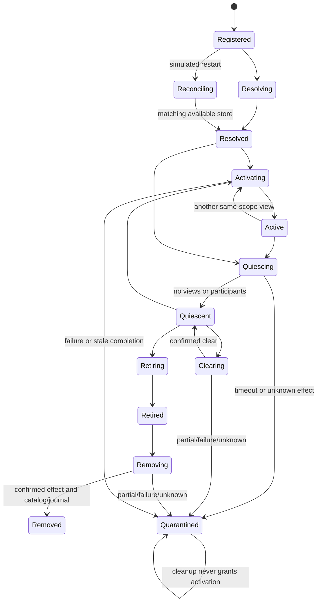

# WS-F0 state machines and qualification contracts

Implemented fake-only, 2026-11-09. Baseline0075b524a84712feeaf4f04d34b7b81ef6de8f3b. This companion explains the isolated [Swift package](../../../../../qualification/webkit-storage-f0/README.md); no app integration or architecture/owner/ADR status transition.

## Target boundaries

BrowserDomain contains tagged immutable IDs and typed scopes/outcomes. BrowserPorts depends only on Domain and supplies host authority, catalog, journal, engine storage, resource and abstract view-construction protocols. BrowserCore depends on Domain/Ports and coordinates actor-owned state. BrowserPersistence implements qualification-only **in-memory** catalog/restart adapters, not SQLCipher or production storage. WSF0Fakes supplies bounded deterministic fault/resource/provider/construction/authority infrastructure. The test target composes those five targets without external package dependencies. Nothing is injected into the real AppKit app.

This implements the approved logical four-target separation inside a qualification package. The additional fake target is test infrastructure, not a fifth product-core target. No existing core implementation existed to reuse. Future native adaptation must meet these typed behaviors plus the still-required engine-specific/runtime contracts; this is not a frozen production ABI or sufficient security boundary by itself.

## Binding and authority

ProfileID/StoreID/PrivateSessionID/EphemeralStoreID and all operation/view/run/resource/caller IDs are distinct tagged types validated as canonical nonzero UUID values. Profile and persistent-store identities must differ. Catalog insertion enforces scope/store uniqueness, namespace, revision and capacity; malformed/conflicting raw snapshot records remain explicit issues. Catalog enumeration is stable and does not call the engine. A fresh mapping cannot adopt an already observed orphan; established recovery never creates a missing store.

CallerContext is a claim checked against an injected host registry binding caller/run/scope/current authority epoch. Its public initializer does not mint permission. Ports and trusted harness introspection must not be exposed directly as chrome/UI services. Native authority, website origins, platform grants and Keychain remain outside fake qualification.

## Lifecycle

Every admitted operation reserves its exact ID/request and bounded diagnostics, installs a pending scope ticket, and writes its persistent pending checkpoint before calling an effect port. Private scopes skip the catalog/journal entirely. After awaited effects, current host authority/run/scope/pending operation and scope generation are rechecked. Source scope is revalidated before and after destination construction/activation during a switch. No live view or fake data is moved across scope boundaries.

Concurrent per-scope work returns Busy; an identical pending request also returns Busy. A terminal same-ID/same-request replay returns its retained result without repeating an effect. Same ID/different request returns OperationConflict. The finite128-admitted-operation bound stops new work rather than evicting unknown outcomes or promising unlimited exactly-once behavior. Separate disjoint scopes can progress independently.

Quiesce/retire fence acquisition of new managed references. Existing view/participant/pending-operation references block retirement/removal; close releases only the matching scope/view. A deliberate fake uncoordinated-reference hook tests admission invariants but is not a production capability. Private last-view closure initiates quiescence and retirement; a held independent reference blocks successful cleanup until explicitly released. A timeout/error never fabricates cleanup.

Fail/quarantine immediately fence scope generation, requests/results and resource acquisition; late completions cannot reactivate it. Best-effort close failures retain tracked resources. Cleanup operations may report their own success while the scope remains quarantined; this does not clear uncertainty or authorize use. No public unquarantine/reset operation exists in this slice.

## Clear versus removal

Clear requires quiescence and a nonempty explicit type set; it invokes only the clear provider and preserves store/mapping plus unselected data. Whole-store removal requires retired scope and empty resources, persists a deleting catalog status, invokes the separate remove provider and retains a deleted tombstone only after all confirmed terminal writes.

ProviderOutcome is completed/partial/failed(code)/unknown. Coordinator results retain those distinctions. An error or unknown result quarantines; provider completion followed by catalog/journal failure yields Unknown. Retries cannot turn partial/unknown into confirmed deletion; new operations are refused while quarantined. Same-operation replay returns the original result. This is logical fake deletion, never physical destruction/secure erasure.

## Simulated recovery

RestartSnapshot contains persistent profiles only, version, previous run and exact resource/generation/operation/phase/optional interrupted-action metadata. It has no URLs, data payload, private session, views, navigation/form/POST request or active grant fields. New coordinator/run starts with no runtime authority or views. Journal parser rejects wrong version, same run, duplicate profile/store, namespace/resource mismatch, invalid generation or excess records.

Reconciliation compares catalog, journal phase and provider observation. Available exact identities may resolve under a fresh generation without constructing a view. Missing/unavailable/conflicting/unknown stores and pending/deleting/quarantined/removed records do not become success or trigger creation. Pending delete and a missing store remain unresolved; absence alone cannot prove a successful callback. Orphan provider data is never adopted or swept.

Journal generations are monotonic. Quarantine writing first records a pending fence, then its classified outcome, preserving the earlier interrupted operation. A failed simulated journal/quarantine write returns the explicit failure and poisons exported snapshot validity; this conservative global fail-closed model prevents pretending an older stable record persisted. It is not an authenticated disk format, real crash persistence, backup or proof of OS recovery. The fake catalog/journal objects may be replaced from controlled immutable snapshots to model restart; no process or database is used.

## Diagnostics and bounded infrastructure

Diagnostics contain only typed action/classification/failure enums, sequence, opaque operation ID and scope kind. No native error strings, profile/private IDs, URLs/data/keys/paths/native handles are accepted as event payloads. Capacity is2..4096 with two slots reserved per admitted operation and outstanding terminal reservations protected from rejected-request pressure. Overflow refuses new admission; terminal records remain bounded. The fake provider recorder and fault queues are independently bounded; no production logging/privacy conclusion follows.

ControlledGate uses checked continuations for named arrival/release, not sleeps, polling, time or randomness. Every test fixture has its own injected actors; no global mutable state. Fake fault queues are FIFO and consumed once. Snapshot publication checks only immutable metadata membership/generation/privacy lineage/conflicts; it does not fetch or restore website data, create blobs/archives, run crypto or qualify a backup format.

## Implementation limits and recorded refinements

Separate quiescence/retirement, persistent tombstones, record-generation adoption, resource-acquisition fences and explicit failure poisoning make the proposed architecture executable without changing owner policy. Module/source locations are isolated qualification choices; production package location, ABI, native main-actor behavior, callback retention, popup configurations and database/public-API integration remain later tasks.

The existing WKS inventory includes native origin/cookie/sessionStorage, service-worker/network, modified-since deletion, backup/migration, SDK/minimum-OS and at-rest claims. These remain blocked or partial routes as recorded in the [WKS dispositions](m1-wsf0-wks-traceability.md); fake string dictionaries and typed failures do not validate them. D2A-01 and all SQLCipher PQR/EXP authority/status remain unchanged. No real WebKit/provider/database/Keychain or filesystem-backed website storage is introduced.
