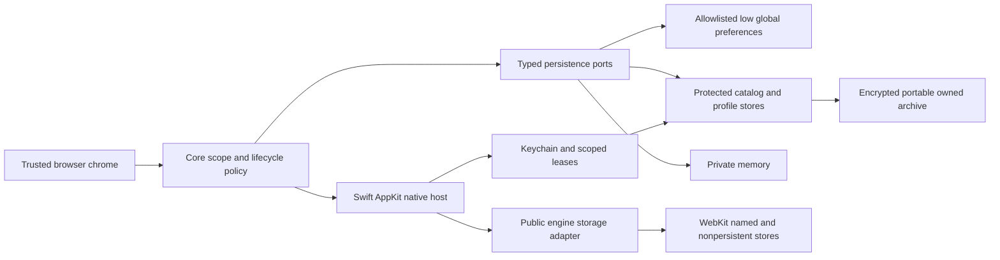

# Recommended persistence architecture

**Proposed for owner review · 2026-11-09**

## 1. Executive recommendation

Adopt **Option D** as the target architecture. Retain encrypted transactional SQLite as the preferred shape for the protected tiers. **SQLCipher remains the leading candidate for those tiers only**, subject to D2A-01, provider trust/runtime qualification and product integration evidence. No currently qualified native-only substitute satisfies the approved profile protection requirements. If the literal D2A-01 rule remains and no supported path emerges, evaluate one bounded ciphertext-record SQLite design before selecting a different protected backend. [Comparison](architecture-options.md)

## 2. Current findings

The reviewed WebKit runtime already keeps website payloads engine-managed. The gap is Vezham's protected durable product state: normal composition refuses access, native Keychain positive custody is blocked, and the synthetic archive and volatile lock tests exercise only subsets. “Continue SQLCipher” would mean qualifying a candidate, not retaining an active product database. [Source and archived evidence](current-state-assessment.md)

## 3. Target architecture

## 4. Data ownership

WebKit owns website data and internal formats. Vezham coordinates named/private store assignment, clearing and removal via public APIs. macOS owns native auth, consent, filesystem/security and Keychain services. Core owns policy, profile binding and generation. External downloads remain user-controlled. [Boundary inventory](ownership-boundaries.md)

## 5. Protection by data class

Keep full persistent profiles and sensitive catalog records protected, including histories and derived indexes, grant records, session data, downloads metadata and recovery journals. Use OS-protected storage only for allowlisted low global fields with no authority. Keep private records in memory. Seal sensitive native artifacts and portable archives independently. No WebKit data moves into owned storage or receives a Vezham key. [Classification](data-classification.md)

## 6. Keys and custody

Use independent profile key material and separate catalog protection. Adopt purpose/version-separated keys or envelopes after cryptographic review, using checked OS randomness, native scoped leases and supported crypto. Keychain protects normal-access wrapping authority; independent user-held recovery supports offline migration. Verify no raw key in SQL, URI, UI, logs or telemetry. Lock, rotation, recovery and loss require explicit state and old-key retirement only after validation. [Key specification](../M1/m1-keychain-and-independent-recovery-specification.md), [D2A-01](d2a-01-impact-analysis.md)

## 7. Isolation and lock

Publish persistent scope only after authenticated expected identity and generation. Every operation and response checks the same scope and epoch. Lock on approved OS triggers, inactivity and manual action. Close admission, retire views, invalidate grants and in-flight operations, and close/quarantine storage handles and revoke leases. Never let UI visibility alone define lock. Keep unaffected profiles usable. Require OS authentication and resource revalidation before unlock. [Failure matrix](security-threat-model.md)

## 8. Backup and recovery

Default to owned-only encrypted logical archives. Optional selected external files use separate authorized manifest members and no-overwrite restore. Keep portable key recovery independent of device Keychain and cloud. Unknown deletion history needs explicit confirmation. Preserve previous archives and stage verified restore before publication. [Backup design](backup-recovery-migration.md)

## 9. Migration

No production protected format was established in the inspected snapshot. Inventory authorized sources before migration. Preserve existing qualification artifacts and plan logical export, versioned staging, authenticated verification and durable promotion only for confirmed real sources. Existing SQLCipher source material, if any, must still satisfy its safe-open policy. [Migration design](backup-recovery-migration.md)

## 10. Engine independence

Use engine-neutral profiles, records, ports and archives. Version native bindings separately and plan new engine stores without interpreting old engine formats. Keep WKWebView conditional and Chromium/CEF evaluation-only. [Engine independence](engine-independence.md)

## 11. Trade-offs

D narrows the dependency and protection surface without relaxing approved profile confidentiality. It adds classification and coordinated lifecycle work. A offers mature SQL and page encryption but imposes provenance, worker, VFS and open-order requirements. C may remove the provider dependency but must establish authenticated completeness and freshness, disclosure, search and crash semantics. OS-only B does not close those gaps for protected data. [Options](architecture-options.md), [maintenance](performance-maintainability.md)

## 12. Outstanding owner decisions

Approve the D boundary and proposed owned-only default archive, choose the protected backend evaluation path, explicitly decide D2A-01 if any affected SQLCipher open remains, and decide any accepted bootstrap leakage or topology change. Keep OD-R01–20, OP-01–04, ADRs and safety gates intact. [Open decisions](open-questions.md)

## 13. Implementation sequence

Separate design acceptance and execution authorization. Freeze shared contracts and qualification oracles. Qualify signed native custody and engine behavior, then the chosen protected adapter, then integrated lifecycle, data and recovery. Do not start WS-F2R or WS-F3 from this report. [Sequence and scope](implementation-impact.md)

## 14. Qualification and release

Evidence must cover signed custody, provider or alternative equivalence, no unauthorized native access or cross-profile leakage, supported WebKit behavior, OS-trigger lock, safe permissions/transfers, coherent backup/restore, privacy and recovery failures. Stage C separately requires the actual final candidate on macOS 26.0 and latest supported 26.x, Developer ID signing, notarization, Gatekeeper, sandbox, Hardened Runtime, entitlements, updater, release compatibility and performance. Deferral is not passage. Internal-only distribution remains subject to approval and these gates. [ADR 0001](../../../../decisions/0001-browser-engine-strategy.md), [ADR 0002](../../../../decisions/0002-browser-distribution-and-platform.md), [qualification backlog](../M1/m1-wsf2-public-release-qualification-backlog.md)
