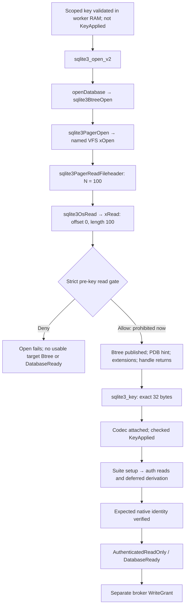

# D2A-01 SQLCipher initialization feasibility investigation

2026-11-09. **Investigation only. D2A-01 remains Proposed / Not Decided. No WS-F2R implementation or pre-key-read exception is authorized.**

## 1. Executive summary

**Classification: `NOT_FEASIBLE_WITH_CURRENT_SQLCIPHER_PATH`.**

The pinned ordinary cold existing-file open constructs its B-tree/pager and requests 100 raw main-database bytes at offset 0 **before** `sqlite3_open_v2` returns a usable handle for `sqlite3_key`. The strict application/VFS no-read-before-successful-target-key-application policy therefore conflicts with this path. A truthful VFS must either service the prohibited request or deny it and prevent a working open. Possessing the scoped key in worker RAM does not attach it to that target connection.

This is a source-supported negative result for the current public-API/private-cache existing-file architecture, not a claim that all conceivable providers or future SQLCipher APIs are impossible. No supported pre-read key-binding hook was established. The source also places automatic extensions, URI key handling and the `SQLITE_FCNTL_PDB` connection-pointer hint after the offending header request. Deferred key derivation/salt acquisition is distinct from both that early raw-header read and later authenticated schema reads.

Evidence is reproducible without running SQLCipher: **19 whitelisted source/text members match the recorded pinned Git blobs; 22 final static source checks pass; 28 source-reference spans are fingerprinted**. The retained vendor archive matches its prior authenticated SHA256. Actual provider/database runtime experiments: **NOT_EXECUTED**. No production catalog, database, encrypted fixture, VFS adapter or fallback was implemented. Source facts support the conflict directly; a merely proposed successful sequence is not being counted as feasibility.

## 2. Repository, source identity and evidence levels

| Item | Verified value / limitation |
|---|---|
| Repository | `/Users/vigneshwaranbhoj/Downloads/repo-labs/vx-browser` |
| Starting and final HEAD | `701183003e967843dd77e8506f41cd9b80fedca9` |
| Branch / initial state | `timeline`; clean working tree |
| Parent / WS-F2 implementation | `d90ef9b029568c650588ffbead99866ee1378710` |
| Handoff baseline | Existing nine reports in this directory, preserved |
| SQLCipher commit | `355d4db92d3404e71faa8088d071a71d767807f4` |
| Annotated tag object | `52252487a5cada9b430e8d4b20025790c5a6ba20` → that commit in retained metadata |
| Recorded source tree | `b3aa6f0a71413a40df4c968d357bbbbee61b42cb` |
| Vendor archive SHA256 | `a1417a5a672a2342de6ae44e08ccd68487fa3d0a43212331f4226a0d00b51b9c` |
| Candidate | SQLCipher 4.20.0 Community/CommonCrypto; SQLite 3.54.1 per retained source/build recipe, not a newly observed runtime version |
| New working-tree changes | Only this report and its new static-evidence directory; nothing staged or committed |

The checker reads the preserved archive under `docs/architecture/phase-5/evidence/20261108T142421Z-m1-vendor-archive-verification/sources/`, checks the retained tag→commit→tree relationship and recomputes Git blob IDs/SHA256 for the selected 19 members. The historical [vendor verification decision](../../evidence/20261108T142421Z-m1-vendor-archive-verification/results/qualification-decision.json) records the earlier archive signature and complete 2,325-file correspondence. This task repeats selected-byte integrity checks, **not** GPG verification or publisher identity validation. The separate Git tag-signature unknown-key limitation remains unchanged.

Evidence labels used here:

- **Source fact:** directly inspected code in the pinned, byte-verified source, referenced by SRC identifiers below.
- **Observed inspection:** Git state, archive/blob/hash comparisons and static-checker output actually obtained in this task.
- **Engineering inference:** consequences of those facts for a cold existing-file open under the current architecture; not a native trace.
- **Proposed qualification:** future instrumentation and acceptance, not executed or approved implementation.

The machine-readable [source inspection](d2a-01-initialization-evidence/source-inspection.json) contains full source-file hashes, exact line-span hashes, checks, integration-file hashes and limitations. It is a source-inspection result, not a native encryption/acceptance PASS.

## 3. Exact initialization sequence and distinct milestones

The following describes the supported ordinary sequence and existing proposed Vezham safeguards. **It is blocked at step 4 under the unchanged policy**, not instructions to execute a currently compliant open.

| Step | Required operation / phase | Source and policy consequence |
|---|---|---|
| 1. Admission | Native supervisor validates full scope/store/operation/lease/key-version/resource identity; receives exactly 32 scoped key bytes into worker-owned memory | Existing Phase 2 design; KeyReceived is not KeyApplied. Reject private scopes, invalid lengths and stale authority before target access. No key SQL/URI/logging. |
| 2. Global configuration / initialization | Apply reviewed pre-init configuration; `sqlite3_initialize`; check compiled identity; register/select the reviewed named confinement/observer VFS | SRC-01; VFS lookup/registration can themselves initialize (os.c:362–413). `SQLITE_EXTRA_INIT` initializes the provider globally; it has no target key/connection argument. No target is authenticated. |
| 3. Start target connection construction | Broker binds admitted existing resources, installs zero-read/pre-auth mutation fences; call `sqlite3_open_v2` with no CREATE and the named VFS under the private-cache/single-worker contract | SRC-03/04/09. The worker must not acquire arbitrary paths or substitute a default provider/VFS. Current production implementation contains no such opening executor. |
| 4. Implicit initial file read | `sqlite3BtreeOpen` → `sqlite3PagerOpen` → VFS `xOpen`; then `sqlite3PagerReadFileheader(N=100)` → `sqlite3OsRead(...,100,0)` → file `xRead` | SRC-05–10. On the ordinary open file branch this request occurs before the caller can apply the target key. **This is the conflict.** No schema query is necessary to trigger it. |
| 5. Finish open if permitted | B-tree publication/PDB hint, built-in/automatic extensions, handle publication and late URI key handling; finally return from open | SRC-03/04/07. These stages cannot provide a supported key hook before step4. Allowing that step is not authorized. |
| 6. Key application | After a successful usable open: `sqlite3_key(db, bytes, 32)` → `sqlite3_key_v2` → `sqlcipherCodecAttach`; check return, current identity and epoch | SRC-13–15. Allocate codec, copy/set binary pass material and install codec. Negative nKey uses string length and is disallowed by Vezham's exact-binary contract. API success is neither derived-key authentication nor database readiness. |
| 7. Cipher and connection configuration | Only after successful key binding, apply the reviewed allowlisted settings before derivation/schema workload; validate required getters and unsupported results | SRC-19/20/25–27 and Phase 2 §6. Settings must match the format; do not try alternative suites/keys/migration automatically. Generic PRAGMAs can call VFS or load schema. |
| 8. First post-binding reads / derivation | Start bounded schema/identity authentication while all persistent writes remain fenced; instrument before prepare as well as step | SRC-16–18/21/22. Codec use derives keys; salt acquisition can issue another offset0 read. These later reads are not the earlier raw header request and do not retroactively authorize it. |
| 9. Authenticate and validate | Real encrypted schema/required fixture reads, effective suite and expected native scope/store/schema/reader-writer/key-version checks | Schema success alone cannot authorize a different profile/store. Wrong key versus corruption may remain indistinguishable. No provisional rows are published. |
| 10. Ready / separate write grant | Record AuthenticatedReadOnly and DatabaseReady for permitted reads only after all identity/policy checks; supervisor durable intent and broker grant epoch separately authorize writes | Existing OPEN-02 and Phase 2 contracts; API return0, protocol readiness or process exit alone cannot grant either authority. No such runtime transition was executed here. |

The source comment in `main.c:3712–3714` deliberately defers **schema** loading. That does not contradict the earlier **file-content** read at `btree.c:2716`/`pager.c:4076`. Vezham's strict rule is stronger than “set the key before the first SQL query.”

The public vendor contract describes handle-based key APIs, just-in-time derivation and subsequent schema access to test a key; it does not promise zero VFS reads during handle construction. [Zetetic API](https://www.zetetic.net/sqlcipher/sqlcipher-api/). SQLite documents handle creation and VFS selection separately; an error can still return an allocated handle, which must not be treated as usable/authenticated. [SQLite open contract](https://sqlite.org/c3ref/open.html).

### Required suite versus other proposed settings

The retained [provider configuration](../../evidence/20261108T150828Z-m1-sqlcipher-runtime-readiness/provider-configuration.json) and [Phase 2 §6](../M1/m1-sqlcipher-provider-adapter-phase2-design.md) specify SQLCipher4 compatibility, 4096-byte pages, AES-256-CBC, enabled HMAC-SHA512, PBKDF2-HMAC-SHA512 at 256000 iterations, plaintext-header size0, and **32 binary bytes as a length-explicit passphrase**, not hex/raw-key syntax. SRC-19 confirms the compatibility4 constituent setters. Compatibility is not an authentication result or a guessed compatibility getter.

Memory-security/logging controls, memory-only temp, mmap0, busy timeout, durability/checkpoint and journal transitions retain their existing reviewed/proposed phases. Do not promote engineering proposals to approved policies here. An after-open mmap setting cannot prevent the header request that already occurred; pre-open protection needs the broker/VFS and reviewed global setup. Do not change an existing journal mode, checkpoint or migrate while still authenticating.

An old comment in context initialization says to read salt, but the inspected function body only allocates/configures and sets pass material; actual salt initialization is called from deferred derivation or a salt getter (SRC-15–17/27). This is why the report distinguishes KeyApplyEnter, checked KeyApplied, derivation and authentication. The key API's page-size helper return is not propagated at `sqlcipher.c:3755`; effective-setting/error checks still matter. No claim that the key call is completely side-effect-free follows from this inspection.

## 4. Read-before-key call flow

This diagram is **source-derived**, not an observed runtime trace. The allow branch is counterfactual and remains unauthorized.



**Why the strict branch cannot finish a usable open:** a real pre-key `xRead` refusal propagates out of header/B-tree construction. B-tree error cleanup clears its output pointer (SRC-07). Codec attachment requires a present target `pBt` (SRC-13). Merely keying the sick allocated handle from a failed open is not a supported recovery path. Pretending an existing header is empty/short or waiting for a key call that cannot happen until open returns does not solve the public-API dependency cycle.

## 5. Exact pinned source references

All upstream links below point to the fixed commit, not current main. The equivalent bytes are available in the retained authenticated archive, with span/file fingerprints in the new JSON. SRC identifiers are local evidence references, not new owner/REQ/WKS/PQR identifiers.

| Ref | Exact source path and line range | Symbol / subject |
|---|---|---|
| SRC-01 | [`src/main.c:349–377`](https://github.com/sqlcipher/sqlcipher/blob/355d4db92d3404e71faa8088d071a71d767807f4/src/main.c#L349) | `sqlite3_initialize / openDatabase / public open wrappers` |
| SRC-02 | [`src/main.c:3381–3417`](https://github.com/sqlcipher/sqlcipher/blob/355d4db92d3404e71faa8088d071a71d767807f4/src/main.c#L3381) | `sqlite3CodecQueryParameters` |
| SRC-03 | [`src/main.c:3662–3735`](https://github.com/sqlcipher/sqlcipher/blob/355d4db92d3404e71faa8088d071a71d767807f4/src/main.c#L3662) | `openDatabase Btree open; deferred schema comment` |
| SRC-04 | [`src/main.c:3762–3816`](https://github.com/sqlcipher/sqlcipher/blob/355d4db92d3404e71faa8088d071a71d767807f4/src/main.c#L3762) | `openDatabase handle publication / URI key / return; open_v2` |
| SRC-05 | [`src/btree.c:2562–2589`](https://github.com/sqlcipher/sqlcipher/blob/355d4db92d3404e71faa8088d071a71d767807f4/src/btree.c#L2562) | `sqlite3BtreeOpen header buffer` |
| SRC-06 | [`src/btree.c:2692–2740`](https://github.com/sqlcipher/sqlcipher/blob/355d4db92d3404e71faa8088d071a71d767807f4/src/btree.c#L2692) | `sqlite3BtreeOpen pager/header/page-size order` |
| SRC-07 | [`src/btree.c:2823–2847`](https://github.com/sqlcipher/sqlcipher/blob/355d4db92d3404e71faa8088d071a71d767807f4/src/btree.c#L2823) | `Btree publication, error cleanup, PDB hint` |
| SRC-08 | [`src/pager.c:4063–4081`](https://github.com/sqlcipher/sqlcipher/blob/355d4db92d3404e71faa8088d071a71d767807f4/src/pager.c#L4063) | `sqlite3PagerReadFileheader` |
| SRC-09 | [`src/pager.c:5126–5155`](https://github.com/sqlcipher/sqlcipher/blob/355d4db92d3404e71faa8088d071a71d767807f4/src/pager.c#L5126) | `sqlite3PagerOpen main-file xOpen` |
| SRC-10 | [`src/os.c:88–91`](https://github.com/sqlcipher/sqlcipher/blob/355d4db92d3404e71faa8088d071a71d767807f4/src/os.c#L88) | `sqlite3OsRead / xRead` |
| SRC-11 | [`src/os.c:191–207`](https://github.com/sqlcipher/sqlcipher/blob/355d4db92d3404e71faa8088d071a71d767807f4/src/os.c#L191) | `sqlite3OsFetch / xFetch` |
| SRC-12 | [`src/os_unix.c:3463–3577`](https://github.com/sqlcipher/sqlcipher/blob/355d4db92d3404e71faa8088d071a71d767807f4/src/os_unix.c#L3463) | `seekAndRead / unixRead` |
| SRC-13 | [`src/sqlcipher.c:3657–3784`](https://github.com/sqlcipher/sqlcipher/blob/355d4db92d3404e71faa8088d071a71d767807f4/src/sqlcipher.c#L3657) | `sqlcipherCodecAttach` |
| SRC-14 | [`src/sqlcipher.c:3810–3822`](https://github.com/sqlcipher/sqlcipher/blob/355d4db92d3404e71faa8088d071a71d767807f4/src/sqlcipher.c#L3810) | `sqlite3_key / sqlite3_key_v2` |
| SRC-15 | [`src/sqlcipher.c:1553–1677`](https://github.com/sqlcipher/sqlcipher/blob/355d4db92d3404e71faa8088d071a71d767807f4/src/sqlcipher.c#L1553) | `codec context construction` |
| SRC-16 | [`src/sqlcipher.c:1487–1528`](https://github.com/sqlcipher/sqlcipher/blob/355d4db92d3404e71faa8088d071a71d767807f4/src/sqlcipher.c#L1487) | `salt init / getter` |
| SRC-17 | [`src/sqlcipher.c:1856–1918`](https://github.com/sqlcipher/sqlcipher/blob/355d4db92d3404e71faa8088d071a71d767807f4/src/sqlcipher.c#L1856) | `key derivation / raw-key branches` |
| SRC-18 | [`src/sqlcipher.c:3496–3575`](https://github.com/sqlcipher/sqlcipher/blob/355d4db92d3404e71faa8088d071a71d767807f4/src/sqlcipher.c#L3496) | `codec use / salt offset / authenticated read result` |
| SRC-19 | [`src/sqlcipher.c:3291–3306`](https://github.com/sqlcipher/sqlcipher/blob/355d4db92d3404e71faa8088d071a71d767807f4/src/sqlcipher.c#L3291) | `cipher compatibility4 suite` |
| SRC-20 | [`src/pragma.c:480–539`](https://github.com/sqlcipher/sqlcipher/blob/355d4db92d3404e71faa8088d071a71d767807f4/src/pragma.c#L480) | `PRAGMA VFS / codec / schema dispatch` |
| SRC-21 | [`src/prepare.c:267–285`](https://github.com/sqlcipher/sqlcipher/blob/355d4db92d3404e71faa8088d071a71d767807f4/src/prepare.c#L267) | `schema init read transaction` |
| SRC-22 | [`src/pager.c:3188–3240`](https://github.com/sqlcipher/sqlcipher/blob/355d4db92d3404e71faa8088d071a71d767807f4/src/pager.c#L3188) | `readDbPage` |
| SRC-23 | [`src/attach.c:211–287`](https://github.com/sqlcipher/sqlcipher/blob/355d4db92d3404e71faa8088d071a71d767807f4/src/attach.c#L211) | `ATTACH Btree then codec` |
| SRC-24 | [`src/sqlite.h.in:1509–1533`](https://github.com/sqlcipher/sqlcipher/blob/355d4db92d3404e71faa8088d071a71d767807f4/src/sqlite.h.in#L1509) | `VFS xOpen signature` |
| SRC-25 | [`src/sqlcipher.c:2782–2804`](https://github.com/sqlcipher/sqlcipher/blob/355d4db92d3404e71faa8088d071a71d767807f4/src/sqlcipher.c#L2782) | `page-size coordination helper` |
| SRC-26 | [`src/pager.c:3932–3991`](https://github.com/sqlcipher/sqlcipher/blob/355d4db92d3404e71faa8088d071a71d767807f4/src/pager.c#L3932) | `page-size reconfiguration` |
| SRC-27 | [`src/sqlcipher.c:3142–3152`](https://github.com/sqlcipher/sqlcipher/blob/355d4db92d3404e71faa8088d071a71d767807f4/src/sqlcipher.c#L3142) | `salt getter PRAGMA` |
| SRC-28 | [`src/sqlcipher.c:412–450`](https://github.com/sqlcipher/sqlcipher/blob/355d4db92d3404e71faa8088d071a71d767807f4/src/sqlcipher.c#L412) | `Apple / atexit finalization hooks` |

## 6. Actual Vezham integration

| Existing location | Inspected status / significance |
|---|---|
| `apps/browser-macos/Sources/Host/ApplicationDelegate.swift:26–28` | Normal AppKit startup composes `NativeStorageSession.protectedFoundation()`. |
| `apps/browser-macos/StorageRuntime/Sources/BrowserNativeStorage/NativeStorageSession.swift:32–48` | Connects Domain/Ports/Core/native services and constructs `ProtectedCatalog` as catalog/journal; no SQLCipher opener. |
| `qualification/webkit-storage-f0/Sources/BrowserPersistence/ProtectedCatalog.swift:5–18` | Explicit D2A01KeyBeforeRead gate; returns unavailable/failed outcomes; no target DB open/create/hash/copy or plaintext fallback. Schema strings/plans below it are not executed transactions. |
| `qualification/sqlcipher-phase1/worker.c:111–119` | Validates then wipes the fake key frame before ProtocolReady. It does not call a key API. It cannot be repurposed as evidence of successful target key binding. |
| `qualification/sqlcipher-phase1/link_identity.c:1–8` | Static symbol roots for linkage inspection, not runtime calls. The linked worker is not launched by this task. |
| `docs/architecture/phase-5/reports/M1/m1-sqlcipher-provider-adapter-phase2-design.md`, §§2–6 | Proposed serialized provider executor, named observer/confinement VFS, suite/authentication and identity boundaries; not an implemented production adapter. |
| `m1-sqlcipher-open02-write-fence-specification.md`, §§2–5 | Proposed broker read/write phases and source-preservation requirements; no working native fence qualification implied. |
| `m1-sqlcipher-open03-vfs-confinement-specification.md` | Broker-owned descriptors/path confinement/scope contracts; no approved content substitution or alternate encryption format. |

The actual current production integration is therefore **a safe unavailable gate plus contracts**, not an existing successful SQLCipher connection that this investigation can instrument retrospectively. “Actual Vezham path instrumentation” below means where a separately authorized adapter must be connected; no present trace is fabricated.

BrowserDomain/Ports/Core retain policy and opaque identity. Native platform services own Keychain and execution authority; BrowserPersistence applies only to Vezham-owned catalog/profile files. WebKit owns cookies, localStorage, IndexedDB, HTTP cache and service workers. No WebKit internal file was inspected/manipulated or SQLCipher-wrapped in this task.

## 7. Proposed instrumentation design

### Event ordering and enforcement

Use the existing isolated-worker/broker architecture with an epoch-scoped, monotonically ordered event stream covering the entire operation. Correlate supervisor and worker with acknowledged causal markers; wall-clock timestamps alone cannot order cross-process events. Install and observe policy **before** provider initialization/VFS selection/open; never add tracing only after a handle has returned.

| Event / observation | Placement / required fields | Required interpretation |
|---|---|---|
| ProviderInitEnter/Exit | Around initialization and linked-image lifecycle; build/pin/runtime identity, numeric result | Global initialized is not a connection, key or DB ready. Linked-image finalizers need their own future scope (SRC-28). |
| KeyReceived | Complete validated binary frame in worker memory; opaque run/worker/scope/store/lease/key-version | No key bytes, representation, raw pointers or key hash; not target key application. |
| OpenEnter/Exit | Immediately around `sqlite3_open_v2`; opaque connection/resource ID, flags, named VFS, result | An allocated error handle is not a usable target connection. |
| VFS xOpen / broker acquisition | Entry/decision/completion for main/WAL/journal/temp/SHM resources; object IDs/flags/epoch | Observe hidden underlying I/O too; no CREATE/TRUNC or path substitution on existing-open path. |
| ReadRequested / Allowed-or-Denied / Completed | At every VFS `xRead` entry and broker delegation; resource kind, exact offset/length, phase, ordinal, coarse result | Count the request even if denied or served from RAM/cache. Strict oracle permits no pre-KeyApplied target-content request. |
| Fetch/Map / file-control | Every `xFetch`, mapping/SHM operation and file-control opcode, bounded metadata summary | No silent mmap or custom-file-control bypass; request absence in xRead alone is insufficient. |
| KeyApplyEnter / KeyApplied-or-Failed | Around actual length-explicit key call; checked result, exact handle/epoch and broker phase acknowledgement | KeyApplied only after successful return for current target; failed/unknown result never advances read authority. Reads attempted inside the call remain pre-success and must be accounted for. |
| ConfigEnter/Exit | Reviewed setting ID, expected/effective nonsecret value, result shape/code | PRAGMA/file-control callbacks can do work during preparation; unsupported/empty result cannot be treated as success. |
| AuthBegin / first post-key content read | Before prepare, schema init and step, with all source writes still fenced | Distinguish the already-offending raw header request from post-key salt/page/schema reads. |
| SchemaChecked / NativeIdentityChecked | Complete schema, scope/store/suite/schema-reader-writer/key-version and fixture outcome, no raw records | Key return0, schema count or version string alone cannot authorize the wrong store. |
| DatabaseReady | After full identity, current lease and policy checks; read-authorized state | Separate from protocol ready, KeyApplied and write permission. |
| WriteGrant / denied mutation / retirement | Broker atomically installed grant epoch plus durable supervisor intent; all mutation and cleanup paths | No grant on an auth failure or pending/unknown result; errors/exit never manufacture rollback/cleanup success. |

An ordered trace must retain attempted and rejected operations; log overflow, gaps, missing terminal events or unknown methods invalidate the trace and stop qualification. Emit only bounded enums/numbers/opaque registered IDs. Provider SQL/profiling/device-debug logs are not an acceptable secret-safe substitute. No key, URI containing a key, arbitrary SQL, file path, user record or raw provider error text enters evidence.

### VFS coverage and physical-I/O boundary

Cover `xRead`, `xWrite`, `xTruncate`, `xSync`, `xFileSize`, `xLock/xUnlock`, `xFileControl`, `xFetch/xUnfetch`, `xShmMap/Lock/Barrier/Unmap`, `xOpen`, `xDelete`, access and namespace handling. Treat unknown callback/opcode effects as unqualified. Keep the broker's content-write fence active for main/WAL/journal/SHM/temp/provider scratch and cleanup, not just SQL write statements. A PRAGMA is not automatically metadata-only: SRC-20 dispatches file control before codec handling and generic schema loading.

The documented VFS interface exposes file operations, not a preconstructed keyed SQLCipher connection. Its public `xOpen` signature has no database-handle parameter (SRC-24); its PDB hint arrives after the header (SRC-07). File-control overrides require review and do not constitute a supported pre-open key-binding API. [SQLite VFS](https://sqlite.org/c3ref/vfs.html), [file methods](https://sqlite.org/c3ref/io_methods.html), [file control](https://sqlite.org/c3ref/file_control.html).

A wrapper that only counts delegated `read/pread` calls can miss reads performed in another callback or satisfied from mapped memory. SRC-12 shows unixRead serving mapped data or using pread. Independent, separately authorized OS/syscall observation can corroborate the broker/VFS trace and detect bypasses, but **neither VFS nor syscall tracing proves zero physical bytes fetched by the OS/device**. Cache hits, filesystem metadata, sectors, read-ahead and mmap/page faults are different observability layers. This investigation demonstrates a prohibited application/VFS request; it does not need or claim a physical-media measurement. An Option2 100-byte application/VFS bound would not bound physical transfer sizes.

## 8. Supported alternatives and trade-offs

Only documented/public interfaces are treated as API candidates. Rejected tricks are identified as exclusions, not promoted to supported alternatives.

| Approach | Source/documented result under strict policy | Security / operational trade-off and disposition |
|---|---|---|
| Ordinary `open_v2` then binary `sqlite3_key` | SRC-03–14 show header request before key | Supported normal API sequence, incompatible with current zero-request-before-key condition; no Ready/write without full auth. |
| `sqlite3_open` / open16 instead | Same underlying openDatabase construction; no earlier key parameter | Convenience API changes flags/encoding, not the cold-open dependency; CREATE behavior is additionally unsuitable for existing-store admission. |
| Read-only / immutable / nolock flags | Pager still opens main and B-tree still requests header (SRC-06/09) | Read-only is not no-read; immutable/nolock assert conditions and can alter consistency semantics. Not a remedy or a selected workaround. |
| URI key/hexkey/textkey | SRC-02/04 parse keys only after B-tree construction | Too late, and violates the existing no-key-in-URI/logging and exact-binary channel contract. No secret URI test needed. |
| `sqlite3_auto_extension` | SRC-03 executes it after B-tree open | Documented connection callback, not a pre-header callback. Global key lookup/reentrancy would add authority hazards without fixing ordering. [SQLite contract](https://sqlite.org/c3ref/auto_extension.html). |
| Global extra-init / cipher-default configuration | SRC-01 and context defaults do not attach a key to a target B-tree | Initializes provider/defaults, not a per-target keyed connection. Changing defaults/page size cannot remove step4. |
| VFS xOpen / PDB / custom file-control | xOpen lacks handle; PDB is after the header; attachment requires a published B-tree | Legitimate enforcement/observation surfaces. No supported reentrant pre-header key-binding path established; knowing a key in VFS private state is not target `sqlite3_key`. |
| Memory connection plus ATTACH | SRC-23 opens target B-tree before codec/key handling | Keyed memory DB is not keyed target. Arbitrary ATTACH is excluded by Vezham's existing executor contract; no scope/format shortcut. |
| `sqlite3_deserialize`, backup/export or preload | APIs require content acquisition or an already usable source connection; no pin-supported opaque target transplant into an already keyed pager established | Pre-key hashing/copying/preload violates policy; decrypted memory import changes protection/format/recovery semantics. Not an approved current path. [SQLite deserialize contract](https://sqlite.org/c3ref/deserialize.html). |
| Raw key/explicit salt or plaintext-header settings | Configuration happens after the ordinary handle/header request | Different key format or exposing SQLite header does not remove the read; raw-key substitution/plaintext-header changes violate the frozen suite/channel. |
| Already keyed shared B-tree / connection reuse | Can take a different branch that skips new B-tree construction | Does not bootstrap cold start; first opener still has the conflict, and cross-connection/profile key/authority sharing is outside the current private-cache contract. Not proof of strict existing-file initialization. |
| Truly new empty reservation | May have no existing bytes, but a truthful header request/short read can still occur | Does not qualify cold reopen or the task's no-pre-key-content-request oracle; no product DB or fixture was created. |
| Maintained vendor key-aware open / revised supported storage architecture | No such documented API meeting the frozen target-binding contract was found in this pin | A future supported two-phase/key-aware design would need vendor/source evidence, explicit architecture review and migration/recovery qualification. Feasibility of that future path is INCONCLUSIVE, not an available solution. No vendor contact or provider change made. |

Explicitly excluded: fabricated zero/short headers, pager/codec patches, unsupported access to a half-constructed handle, deadlocking xRead until an unavailable public key call, plaintext SQLite fallback, pre-key full-file hash/copy and replacing WebKit storage. Returning a hard VFS error safely preserves the policy but is refusal, not a successful open. Merely using a different implementation of xRead to serve the same target bytes from cache would still issue the prohibited request.

## 9. Feasibility determination and decision comparison

The task's four classifications are evaluated as follows:

| Classification | Finding |
|---|---|
| `FEASIBLE_WITH_EXISTING_INTEGRATION` | Not supported: product catalog is unavailable; pinned ordinary cold-open path contains the pre-key request. |
| `FEASIBLE_WITH_SUPPORTED_CHANGES` | Not established: inspected documented hooks/flags do not remove the request while retaining exact target key binding, truthful I/O and frozen source/suite. |
| **`NOT_FEASIBLE_WITH_CURRENT_SQLCIPHER_PATH`** | **Selected investigation classification:** a necessary source-derived request precedes successful supported key binding for the current path. |
| `INCONCLUSIVE` | Applies to future vendor-supported architectures, actual runtime request multiplicity/side effects and OS/device reads; not used to obscure the identified current-path conflict. |

The necessary request is enough to rule out the strict **current** path; a live run that intentionally allowed it would not be required to establish this source-level negative and is not authorized by this report. Conversely, source inspection does not prove that Option2 would permit only that one request in a future native VFS, that the key call has no additional I/O, or that authentication/recovery would succeed. Those remain qualification obligations.

| Existing D2A-01 alternative | Consequence of these findings |
|---|---|
| Option1: retain literal rule | Keep existing-file opens blocked; seek a separately reviewed supported key-aware/provider architecture if the requirement is retained. Source-proven refusal does not become a functional catalog. |
| Option2: approve only existing exact encrypted-header request exception | Could make ordinary construction eligible for bounded qualification, provided only its frozen offset0/length100 application/VFS request occurs and every other restriction holds. It does not make strict-zero-read true, approve a broader hash/copy exception or establish working backup/recovery. |

No alternative is selected or approved. Both are reproduced and explained in the existing [owner decision handoff](d2a-01-owner-decision.md) and canonical [OPEN-01 §4](../M1/m1-sqlcipher-open01-resolution.md). This report does not alter them.

## 10. Security implications and precise limits

- No target-content request before KeyApplied is stricter than “no decrypted schema/row access before key.” Ciphertext/salt reads still count under the current rule. Normal encrypted page1 contains salt plus ciphertext; plaintext-header size0 does not mean the salt is encrypted or that constructor reads do not occur (SRC-16–18).
- Possession, codec attachment, KDF completion, page-HMAC/decryption success, native identity validation, DatabaseReady and write grant are separate milestones. No one marker can stand for all of them.
- Wrong key, wrong suite, corrupt/tampered input, missing database and a valid foreign profile must preserve sources and deny publication/writes. API return0 cannot prove key correctness, entire-file integrity or identity.
- Authentication itself can encounter hot journals, WAL/SHM work or side effects. The existing [OPEN-02 fence](../M1/m1-sqlcipher-open02-write-fence-specification.md) requires denial/preservation or separately authorized recovery; read-only flags and eventual post-failure hashes alone are not enforcement.
- If key binding never succeeds, database-content hash witnesses can be unavailable under the strict rule. Record that absence; do not pre-key hash/copy a target to claim before/after preservation.
- Some historical analysis uses the phrase “physical read.” The independently established claim here is **application/VFS read request**, not physical-device byte count. Preserve the historical wording/results and use the precise observability distinction in new qualification.
- This investigation is independent of Keychain developer/production signing and macOS26 release testing; those do not change the pinned call order. Their separate gates remain. WebKit-managed data remains outside SQLCipher and outside this investigation.

## 11. Remaining unknowns

| Unknown | Why still unknown / evidence needed |
|---|---|
| Exact native VFS callback multiplicity and hidden OS calls | No production observer/broker VFS exists or ran; need pinned exact-build trace with complete callback/mutation coverage. |
| Key-call/settings implicit reads or effects in actual build | Selected source inspected, but provider/native hooks, allocation/logging, method delegation and macro-selected branches need runtime source/build identity and trace. |
| Actual wrong-key/tamper/recovery behavior and source preservation | No target DB, encrypted fixture or provider-linked runtime launched. Need authorized controlled original-preservation/fault evidence under the chosen D2A branch. |
| WAL RAM-index/read-only/pre-auth recovery compatibility | Existing design is a candidate; any required persistent mutation must stop/preserve, not silently expand permissions. |
| Supported future early-key API | No maintained documented target-key-aware API established in this pin; no claim about every future vendor/edition/provider. |
| Physical OS/device reads | Not derivable from this inspection or a VFS trace; cannot promise zero physical transfer. |
| Full key/custody/catalog production integration | Current gate and fake worker do not implement these features; this task adds no implementation. |
| Fresh publisher / Git tag-signature authentication | Prior vendor verification reused; no new GPG/vendor-key validation, no resolution of the historical separate tag-signature limitation. |

These unknowns do not make an identified earlier necessary request disappear, and they do prevent claiming a positive engine/provider qualification.

## 12. Evidence required before any future implementation qualification

First obtain explicit D2A disposition and separately scoped implementation/runtime authority. Freeze source/header/archive/link identities, approved native admission contracts, exact budgets, callback coverage and allowed data/fixtures. Retain original PQR E12/K16/T10/R12 definitions and mapping; local STATIC/SRC identifiers here create no PQR/EXP/WKS acceptance pass.

1. **Strict Option1:** show a maintained documented early target-key API/architecture, then an actual complete trace proving zero target-content requests before successful target KeyApplied. A VFS denial result proves refusal only; a mocked/warmed connection is not cold-open proof.
2. **Only if exact Option2 approved:** show only the explicitly permitted raw header request before KeyApplied, key already validated in worker memory, no extra application/VFS pre-key reads/mappings/hash/copy and no persistent mutation. A different bound or an unexpected key-call effect stops the run and requires explicit reconsideration, not an automatic allowance.
3. **Both branches:** correct, wrong, missing/invalid-length/key-version and foreign native identity controls; new create plus cold fresh-process reopen; exact suite/getters and full fixture/schema identity; no Ready/write grant on failed/partial/stale operations.
4. Attribute content reads beginning with construction and before SQL prepare, all file-control/mapping and sidecar/direct-I/O effects. Demonstrate an appropriate violation-detection positive control without reading production data. Record denied attempts as well as delegated/completed operations.
5. Qualify all pre-auth write/namespace/close/recovery fences, busy/disk-full/corruption/interruption and late-result outcomes with truthful original-preservation witnesses. Record recovery-required when dirty-state operation cannot satisfy the fence; do not label it successful recovery.
6. Freeze expected error/result shapes and cleanup receipts. Preserve every failed/incomplete run in a new evidence root; no aggregate fake/native pass rate or silent historical reclassification. Effective crypto/settings, source-identity, authenticated scope and artifact observations complement each other; no single negative plaintext scan proves encryption.

## 13. Explicit owner decision required

**D2A-01 is still Proposed / Not Decided.** The product owner must deliberately choose:

1. Retain the literal rule and keep the pinned current existing-file path blocked; separately review a supported strategy capable of meeting it; **or**
2. Approve the **exact existing** offset0/length100 encrypted-header application/VFS request exception in OPEN-01 §4, including its validated32-byte-worker-key prerequisite, no physical zero-read guarantee, no additional pre-key request/hash/copy, no mutation/recovery/checkpoint write, no secret SQL/URI, and no publication/Ready/write grant before required authentication/native identity checks.

The complete canonical wording remains [unchanged in the owner handoff](d2a-01-owner-decision.md). This task records neither approval nor rejection, makes no change to the policy and grants no subsequent implementation authority. Developer ID/release work is not a substitute for this owner decision.

## 14. Reproducibility, commands and preservation

The only new executable artifact is a **static source-inspection script**, not a SQLCipher/VFS/runtime implementation. It reads existing Git/source evidence and the whitelisted source ZIP members, verifies relationships/hashes/order witnesses and creates an optional output file exclusively. It imports no provider library, never calls SQLite/SQLCipher, opens no DB and executes no build/test runner. Its subprocess import is unused; no provider-linked executable is loaded, including finalizer-bearing images.

From the repository, reproduce into a fresh temporary output path:

```text
python3 docs/architecture/phase-5/reports/WS-F2R-owner-handoff/d2a-01-initialization-evidence/verify_source.py --repo /Users/vigneshwaranbhoj/Downloads/repo-labs/vx-browser --output /private/tmp/vx-d2a-source-recheck.json
```

Omit `--output` to print without creating a file. Existing output is never overwritten. Expected final classification: `NOT_FEASIBLE_WITH_CURRENT_SQLCIPHER_PATH`; expected final static checks:22; selected source members:19; source spans:28. These are static inspections, not native test counts.

| Actual activity in this task | Outcome |
|---|---|
| `git status`, branch/HEAD/parent/log/diff inspection | Expected handoff HEAD701183… on timeline, initially clean; no Git mutation. |
| `rg`, `nl`, `sed`, `cat`, JSON reads | Inspected original owner handoff, Phase 2/2A design and current Core/native/worker source; no execution of their code. |
| Python ZIP/hash/source inspection | Archive hash matches; 19 members' Git blobs and SHA256 match recorded pin/tree; no DB resource or binary extracted. A temporary text-only inspection directory was used. |
| Initial draft static checker | Exit1 at STATIC-04: textual selector matched an earlier already-shared B-tree assignment, not the cold branch. This checker error is preserved in history and the initial source. |
| Corrected final static checker | Exit0; 22 static source checks passed after anchoring the cold-branch order witness at sqlite3PagerOpen. This does not reclassify any old native result. |
| Primary documentation lookup | Zetetic API and SQLite open/VFS/method/file-control/auto-extension/deserialize contracts reviewed; current docs are context, pinned bytes govern timing. |
| Final report/link/JSON/hash/preservation checks | Only new reporting/static-evidence paths; all2,979 preexisting tracked files required byte-identical. |
| Provider runtime / encrypted DB tests / PQR / Keychain / WebKit | **NOT_EXECUTED**. No provider-linked launch, DB creation/open/read/hash/copy/migration, or device/API experiment. |
| Builds / dependencies / signing / commits / push / branch change | None. |

New files: this report; `d2a-01-initialization-evidence/verify_source.py`, `source-inspection.json`, `static-checker-history.json`, `verify_source_initial.py.txt`, `owner-task.txt`, `preservation-and-nonexecution.json`, `SHA256SUMS`. The new checksum file covers this investigation's new artifacts except itself. Existing source manifests, checksum files, archives, reports, decisions, OP/OD-R/WS01.1 records and results are untouched.

The strict policy remains intact because the protected catalog stays blocked and no target-content operation was attempted. ADR0001/WKWebView conditional status, provider pin, native security requirements, engine independence and WebKit ownership remain unchanged. Stop here for owner review; WS-F2R implementation has not started.
