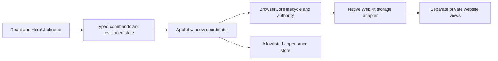

# UI architecture

React owns sidebar, menus, input, transient bookmarks and appearance presentation. The host owns active scope, selected tab, ordered view IDs, navigation availability and the native page area. WebKit owns its page state and website storage. Native state reconciles through revisioned snapshots; React can discard stale responses. Explicit command results carry user-facing failures without raw OS or network diagnostics.

The chrome document is a bundled local resource with a restrictive CSP. The app grants file read access only to the chrome resources folder. Trusted chrome sends typed messages; website views use a separate WebKit configuration without the chrome handler. The primary view mounts as a native sibling in a bounded region inside the same AppKit window. For panels, search suggestions and menus, the host temporarily hides the website surface so it cannot cover trusted controls.

The UI consumes a capability state instead of assuming that an identity can be opened. WS-F6 can supply an authenticated protected profile implementation behind Core and the bridge without giving React access to databases, keys, engine objects or profile file paths.

[Contract](bridge-contracts.md) · [AppKit host](../../../../../apps/browser-macos/Sources/Host/MainWindowController.swift)
